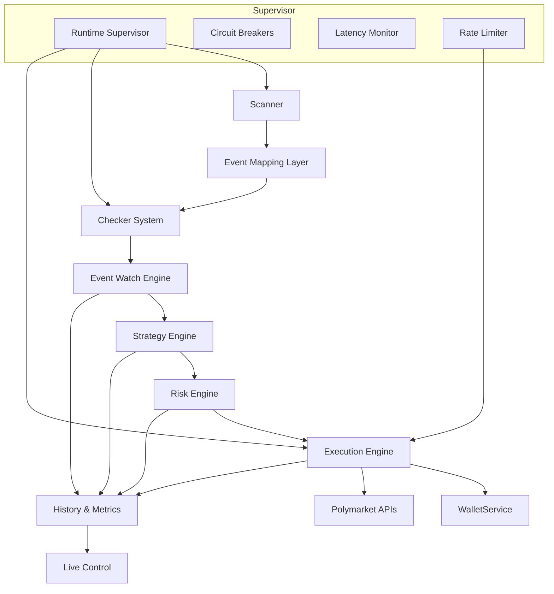
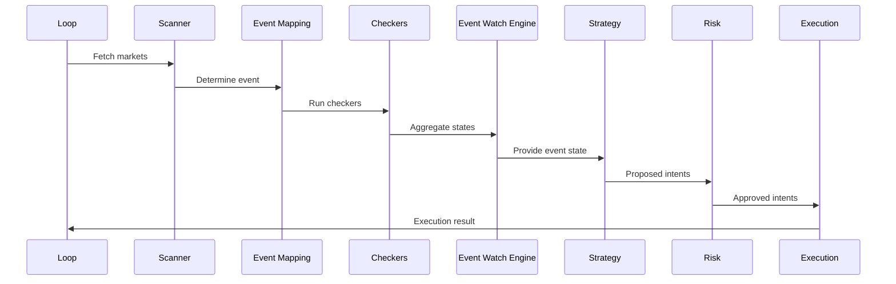

# Executive Summary

**PolyLiquidity Desk – Resumen Ejecutivo del Sistema**

**Versión 1.0 - Resumen de Alto Nivel**

---

## 1. Visión General

PolyLiquidity Desk es un **sistema automatizado de provisión de liquidez** diseñado para operar en mercados de predicción como Polymarket. Su objetivo es detectar eventos externos (ej. deportivos) que han concluido antes de que el mercado sea oficialmente resuelto y aprovechar oportunidades de pricing ejecutando órdenes automatizadas.

### Características Clave

El sistema está compuesto por **módulos independientes**, supervisados por un **Runtime Supervisor** que garantiza:

- ✅ **Seguridad operativa** - Circuit breakers y fail-safes
- ✅ **Robustez operativa** - Tolerancia a fallos y recuperación automática
- ✅ **Cumplimiento de límites de riesgo** - Validación continua de exposición

**La arquitectura está diseñada para escalar y soportar niveles de capital relevantes (100k–200k EUR).**

---

## 2. Stack Tecnológico

PolyLiquidity Desk es un backend event-driven construido sobre:

### 2.1. Backend

- **Python 3.11+** - Lenguaje principal
- **AsyncIO** - Programación asíncrona
- **FastAPI** - Framework web
- **PostgreSQL** - Persistencia de datos
- **Redis** (opcional) - Caching

### 2.2. Servicios Propios

- **Wallet Management Service** - Gestión segura de claves privadas
- **Checker System** - Integración modular con APIs externas (ESPN, Flashscore, etc.)

### 2.3. Frontend

- **React/Next.js** - Interfaz de usuario
- **Live Control Dashboard** - Monitoreo operativo en tiempo real

### 2.4. Operación

El sistema opera en un **runtime loop de alta frecuencia (1–5 segundos)**, tolerante a fallos, monitorizado y auditado.

---

## 3. Arquitectura de Alto Nivel

### 3.1. Diagrama de Arquitectura



### 3.2. Flujo Principal

**Scanner → Event Mapping → Checker System → Event Watch Engine → Strategy → Risk → Execution → Polymarket**

---

## 4. Resumen de Componentes

Una descripción más detallada está en los `.md` específicos en `docs/services/`; aquí solo se definen las responsabilidades estratégicas.

### 4.1. Scanner Engine

**Responsabilidades:**
- ✅ Consulta Polymarket API
- ✅ Filtra mercados candidatos (binarios, abiertos, price-threshold)
- ✅ Mantiene snapshots actualizados de orderbooks
- ✅ Minimiza requests mediante caching y ventanas de actualización

**Frecuencia:** Cada 30-60 segundos (configurable)

### 4.2. Event Mapping Layer

**Responsabilidades:**
- ✅ Mapea cada mercado → evento real externo
- ✅ Determina qué watcher usar dependiendo del tipo de evento
- ✅ Resuelve configuraciones complejas: IDs ambiguos, offsets horarios, endpoints múltiples
- ✅ Permite añadir nuevos dominios (política, geopolítica, economía) sin tocar el core

**Extensibilidad:** Sistema modular para nuevos tipos de eventos

### 4.3. Checker System

**Responsabilidades:**
- ✅ Framework modular para consultar APIs externas
- ✅ Cada checker expone: `check(event): { state, confidence, raw }`
- ✅ Incluye retry, circuit breaker y observabilidad por checker
- ✅ Puede ejecutar varios checkers en paralelo por evento

**Checkers disponibles:**
- ESPN (deportes)
- Flashscore (deportes)
- APIs alternativas (extensible)

### 4.4. Event Watch Engine

**Responsabilidades:**
- ✅ Agrega resultados de los checkers mediante quorum
- ✅ Estados: `LIVE`, `FINISHED_UNCONFIRMED`, `FINISHED_CONFIRMED`
- ✅ Calcula confianza agregada
- ✅ Mantiene estado histórico de cada evento
- ✅ Genera señales para Strategy

**Quorum:**
- 2+ fuentes = `FINISHED_CONFIRMED`
- 1 fuente = `FINISHED_UNCONFIRMED`
- 0 fuentes = `LIVE`

### 4.5. Strategy Engine

**Responsabilidades:**
- ✅ Reglas de entrada al mercado
- ✅ Calcula precio objetivo y tamaño
- ✅ Ajusta por latencia: YELLOW reduce agresividad; RED cancela entradas

**Reglas de entrada:**
```python
if event.state == FINISHED_CONFIRMED and price >= min_price:
    target_price = min(best_ask - tick_safety, 1.0 - margin)
    size = compute_size(...)
    return OrderIntent(target_price, size)
```

### 4.6. Risk Engine

**Responsabilidades:**
- ✅ Evalúa límites:
  - Exposición por mercado
  - Exposición global
  - Máximo de mercados activos
  - Estado de latencia del sistema
- ✅ Si alguna regla falla → rechazo del intent

**Garantías:**
- Nunca viola límites de riesgo
- Validación continua de exposición

### 4.7. Execution Engine

**Responsabilidades:**
- ✅ Firma órdenes usando WalletService (EIP-712)
- ✅ Envía órdenes vía Polymarket Trading API
- ✅ Gestiona lifecycle (open, partially filled, filled, cancelled)
- ✅ Cancela órdenes automáticamente ante pausas del sistema
- ✅ Detecta fills a través de polling o streams

**Trazabilidad:** Cada orden tiene un trace completo

### 4.8. Wallet Service

**Responsabilidades:**
- ✅ Maneja claves privadas de forma segura (separada del runtime)
- ✅ Firma EIP-712 determinista
- ✅ Expone: `sign_order(payload)`, `get_active_wallet()`, `rotate_wallet()`
- ✅ Integra con sistemas seguros de secrets storage (Vault, KMS)

**Seguridad:**
- Private keys nunca expuestas
- Rotación en runtime sin reinicio

### 4.9. Live Control Module

**Responsabilidades:**
- ✅ Dashboard que muestra:
  - Eventos activos siendo vigilados ("watchers live")
  - Latencias por checker
  - Requests por segundo
  - Estado del event loop en tiempo real
  - Logs en vivo por módulo
- ✅ Fuente principal de visibilidad operativa del sistema

**Características:**
- Actualización en tiempo real (SSE/WebSocket)
- Visualización de métricas clave
- Control operativo

### 4.10. Runtime Supervisor

**Responsabilidades:**
- ✅ Módulo que garantiza estabilidad:
  - Latency monitor (GREEN / YELLOW / RED)
  - Circuit breakers por checker, por Polymarket, y por Execution
  - Rate limiter global y por dominio
  - Fail-safe: congela nuevas entradas si algo va mal
  - Health checks continuos

**Modos de operación:**
- **GREEN:** Operación normal
- **YELLOW:** Operación conservadora
- **RED:** Trading pausado

### 4.11. History & Metrics

**Responsabilidades:**
- ✅ Guarda absolutamente todo:
  - Órdenes generadas y enviadas
  - Fills
  - Riesgo
  - Eventos y cambios de estado
  - Latencias
  - Señales de strategy y rechazos
- ✅ Permite auditoría completa

**Capacidades:**
- Replay histórico
- Análisis forense
- Backtesting

---

## 5. Runtime Loop Overview

### 5.1. Diagrama de Secuencia



**Loop configurable:** 1–5 segundos

### 5.2. Pasos del Loop

1. **Scanner:** Buscar mercados en Polymarket
2. **Event Mapping:** Determinar evento real
3. **Checkers:** Ejecutar checkers en paralelo
4. **Event Watch Engine:** Agregar estados
5. **Strategy:** Generar intents
6. **Risk:** Validar y aprobar/rechazar
7. **Execution:** Firmar y enviar órdenes
8. **Metrics:** Registrar métricas

---

## 6. Modelo de Datos Resumido

### 6.1. Markets

```python
class Market:
    id: UUID
    title: str
    event_external_id: str
    state: str  # OPEN, CLOSED, RESOLVED
    price_*: float  # best_ask, best_bid, etc.
    timestamps: datetime
```

### 6.2. Events

```python
class Event:
    id: UUID
    type: str  # sports, politics, etc.
    provider: str
    external_ids: Dict[str, str]
    state: str  # LIVE, FINISHED_CONFIRMED, etc.
    confidence: float
    timestamps: datetime
```

### 6.3. Orders

```python
class Order:
    id: UUID
    market_id: UUID
    side: str  # BUY, SELL
    size: float
    price: float
    status: str  # open, filled, cancelled
    raw_response: Dict
    signature: str
    timestamps: datetime
```

### 6.4. Metrics

```python
class Metrics:
    latencies: Dict[str, float]
    exposures: Dict[str, float]
    system_health: Dict
    checker_results: List[Dict]
```

---

## 7. API Surface (Simplificada)

### 7.1. Backend → Frontend

**Endpoints principales:**
- `GET /status` - Estado del sistema
- `GET /markets/live` - Mercados activos
- `GET /events/watching` - Eventos siendo monitoreados
- `GET /metrics/performance` - Métricas de rendimiento
- `POST /control/pause` - Pausar sistema
- `POST /control/resume` - Reanudar sistema

### 7.2. Internal Services

**Servicios internos:**
- WalletService RPC
- Checker modules
- Event Engine internal bus

---

## 8. Arquitectura de Despliegue

### 8.1. Componentes

- **Docker o Conda environment** - Contenedorización
- **Gunicorn/Uvicorn** - Servidor ASGI para API
- **SupervisorD / SystemD** - Supervisión del loop principal
- **PostgreSQL** - Base de datos principal
- **Redis** (opcional) - Caching
- **VPN segregation** - Para event-checking heavyweight APIs
- **Logging centralizado** - Elastic, Loki o equivalente

### 8.2. Requisitos

**Mínimos:**
- Python 3.11+
- PostgreSQL 12+
- 4GB RAM mínimo
- 2 CPU cores mínimo

**Recomendados:**
- 8GB+ RAM
- 4+ CPU cores
- SSD para base de datos
- Red de baja latencia

---

## 9. Caching & Rate Limiting

### 9.1. Caching

**Estrategias:**
- **Scanner:** 30–60s
- **Checkers:** TTL por deporte
- **Event Engine:** Caching débil para evitar picos

### 9.2. Rate Limiting

**Límites:**
- **Polymarket Scanner:** 200 req / 10s
- **Trading API:** 2400 req / 10s
- **Checkers:** Configurable por módulo

**Circuit breakers** evitan que un fallo externo bloquee el loop.

---

## 10. Garantías del Sistema

El sistema garantiza:

- ✅ **Nunca entra si no hay quorum externo** - Validación multi-fuente
- ✅ **Nunca viola límites de riesgo** - Validación continua
- ✅ **Nunca ejecuta si la latencia es roja** - Fail-safe automático
- ✅ **Todas las acciones quedan registradas** - Trazabilidad completa
- ✅ **Cada transición de estado es trazable** - Auditoría completa
- ✅ **Recovery automático ante fallos transitorios** - Tolerancia a fallos
- ✅ **Extensible a nuevos dominios de eventos sin refactor masivo** - Arquitectura modular

---

## 11. Roadmap Futuro

### 11.1. Fase 2 – Checkers Extendidos

**Agregar watchers para:**
- Política
- Economía (CPI, empleo, etc.)
- Forecasting (NOAA, CDC)

### 11.2. Fase 3 – Optimizaciones

**Mejoras planificadas:**
- Integración con websockets de Polymarket
- Machine learning para priorizar mercados
- Optimización del Exposure Manager
- Multi-wallet rotation policies

---

## 12. Documentación Detallada

Para más información sobre cada componente, consulta:

### **Backend Core Logic**
- [`scanner.md`](./docs/services/scanner.md)
- [`event_mapping_layer.md`](./docs/services/event_mapping_layer.md)
- [`checker_system.md`](./docs/services/checker_system.md)
- [`event_watch_engine.md`](./docs/services/event_watch_engine.md)
- [`strategy.md`](./docs/services/strategy.md)
- [`risk_engine.md`](./docs/services/risk_engine.md)
- [`execution.md`](./docs/services/execution.md)
- [`wallet_service.md`](./docs/services/wallet_service.md)

### **Supervisión y Estabilidad**
- [`runtime_supervisor.md`](./docs/services/runtime_supervisor.md)
- [`metrics_observabilitiy.md`](./docs/services/metrics_observabilitiy.md)
- [`historical_replay.md`](./docs/services/historical_replay.md)

### **Experiencia de Usuario**
- [`livecontrol.md`](./docs/services/livecontrol.md)
- [`signatures_trazability.md`](./docs/services/signatures_trazability.md)

### **Documentación General**
- [`overall.md`](./docs/overall.md) - Visión general del sistema
- [`algoritmo_backend.md`](./docs/algoritmo_backend.md) - Algoritmo del backend

---

## 13. Resumen

**PolyLiquidity Desk** es un sistema automatizado de provisión de liquidez de nivel institucional que:

- ✅ **Detecta oportunidades** mediante escaneo continuo de mercados
- ✅ **Valida eventos** con múltiples fuentes independientes
- ✅ **Ejecuta órdenes** de forma segura y trazable
- ✅ **Gestiona riesgo** con límites estrictos y validación continua
- ✅ **Supervisa operación** con métricas y alertas en tiempo real
- ✅ **Audita todo** con replay histórico completo

**Construido para niveles de capital de 100k–200k+ EUR con seguridad y observabilidad de nivel profesional.**

---

**PolyLiquidity Desk – A complete liquidity provision platform for real-world-driven prediction markets.**  
**Intelligent. Safe. Auditable. Scalable.**
