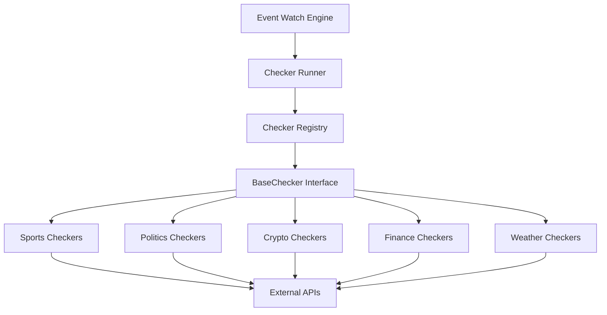

# Checker System – Sistema de Verificación de Eventos Externos

**Versión 1.0 - Especificación Técnica para Implementación**

---

## 1. Propósito del Módulo

El **Checker System** es una capa modular de acceso a datos externos que:

1. **Convierte el mundo real en señales estructuradas** sobre las que el sistema puede operar
2. **Permite añadir nuevas fuentes** sin tocar el núcleo de negocio
3. **Soporta múltiples tipos de eventos** (sports, politics, crypto, finance, weather, etc.)
4. **Devuelve resultados normalizados** (`LIVE`, `FINISHED`, `UNKNOWN`)
5. **Alimenta el Event Watch Engine** con información consistente y confiable
6. **Mantiene trazabilidad completa** de cada llamada externa

### Importancia Crítica

**Es la pieza que convierte "el mundo real" en señales estructuradas.** Sin checkers, el sistema no puede determinar si un evento ha terminado realmente. Cada checker es una fuente de verdad independiente que consulta APIs externas para verificar el estado de eventos.

---

## 2. Arquitectura General

### 2.1. Componentes Principales



### 2.2. Flujo de Ejecución

1. **Event Watch Engine** detecta necesidad de verificar un evento
2. **Checker Runner** consulta el **Checker Registry** para obtener checkers del tipo de evento
3. **Checker Runner** ejecuta todos los checkers en paralelo
4. Cada **Checker** consulta su API externa correspondiente
5. Los resultados se normalizan y retornan al **Event State Aggregator**

---

## 3. Modelo de Datos

### 3.1. CheckerResult

Cada checker retorna un `CheckerResult` normalizado:

```python
class CheckerResult(BaseModel):
    """Resultado de la ejecución de un checker."""
    state: str                        # "LIVE", "FINISHED", "UNKNOWN"
    confidence: float                 # 0.0 - 1.0
    finished_at: datetime | None       # Si está FINISHED, cuándo terminó
    raw_payload: Dict                 # Datos crudos para auditoría
    source: str                       # Nombre del checker (ej: "espn_nba_scoreboard_v1")
    latency_ms: float                 # Tiempo de respuesta
    error: str | None                 # Si hubo error
    timestamp: datetime               # Cuándo se ejecutó
```

**Estados posibles:**
- **`LIVE`:** Evento sigue activo
- **`FINISHED`:** Evento terminó
- **`UNKNOWN`:** No se pudo determinar (error, timeout, etc.)

### 3.2. BaseChecker Interface

Todos los checkers implementan la interfaz `BaseChecker`:

```python
class BaseChecker(ABC):
    """Clase base abstracta para todos los checkers."""
    
    # Propiedades de configuración
    name: str                         # Nombre del checker
    event_types: List[str]            # ["sports"], ["politics"], etc.
    weight: float                     # Importancia relativa en quorum (0-1)
    timeout_ms: int                   # Timeout en milisegundos
    max_retries: int                  # Máximo de reintentos
    
    @abstractmethod
    async def check(
        self,
        external_event_id: str,
        credentials: Optional[Dict[str, str]] = None
    ) -> CheckerResult:
        """
        Verifica si el evento está finalizado.
        
        Args:
            external_event_id: ID del evento en la API externa
            credentials: Credenciales (API keys, tokens, etc.)
        
        Returns:
            CheckerResult con state, confidence, etc.
        """
        pass
```

### 3.3. Requisitos de Implementación

Cada checker debe cumplir:

1. **Idempotencia:** Ante el mismo evento, no causar efectos secundarios
2. **Time-bounded:** Respetar un timeout estricto (no bloquear el event loop)
3. **Logging estructurado:** Registrar su actividad vía logging
4. **Resiliencia:** No reventar el Watch Engine si la API está caída
5. **Normalización:** Retornar siempre un `CheckerResult` válido (nunca lanzar excepciones)

---

## 4. Tipos de Checkers

### 4.1. Sports Checkers

**Propósito:** Verificar finalización de eventos deportivos.

#### ESPNScoreboardChecker

**API:** ESPN Scoreboard API

**Endpoints:**
- `/sports/{sport}/{league}/scoreboard`
- `/sports/{sport}/{league}/events/{event_id}`

**Lógica de verificación:**
```python
# Respuesta ESPN típica:
{
  "status": {
    "type": {
      "state": "post",        # "pre", "in", "post"
      "completed": true,      # true/false
      "description": "Final"
    }
  }
}

# Traducción:
if completed == true:
    return CheckerResult(
        state="FINISHED",
        confidence=0.95,
        finished_at=parse_datetime(response["finished_at"]),
        source="espn_scoreboard"
    )
elif state == "in":
    return CheckerResult(
        state="LIVE",
        confidence=0.9,
        source="espn_scoreboard"
    )
elif state == "pre":
    return CheckerResult(
        state="LIVE",
        confidence=0.6,  # Evento todavía no empezó
        source="espn_scoreboard"
    )
```

#### AlternativeSportsChecker

**APIs alternativas:**
- TheSportsDB
- API-Sports
- FlashScore
- TheScore

**Propósito:** Proporcionar redundancia al sistema.

**Ventajas:**
- Si ESPN falla, otros checkers pueden seguir funcionando
- Permite comparar resultados entre fuentes
- Aumenta confianza cuando múltiples checkers coinciden

### 4.2. Politics Checkers

**Propósito:** Verificar finalización de eventos políticos (elecciones, referendos, etc.).

#### APNewsElectionChecker

**API:** Associated Press Elections API

**Entrada:**
```json
{
  "event_type": "politics",
  "race_id": "president_2024",
  "region": "US",
  "election_date": "2025-11-04"
}
```

**Lógica:**
- Consulta porcentaje escrutado
- Verifica proyección oficial
- Detecta declaración de ganador
- **FINISHED cuando:** Fuente oficial declara resultado definitivo

#### NYTElectionChecker

**API:** New York Times Elections API

**Similar a APNewsElectionChecker** pero con fuente alternativa.

### 4.3. Crypto Checkers

**Propósito:** Verificar eventos relacionados con blockchain (forks, halvings, etc.).

#### EthereumForkChecker

**Entrada:**
```json
{
  "event_type": "crypto",
  "chain": "ethereum",
  "block_height_target": 18449200,
  "fork_name": "prague-deneb"
}
```

**Lógica:**
```python
# Consulta nodo RPC o API
current_block = await get_current_block_height()
confirmations = await get_confirmations()

if current_block >= target_block and confirmations >= 12:
    return CheckerResult(
        state="FINISHED",
        confidence=0.98,
        source="ethereum_fork_checker"
    )
elif current_block >= target_block:
    return CheckerResult(
        state="FINISHED",
        confidence=0.7,  # Esperando confirmaciones
        source="ethereum_fork_checker"
    )
else:
    return CheckerResult(
        state="LIVE",
        confidence=0.9,
        source="ethereum_fork_checker"
    )
```

#### BitcoinHalvingChecker

**Similar a EthereumForkChecker** pero para eventos de Bitcoin.

### 4.4. Finance Checkers

**Propósito:** Verificar eventos financieros (cierres de mercado, releases de datos macro, etc.).

#### YahooFinanceCloseChecker

**Eventos tipo:**
- "TSLA cierra por encima de 200 el 20/03/2025"
- "S&P 500 cierra por debajo de 4000 el 15/01/2025"

**Lógica:**
```python
# Consulta precio de cierre
close_price = await get_close_price(symbol, date)

if date < today:
    # Ya pasó, verificar resultado
    if condition_met(close_price, target):
        return CheckerResult(
            state="FINISHED",
            confidence=0.95,
            source="yahoo_finance_close"
        )
    else:
        return CheckerResult(
            state="FINISHED",
            confidence=0.95,
            source="yahoo_finance_close"
        )
else:
    return CheckerResult(
        state="LIVE",
        confidence=0.9,
        source="yahoo_finance_close"
    )
```

#### CPIReleaseChecker

**Eventos tipo:**
- "IPC EEUU > 3% en enero 2025"
- "Tasa de desempleo < 4% en febrero 2025"

**Lógica:** Consulta releases oficiales de datos macro.

### 4.5. Weather Checkers

**Propósito:** Verificar eventos climáticos.

#### OpenWeatherSnowChecker

**Eventos tipo:**
- "NYC recibe >10cm de nieve el 15/01/2025"
- "Miami tiene temperatura >30°C el 20/02/2025"

**Lógica:**
```python
# Consulta métricas históricas
precipitation = await get_precipitation(location, date)

if date < today:
    # Ya pasó, verificar resultado
    if precipitation >= threshold:
        return CheckerResult(
            state="FINISHED",
            confidence=0.95,
            source="openweather_snow"
        )
    else:
        return CheckerResult(
            state="FINISHED",
            confidence=0.95,
            source="openweather_snow"
        )
else:
    return CheckerResult(
        state="LIVE",
        confidence=0.8,
        source="openweather_snow"
    )
```

---

## 5. Checker Registry

### 5.1. Registro Central

El sistema mantiene un registro central de checkers disponibles:

```python
class CheckerRegistry:
    """Registro global de checkers."""
    
    def __init__(self):
        self._checkers: Dict[str, Type[BaseChecker]] = {}
    
    def register(self, implementation_key: str, checker_class: Type[BaseChecker]):
        """Registra un checker."""
        self._checkers[implementation_key] = checker_class
    
    def get(self, implementation_key: str) -> Type[BaseChecker]:
        """Obtiene un checker por implementation_key."""
        return self._checkers[implementation_key]
    
    def list_by_event_type(self, event_type: str) -> List[Type[BaseChecker]]:
        """Lista checkers para un tipo de evento."""
        return [
            checker for checker in self._checkers.values()
            if event_type in checker.event_types
        ]
```

### 5.2. Registro por Tipo de Evento

El Event Watch Engine no conoce detalles de cada checker, solo:

- El `event_type` del evento
- Qué listado de checkers debe ejecutar para ese tipo

**Ejemplo:**
```python
CHECKER_REGISTRY = {
    "sports": [
        ESPNScoreboardChecker(...),
        AlternativeSportsChecker(...),
        FlashScoreChecker(...)
    ],
    "politics": [
        APNewsElectionChecker(...),
        NYTElectionChecker(...)
    ],
    "crypto": [
        EthereumForkChecker(...),
        BitcoinHalvingChecker(...)
    ],
    "finance": [
        YahooFinanceCloseChecker(...),
        CPIReleaseChecker(...)
    ],
    "weather": [
        OpenWeatherSnowChecker(...)
    ]
}
```

---

## 6. Ejecución de Checkers

### 6.1. Modo por Evento

Para cada `event_id`, el Watch Engine ejecuta:

```python
async def run_checkers_for_event(event_descriptor: EventDescriptor) -> List[CheckerResult]:
    """Ejecuta todos los checkers para un evento."""
    # Obtener checkers del tipo de evento
    checkers = CHECKER_REGISTRY.list_by_event_type(event_descriptor.event_type)
    
    # Ejecutar en paralelo
    tasks = [
        checker.check(
            external_event_id=event_descriptor.event_id,
            credentials=await get_credentials_for_checker(checker.name)
        )
        for checker in checkers
    ]
    
    # Recopilar resultados (con manejo de excepciones)
    results = await asyncio.gather(*tasks, return_exceptions=True)
    
    # Normalizar errores
    normalized_results = []
    for result in results:
        if isinstance(result, Exception):
            normalized_results.append(CheckerResult(
                state="UNKNOWN",
                confidence=0.0,
                error=str(result),
                source="unknown"
            ))
        else:
            normalized_results.append(result)
    
    return normalized_results
```

### 6.2. Timeouts y Retries

**Cada checker tiene:**
- **Timeout propio:** 1-5 segundos (configurable)
- **Retries limitados:** 2-3 intentos (configurable)
- **Backoff exponencial:** Entre reintentos

**En caso de timeout definitivo:**
```python
return CheckerResult(
    state="UNKNOWN",
    confidence=0.0,
    error="timeout",
    source=checker.name
)
```

### 6.3. Normalización de Errores

Todos los errores se normalizan para el agregador:

```python
# Tipos de errores:
ERROR_TYPES = {
    "network_error": "Error de red",
    "timeout": "Timeout excedido",
    "invalid_response": "Respuesta inválida",
    "api_error": "Error de API externa",
    "authentication_error": "Error de autenticación"
}

# Todos retornan:
{
    "state": "UNKNOWN",
    "confidence": 0.0,
    "error": ERROR_TYPE,
    "source": checker_name
}
```

---

## 7. Traducción de Respuestas a Estados

### 7.1. Lógica de Mapping

Cada checker contiene lógica de mapping específica para su API:

**Ejemplo: ESPN (deportes)**
```python
# Respuesta ESPN:
{
    "status": {
        "type": {
            "state": "post",
            "completed": true,
            "description": "Final"
        }
    }
}

# Mapping:
if completed == true:
    state = "FINISHED"
    confidence = 0.95
elif state == "in":
    state = "LIVE"
    confidence = 0.9
elif state == "pre":
    state = "LIVE"
    confidence = 0.6  # Evento todavía no empezó
else:
    state = "UNKNOWN"
    confidence = 0.0
```

**Ejemplo: Crypto (blockchain)**
```python
# Lógica:
if current_block < target_block:
    state = "LIVE"
    confidence = 0.9
elif current_block >= target_block and confirmations >= 12:
    state = "FINISHED"
    confidence = 0.98
elif current_block >= target_block:
    state = "FINISHED"
    confidence = 0.7  # Esperando confirmaciones
else:
    state = "UNKNOWN"
    confidence = 0.0
```

**Ejemplo: Finanzas**
```python
# Lógica:
if market_closed and date < today:
    state = "FINISHED"
    confidence = 0.95
elif market_open:
    state = "LIVE"
    confidence = 0.9
else:
    state = "UNKNOWN"
    confidence = 0.0
```

### 7.2. Confianza por Estado

**Guía de confianza:**
- **0.9-1.0:** Muy seguro (datos oficiales, confirmados)
- **0.7-0.9:** Bastante seguro (datos confiables)
- **0.5-0.7:** Incierto (datos parciales o no confirmados)
- **<0.5:** Baja confianza (probablemente LIVE o error)

---

## 8. Trazabilidad y Logging

### 8.1. Logging Estructurado

Cada ejecución de checker genera logs estructurados:

**Ejemplo de log exitoso:**
```json
{
  "timestamp": "2025-01-25T20:00:05.123Z",
  "level": "INFO",
  "component": "checker",
  "checker_id": "espn_nba_scoreboard_v1",
  "event_id": "401585236",
  "event_type": "sports",
  "state": "FINISHED",
  "confidence": 0.96,
  "latency_ms": 340,
  "raw_source": "espn",
  "error": null,
  "trace_id": "b3c1e7fc-2a5f-4b7a-9c90-1b..."
}
```

**Ejemplo de log con error:**
```json
{
  "timestamp": "2025-01-25T20:00:05.123Z",
  "level": "ERROR",
  "component": "checker",
  "checker_id": "espn_nba_scoreboard_v1",
  "event_id": "401585236",
  "event_type": "sports",
  "state": "UNKNOWN",
  "confidence": 0.0,
  "latency_ms": 5000,
  "error": "timeout",
  "error_details": "Request timeout after 5s",
  "trace_id": "b3c1e7fc-2a5f-4b7a-9c90-1b..."
}
```

### 8.2. Trazabilidad Completa

**Cada checker debe:**
- Incluir `trace_id` en todos los logs
- Guardar `raw_payload` en `CheckerResult` para auditoría
- Registrar latencia y errores
- Mantener historial de ejecuciones

**Esto permite:**
- Auditar por qué se tomó una decisión
- Ver qué checker falló
- Comparar calidad de fuentes
- Depurar problemas de integración

---

## 9. Priorización y Peso de Checkers

### 9.1. Sistema de Pesos

No todos los checkers tienen el mismo peso en el quorum:

```python
class CheckerConfig:
    weight: float                     # 0.0 - 1.0
    reliability_score: float         # Histórico (0.0 - 1.0)
    is_official: bool                 # Fuente oficial
    priority: int                     # Prioridad (mayor = más importante)
```

### 9.2. Cálculo de Confianza Ponderada

El Event State Aggregator usa:

```python
weighted_confidence = sum(
    result.confidence * checker.weight * checker.reliability_score
) / sum(checker.weight * checker.reliability_score for checker in checkers)
```

### 9.3. Degradación de Peso

**Se puede:**
- Degradar peso de checkers con muchos errores recientes
- Dar prioridad a fuentes "oficiales"
- Ajustar dinámicamente según performance histórica

**Ejemplo:**
```python
# Si un checker tiene >10% de errores en última hora:
if error_rate > 0.1:
    effective_weight = checker.weight * 0.5  # Reducir peso a la mitad
```

---

## 10. Estrategia de Fallos

### 10.1. Soft Failure (Recuperable)

**Ejemplos:**
- Timeouts ocasionales
- Pequeños errores de parseo
- Rate limits temporales

**Acción:**
- Se registra y se continúa
- Se incrementa contador de errores
- Se reintenta en siguiente ciclo

### 10.2. Hard Failure (Crítico)

**Ejemplos:**
- Cambios en el esquema de la API
- Endpoint eliminado
- Datos incoherentes persistentes
- Errores de autenticación persistentes

**Acción:**
- Se marca el checker como `disabled` temporalmente
- Se manda alerta (Slack, email, etc.)
- El sistema sigue con otros checkers
- Se requiere intervención manual para reactivar

### 10.3. Circuit Breaker Pattern

**Implementación:**
```python
class CheckerCircuitBreaker:
    """Circuit breaker para checkers."""
    
    def __init__(self, failure_threshold: int = 5, timeout: int = 60):
        self.failure_threshold = failure_threshold
        self.timeout = timeout
        self.failure_count = 0
        self.last_failure_time = None
        self.state = "CLOSED"  # CLOSED, OPEN, HALF_OPEN
    
    async def call(self, checker_func):
        """Ejecuta checker con circuit breaker."""
        if self.state == "OPEN":
            if time.time() - self.last_failure_time > self.timeout:
                self.state = "HALF_OPEN"
            else:
                raise CircuitBreakerOpenError()
        
        try:
            result = await checker_func()
            if self.state == "HALF_OPEN":
                self.state = "CLOSED"
                self.failure_count = 0
            return result
        except Exception as e:
            self.failure_count += 1
            self.last_failure_time = time.time()
            if self.failure_count >= self.failure_threshold:
                self.state = "OPEN"
            raise
```

---

## 11. Requisitos de Seguridad y Compliance

### 11.1. Manejo de Credenciales

**Nunca:**
- Guardar claves API en logs
- Exponer credenciales en respuestas de API
- Commitear credenciales en código

**Siempre:**
- Usar `SecretService` para obtener credenciales en runtime
- Enmascarar credenciales en logs
- Rotar credenciales periódicamente

### 11.2. Términos de Uso

**Respetar:**
- Términos de uso de cada API
- Rate limits establecidos
- Políticas de uso de datos

**Implementar:**
- Rate limiting por checker (por dominio)
- Backoff exponencial
- Headers de User-Agent apropiados

### 11.3. Privacidad de Datos

**No exponer:**
- Respuestas completas de terceros en canales no seguros
- Datos personales en logs
- Información sensible en métricas públicas

---

## 12. Ejemplo de Ciclo Completo

### 12.1. Evento Deportivo

**Flujo completo:**

1. **Watch Engine detecta necesidad de revisar evento:**
   ```
   event_type = "sports"
   sport = "basketball"
   league = "nba"
   espn_event_id = "401585236"
   ```

2. **Ejecuta checkers registrados para "sports":**
   - `ESPNScoreboardChecker`
   - `AlternativeSportsChecker`
   - `FlashScoreChecker`

3. **ESPN devuelve:**
   ```json
   {
     "state": "FINISHED",
     "confidence": 0.96,
     "finished_at": "2025-01-25T20:15:00Z"
   }
   ```

4. **Checker alternativo devuelve:**
   ```json
   {
     "state": "FINISHED",
     "confidence": 0.93,
     "finished_at": "2025-01-25T20:15:05Z"
   }
   ```

5. **FlashScore devuelve:**
   ```json
   {
     "state": "FINISHED",
     "confidence": 0.94,
     "finished_at": "2025-01-25T20:15:02Z"
   }
   ```

6. **Event State Aggregator:**
   - Ve 3 checkers `FINISHED` con confianza alta
   - Resultado final:
     ```
     FINAL_STATE = FINISHED_CONFIRMED
     FINAL_CONFIDENCE ≈ 0.94 (promedio ponderado)
     ```

7. **Watch Engine:**
   - Marca watcher como `FINISHED_DETECTED`
   - Notifica a Strategy: "evento terminado (confirmado), revisar mercados asociados"

---

## 13. Estructura de Archivos a Implementar

```
backend/app/core/checkers/
├── __init__.py
├── base.py                    # BaseChecker, CheckerResult
├── registry.py                # CheckerRegistry
├── runner.py                  # CheckerRunner (ejecuta checkers)
├── circuit_breaker.py        # Circuit breaker para checkers
│
└── implementations/
    ├── __init__.py           # Auto-registro de checkers
    ├── sports/
    │   ├── espn_checker.py
    │   ├── flashscore_checker.py
    │   └── alternative_sports_checker.py
    ├── politics/
    │   ├── ap_news_checker.py
    │   └── nyt_checker.py
    ├── crypto/
    │   ├── ethereum_fork_checker.py
    │   └── bitcoin_halving_checker.py
    ├── finance/
    │   ├── yahoo_finance_checker.py
    │   └── cpi_release_checker.py
    └── weather/
        └── openweather_checker.py
```

### 13.1. Módulos Principales

**`app/core/checkers/base.py`:**
- Clase `BaseChecker` (abstracta)
- Clase `CheckerResult`
- Interfaces y tipos

**`app/core/checkers/registry.py`:**
- Clase `CheckerRegistry`
- Registro y búsqueda de checkers
- Agrupación por tipo de evento

**`app/core/checkers/runner.py`:**
- Clase `CheckerRunner`
- Ejecución en paralelo
- Manejo de timeouts y retries
- Normalización de errores

**`app/core/checkers/circuit_breaker.py`:**
- Clase `CheckerCircuitBreaker`
- Protección contra fallos en cascada

---

## 14. Integración con Otros Módulos

### 14.1. Event Watch Engine

**Flujo:**
```
Watch Engine → CheckerRunner → Checkers → APIs Externas
```

### 14.2. Secret Service

**Flujo:**
```
Checker → SecretService → Credenciales → API Externa
```

### 14.3. Event State Aggregator

**Flujo:**
```
Checkers → CheckerResults → StateAggregator → EventState Final
```

---

## 15. Resumen

El **Checker System** es:

- ✅ **Capa modular** de acceso a datos externos
- ✅ **Permite añadir nuevas fuentes** sin tocar núcleo de negocio
- ✅ **Soporta múltiples tipos de eventos** (sports, politics, crypto, etc.)
- ✅ **Devuelve resultados normalizados** (`LIVE`, `FINISHED`, `UNKNOWN`)
- ✅ **Alimenta el Event Watch Engine** con información consistente
- ✅ **Mantiene trazabilidad completa** de cada llamada externa
- ✅ **Resiliente y escalable** con circuit breakers y rate limiting

**Es la pieza que convierte "el mundo real" en señales estructuradas sobre las que tu máquina de liquidez puede operar.**

---

## 16. Próximos Pasos

1. **Revisar documentación de APIs externas** (ESPN, FlashScore, etc.)
2. **Implementar BaseChecker y CheckerResult** con validación completa
3. **Implementar CheckerRegistry** con auto-registro
4. **Implementar CheckerRunner** con ejecución en paralelo
5. **Implementar Circuit Breaker** para protección contra fallos
6. **Crear checkers específicos** (ESPN, FlashScore, etc.)
7. **Integrar con SecretService** para credenciales
8. **Implementar logging estructurado** con trace_id
9. **Crear tests unitarios** para cada checker
10. **Crear tests de integración** para flujo completo
11. **Configurar métricas y alertas** para monitoreo
