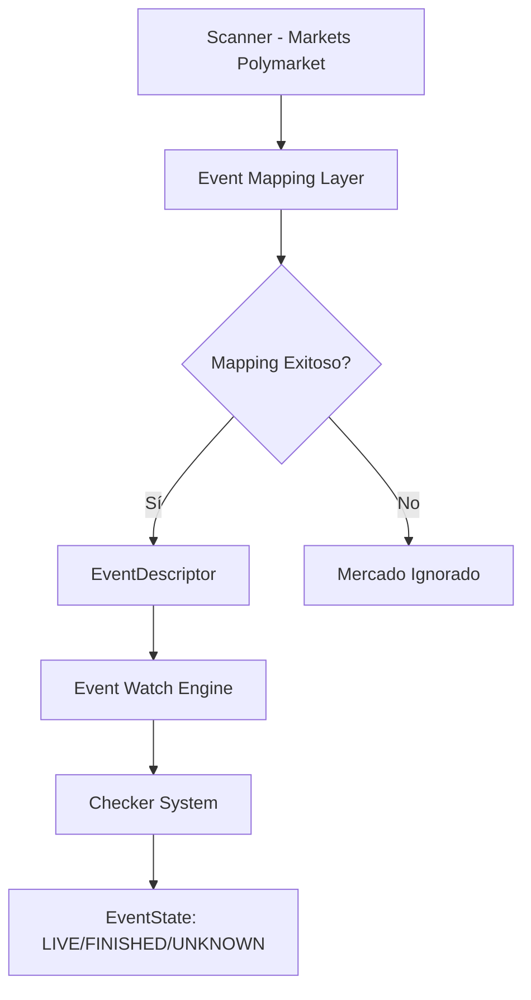
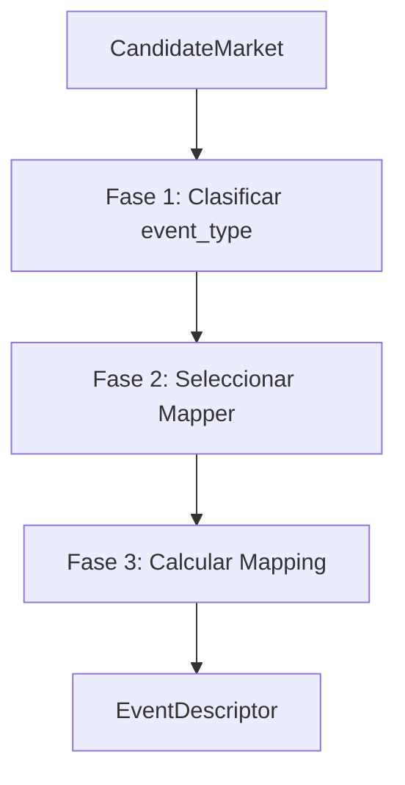

# Event Mapping Layer – Asociación entre Mercados de Polymarket y Eventos Reales

**Versión 1.0 - Especificación Técnica para Implementación**

---

## 1. Propósito del Módulo

El **Event Mapping Layer** es el módulo responsable de:

1. **Leer información** de un mercado de Polymarket (texto, categoría, fechas, etc.)
2. **Determinar qué tipo de evento del mundo real** representa ese mercado (`sports`, `politics`, `crypto`, `finance`, `weather`, `custom`, etc.)
3. **Mapearlo, si es posible**, a un evento concreto y canónico en alguna fuente externa (ESPN, APIs electorales, datos on-chain, Yahoo Finance, etc.)
4. **Devolver un EventDescriptor estandarizado** que el resto del sistema pueda entender y vigilar

### Importancia Crítica

**El mapping es el puente entre:**
> *"Mercado textual en Polymarket"* → *"Evento real claramente definido y trazable"*

**Si el mapping falla o es ambiguo**, el mercado **no entra en el pipeline de watchers/event engine**, y la estrategia lo ignora.

**Este módulo es la base para que el sistema sea multi-evento** sin perder robustez ni claridad.

---

## 2. Posición en la Arquitectura

### 2.1. Flujo Completo



### 2.2. Responsabilidades

**El Event Mapping Layer:**
- ✅ Clasifica mercados por tipo de evento
- ✅ Mapea mercados a eventos reales verificables
- ✅ Calcula confianza del mapping
- ✅ Genera `EventDescriptor` estandarizado

**El Event Mapping Layer NO:**
- ❌ Monitoriza eventos (eso lo hace Event Watch Engine)
- ❌ Llama a ESPN o APIs externas en bucle (eso lo hace Checker System)
- ❌ Decide cuándo comprar (eso lo hace Strategy Engine)

**Solo decide:**
> *"Este mercado corresponde a ESTE evento real, de ESTE tipo, con ESTA confianza."*

---

## 3. Entradas del Sistema

### 3.1. CandidateMarket del Scanner

Para cada mercado candidato que llega desde el Scanner:

```python
class CandidateMarket(BaseModel):
    """Mercado candidato del Scanner."""
    market_id: str                     # ID único del mercado en Polymarket
    question: str                       # Texto principal del mercado
    subtitle: str | None                # Subtítulo (si existe)
    description: str | None             # Descripción (si existe)
    category: str                       # Categoría de Polymarket (ej: "Sports")
    subcategory: str | None             # Subcategoría (ej: "Basketball")
    close_time: datetime                # Fecha/hora de cierre del mercado
    outcomes: List[str]                 # ["YES", "NO"] o similares
    event_metadata: Dict | None          # Metadata preliminar del Scanner (opcional)
    
    # Metadata extraída por el Scanner (si aplica)
    teams_detected: List[str] | None    # Equipos detectados (si es deporte)
    date_detected: datetime | None      # Fecha/hora detectada en el título
    keywords: List[str] | None          # Palabras clave relevantes
```

**Ejemplo:**
```json
{
  "market_id": "pm_12345",
  "question": "Will the Lakers win vs the Warriors?",
  "subtitle": "NBA Regular Season",
  "category": "Sports",
  "subcategory": "Basketball",
  "close_time": "2025-02-12T04:00:00Z",
  "outcomes": ["YES", "NO"],
  "teams_detected": ["Lakers", "Warriors"],
  "date_detected": "2025-02-12T03:00:00Z",
  "keywords": ["win", "vs", "nba"]
}
```

---

## 4. Salidas del Sistema

### 4.1. EventDescriptor

El resultado del mapping es un objeto `EventDescriptor`:

```python
class EventDescriptor(BaseModel):
    """Descriptor de evento estandarizado."""
    market_id: str
    mapped: bool                        # True si se mapeó exitosamente
    event_type: Literal[
        "sports", "politics", "crypto", 
        "finance", "weather", "custom", "unknown"
    ]
    mapping_confidence: float           # 0.0 - 1.0
    canonical_event_id: str | None      # ej: "sports:nba:401585236"
    sources: List[str] = []              # ["espn"], ["ap_news"], etc.
    metadata: Dict                       # Schema depende de event_type
    reason: str | None = None           # Por qué no se mapeó o baja confianza
    trace_id: UUID                       # Para trazabilidad
```

### 4.2. Ejemplo de EventDescriptor Exitoso

```json
{
  "market_id": "pm_12345",
  "mapped": true,
  "event_type": "sports",
  "mapping_confidence": 0.94,
  "canonical_event_id": "sports:nba:401585236",
  "sources": ["espn"],
  "metadata": {
    "sport": "basketball",
    "league": "nba",
    "espn_event_id": "401585236",
    "teams": ["Los Angeles Lakers", "Golden State Warriors"],
    "starts_at": "2025-02-12T03:00:00Z",
    "venue": "Chase Center"
  },
  "trace_id": "b3c1e7fc-2a5f-4b7a-9c90-1b..."
}
```

### 4.3. Ejemplo de EventDescriptor Fallido

**Si NO se puede mapear:**
```json
{
  "market_id": "pm_12345",
  "mapped": false,
  "event_type": "sports",
  "mapping_confidence": 0.0,
  "canonical_event_id": null,
  "sources": [],
  "metadata": {},
  "reason": "no_team_match",
  "trace_id": "b3c1e7fc-2a5f-4b7a-9c90-1b..."
}
```

**O incluso sin tipo claro:**
```json
{
  "market_id": "pm_67890",
  "mapped": false,
  "event_type": "unknown",
  "mapping_confidence": 0.0,
  "canonical_event_id": null,
  "sources": [],
  "metadata": {},
  "reason": "event_type_unrecognized",
  "trace_id": "b3c1e7fc-2a5f-4b7a-9c90-1b..."
}
```

### 4.4. Schema de Metadata por Tipo

El campo `metadata` cambia según el `event_type`:

**Sports:**
```python
{
    "sport": "basketball",
    "league": "nba",
    "espn_event_id": "401585236",
    "teams": ["Los Angeles Lakers", "Golden State Warriors"],
    "starts_at": "2025-02-12T03:00:00Z",
    "venue": "Chase Center"
}
```

**Politics:**
```python
{
    "country": "US",
    "race_type": "presidential",
    "election_date": "2028-11-07",
    "candidates": ["Candidate A", "Candidate B"],
    "official_sources": ["ap_news"]
}
```

**Crypto:**
```python
{
    "chain": "ethereum",
    "event_type": "fork",
    "fork_name": "prague-deneb",
    "target_block": 18449200
}
```

**Finance:**
```python
{
    "symbol": "TSLA",
    "metric": "close_price",
    "threshold": 200,
    "target_date": "2025-03-20"
}
```

**Weather:**
```python
{
    "location": "New York, USA",
    "metric": "snowfall",
    "threshold": 10,
    "unit": "cm",
    "target_date": "2025-01-15"
}
```

---

## 5. Fases del Event Mapping Layer

El mapping ocurre en tres fases principales:



### 5.1. Fase 1: Clasificar event_type

**Objetivo:** Determinar qué tipo de evento representa el mercado.

**Función:**
```python
def classify_event_type(candidate_market: CandidateMarket) -> str:
    """Clasifica el tipo de evento usando heurísticas."""
    # 1. Revisar categoría de Polymarket
    # 2. Analizar texto (question, subtitle, description)
    # 3. Buscar patrones y palabras clave
    # 4. Retornar event_type
```

**Heurísticas iniciales:**

| Patrón | event_type |
|--------|------------|
| Categoría incluye "Sports" o patrones: `vs`, `vs.`, `@`, `win`, `score`, `total points`, `over/under` | `sports` |
| Palabras: `election`, `president`, `vote`, `referendum`, nombres de candidatos | `politics` |
| Palabras: `BTC`, `ETH`, `Bitcoin`, `halving`, `fork`, `merge` | `crypto` |
| Palabras: `TSLA`, `AAPL`, `S&P`, `CPI`, `inflation`, `earnings` | `finance` |
| Palabras: `rain`, `snow`, `temperature`, `degrees`, `cm`, `mm` | `weather` |
| Nada encaja | `custom` o `unknown` |

**Ejemplo:**
```python
# Input:
question = "Will the Lakers win vs the Warriors?"
category = "Sports"

# Output:
event_type = "sports"
```

### 5.2. Fase 2: Delegación a Mapper por Tipo

Una vez determinado `event_type`, el módulo llama al mapper correspondiente:

```python
MAPPERS = {
    "sports": map_sports_event,
    "politics": map_politics_event,
    "crypto": map_crypto_event,
    "finance": map_finance_event,
    "weather": map_weather_event,
    "custom": map_custom_event
}

def map_market(candidate_market: CandidateMarket) -> EventDescriptor:
    """Mapea un mercado a un evento real."""
    # Fase 1: Clasificar
    event_type = classify_event_type(candidate_market)
    
    # Fase 2: Obtener mapper
    mapper = MAPPERS.get(event_type)
    if not mapper:
        return EventDescriptor(
            market_id=candidate_market.market_id,
            mapped=False,
            event_type="unknown",
            mapping_confidence=0.0,
            reason="no_mapper_for_event_type",
            trace_id=generate_trace_id()
        )
    
    # Fase 3: Ejecutar mapper
    return mapper(candidate_market)
```

### 5.3. Fase 3: Scoring de Confianza

Cada mapper devuelve:
- `mapped`: `true`/`false`
- `canonical_event_id`
- `metadata`
- `mapping_confidence` (0-1)

**Lógica de scoring común:**
```python
confidence = (
    0.6 * entity_match_score +      # Coincidencia de entidades (equipos, candidatos, etc.)
    0.25 * date_match_score +         # Coincidencia de fechas
    0.15 * source_reliability_score   # Confiabilidad de la fuente
)
```

**Ejemplo para Sports:**
```python
# entity_match_score: 1.0 (equipos coinciden exactamente)
# date_match_score: 0.9 (fecha muy cercana, ±2 horas)
# source_reliability_score: 1.0 (ESPN es fuente confiable)

confidence = 0.6 * 1.0 + 0.25 * 0.9 + 0.15 * 1.0 = 0.975
```

---

## 6. Sports Mapper (Implementación MVP Principal)

El **Sports Mapper** es la primera implementación real del sistema.

### 6.1. Objetivo

Mapear mercados tipo:
- "Will the Lakers win vs the Warriors?"
- "Lakers vs Celtics – Winner"
- "Real Madrid vs Barcelona – Who will win?"
- "KC Chiefs @ 49ers – Super Bowl Winner"

a un evento deportivo concreto en ESPN (u otra fuente deportiva principal).

### 6.2. Pasos del Sports Mapper

#### Paso 1: Extracción de Equipos, Competición, Fecha

**Usa regex + diccionarios de equipos:**

```python
# Diccionario de alias a nombres canónicos
TEAM_ALIASES = {
    "LAL": "Los Angeles Lakers",
    "Lakers": "Los Angeles Lakers",
    "GSW": "Golden State Warriors",
    "Warriors": "Golden State Warriors",
    # ... más equipos
}

# Regex para detectar equipos
PATTERN_VS = re.compile(r"(\w+)\s+vs\.?\s+(\w+)", re.IGNORECASE)
PATTERN_AT = re.compile(r"(\w+)\s+@\s+(\w+)", re.IGNORECASE)

def extract_teams(question: str) -> List[str]:
    """Extrae equipos del texto."""
    # Buscar patrones "vs" o "@"
    # Normalizar usando diccionario de alias
    # Retornar nombres canónicos
```

**Convierte alias a nombres canónicos:**
- `LAL`, `Lakers` → `Los Angeles Lakers`
- `GSW`, `Warriors` → `Golden State Warriors`

#### Paso 2: Determinación de Deporte y Liga

**A partir de:**
- `category` = "Sports / Basketball"
- Equipos exclusivos de NBA, NFL, etc.

**Ejemplos:**
- `Lakers`, `Warriors` → `basketball`, `nba`
- `Patriots`, `Jets` → `football`, `nfl`

```python
def determine_sport_and_league(teams: List[str], category: str) -> Tuple[str, str]:
    """Determina deporte y liga."""
    # Revisar categoría
    # Revisar equipos conocidos
    # Retornar (sport, league)
```

#### Paso 3: Búsqueda en Calendario Deportivo

**Llama a ESPN (o API deportiva equivalente) para obtener eventos:**

```python
async def search_espn_events(
    sport: str,
    league: str,
    teams: List[str],
    date_range: Tuple[datetime, datetime]
) -> List[Dict]:
    """Busca eventos en ESPN."""
    # Endpoints:
    # /basketball/nba/scoreboard?dates=YYYYMMDD
    # /football/nfl/scoreboard?week=X&seasontype=2
    
    # Retornar lista de eventos candidatos
```

#### Paso 4: Matching por Equipos + Fecha

**Compara:**
- Equipos A/B detectados en Polymarket con equipos locales/visitantes en ESPN
- Fecha de evento vs fecha de cierre del mercado o fecha explícita en el título

```python
def match_event(
    polymarket_teams: List[str],
    polymarket_date: datetime,
    espn_events: List[Dict]
) -> Dict | None:
    """Encuentra el evento que mejor coincide."""
    best_match = None
    best_score = 0.0
    
    for event in espn_events:
        score = calculate_match_score(
            polymarket_teams, polymarket_date,
            event["teams"], event["date"]
        )
        if score > best_score:
            best_score = score
            best_match = event
    
    return best_match if best_score >= 0.7 else None
```

#### Paso 5: Scoring

**Calcula:**
- `team_score`: Coincidencia exacta o por alias (0.0 - 1.0)
- `date_score`: Diferencia en horas entre evento y close time (0.0 - 1.0)
- `league_score`: Coherencia de liga/categoría (0.0 - 1.0)

```python
def calculate_match_score(
    polymarket_teams: List[str],
    polymarket_date: datetime,
    espn_teams: List[str],
    espn_date: datetime
) -> float:
    """Calcula score de coincidencia."""
    team_score = calculate_team_match(polymarket_teams, espn_teams)
    date_score = calculate_date_match(polymarket_date, espn_date)
    league_score = 1.0  # Asumido correcto si llegamos aquí
    
    return 0.6 * team_score + 0.25 * date_score + 0.15 * league_score
```

#### Paso 6: Generación de EventDescriptor

**Ejemplo de salida exitosa:**
```json
{
  "market_id": "pm_12345",
  "mapped": true,
  "event_type": "sports",
  "mapping_confidence": 0.94,
  "canonical_event_id": "sports:nba:401585236",
  "sources": ["espn"],
  "metadata": {
    "sport": "basketball",
    "league": "nba",
    "espn_event_id": "401585236",
    "teams": ["Los Angeles Lakers", "Golden State Warriors"],
    "starts_at": "2025-02-12T03:00:00Z",
    "venue": "Chase Center"
  },
  "trace_id": "b3c1e7fc-2a5f-4b7a-9c90-1b..."
}
```

**Si no hay match robusto:**
```json
{
  "market_id": "pm_12345",
  "mapped": false,
  "event_type": "sports",
  "mapping_confidence": 0.32,
  "canonical_event_id": null,
  "sources": [],
  "metadata": {},
  "reason": "ambiguous_match_multiple_games",
  "trace_id": "b3c1e7fc-2a5f-4b7a-9c90-1b..."
}
```

---

## 7. Otros Mappers (Especificación Futura)

Para el MVP, solo se implementa de forma completa `map_sports_event`. Los demás pueden existir como stubs que devuelven `mapped=false` hasta que se implementen.

### 7.1. Politics Mapper

**Ejemplo de salida:**
```json
{
  "market_id": "pm_67890",
  "mapped": true,
  "event_type": "politics",
  "mapping_confidence": 0.88,
  "canonical_event_id": "politics:us:presidential_2028",
  "sources": ["ap_news"],
  "metadata": {
    "country": "US",
    "race_type": "presidential",
    "election_date": "2028-11-07",
    "candidates": ["Candidate A", "Candidate B"],
    "official_sources": ["ap_news"]
  }
}
```

### 7.2. Crypto Mapper

**Ejemplo de salida:**
```json
{
  "market_id": "pm_11111",
  "mapped": true,
  "event_type": "crypto",
  "mapping_confidence": 0.95,
  "canonical_event_id": "crypto:btc:halving_2028",
  "sources": ["bitcoin_node"],
  "metadata": {
    "chain": "bitcoin",
    "event_type": "halving",
    "target_block": 1050000
  }
}
```

### 7.3. Finance Mapper

**Ejemplo de salida:**
```json
{
  "market_id": "pm_22222",
  "mapped": true,
  "event_type": "finance",
  "mapping_confidence": 0.90,
  "canonical_event_id": "finance:stocks:TSLA:close_above_200:2025-03-20",
  "sources": ["yahoo_finance"],
  "metadata": {
    "symbol": "TSLA",
    "metric": "close_price",
    "threshold": 200,
    "target_date": "2025-03-20"
  }
}
```

### 7.4. Weather Mapper

**Ejemplo de salida:**
```json
{
  "market_id": "pm_33333",
  "mapped": true,
  "event_type": "weather",
  "mapping_confidence": 0.85,
  "canonical_event_id": "weather:NYC:snow_gt_10cm:2025-01-15",
  "sources": ["openweather"],
  "metadata": {
    "location": "New York, USA",
    "metric": "snowfall",
    "threshold": 10,
    "unit": "cm",
    "target_date": "2025-01-15"
  }
}
```

---

## 8. Umbrales de Decisión

### 8.1. Niveles de Confianza

En general:

| Confianza | Nivel | Acción |
|-----------|------|--------|
| `>= 0.85` | **MAPPED_STRONG** | Event Watch Engine puede crear watcher |
| `0.65 <= x < 0.85` | **MAPPED_WEAK** | Watcher se puede crear, pero Strategy puede exigir más confirmación |
| `< 0.65` | **NOT_MAPPED** | Mercado se ignora automáticamente |

### 8.2. Configuración

Estos umbrales son configurables:

```python
class MappingConfig:
    min_confidence_strong: float = 0.85
    min_confidence_weak: float = 0.65
    min_confidence_for_watcher: float = 0.65
```

---

## 9. Caching e Idempotencia

### 9.1. Cache de Mappings

El Event Mapping Layer debe:

**Guardar el resultado de mapping por `market_id`:**
```python
mapping_cache: Dict[str, EventDescriptor] = {}

def get_cached_mapping(market_id: str) -> EventDescriptor | None:
    """Obtiene mapping desde cache."""
    return mapping_cache.get(market_id)

def cache_mapping(market_id: str, descriptor: EventDescriptor):
    """Guarda mapping en cache."""
    mapping_cache[market_id] = descriptor
```

**No recalcular mapping en cada tick** si el mercado no ha cambiado.

### 9.2. Invalidación de Cache

**Permitir invalidar el mapping si:**
- Cambian reglas de mapping
- Se implementa un nuevo mapper
- Se descubren errores
- El mercado cambia significativamente

```python
def invalidate_mapping(market_id: str):
    """Invalida mapping en cache."""
    if market_id in mapping_cache:
        del mapping_cache[market_id]
```

**Esto facilita:**
- Replays históricos
- Corrección de errores
- Actualización de mappings

---

## 10. Logging y Trazabilidad

### 10.1. Logging Estructurado

Cada operación de mapping se loggea de forma estructurada:

**Ejemplo de log exitoso:**
```json
{
  "timestamp": "2025-01-25T20:00:05.123Z",
  "level": "INFO",
  "component": "event_mapping",
  "event_type": "sports",
  "market_id": "pm_12345",
  "mapped": true,
  "mapping_confidence": 0.94,
  "canonical_event_id": "sports:nba:401585236",
  "sources": ["espn"],
  "reasons": ["team_match", "date_close_match"],
  "alternatives": [
    {
      "candidate_event_id": "sports:nba:401585200",
      "score": 0.6
    }
  ],
  "raw_market_text": "Will the Lakers win vs the Warriors?",
  "trace_id": "b3c1e7fc-2a5f-4b7a-9c90-1b...",
  "latency_ms": 245
}
```

**Ejemplo de log fallido:**
```json
{
  "timestamp": "2025-01-25T20:00:05.123Z",
  "level": "WARN",
  "component": "event_mapping",
  "market_id": "pm_99999",
  "mapped": false,
  "event_type": "unknown",
  "mapping_confidence": 0.0,
  "reason": "event_type_unrecognized",
  "raw_market_text": "Will AI take over humanity by 2050?",
  "trace_id": "b3c1e7fc-2a5f-4b7a-9c90-1b...",
  "latency_ms": 12
}
```

### 10.2. Trazabilidad Completa

**Cada mapping incluye:**
- `trace_id` único para rastrear el flujo completo
- `reasons` que explican por qué se mapeó o no
- `alternatives` con otros candidatos considerados
- `raw_market_text` para auditoría
- `latency_ms` para métricas de performance

**Esto permite:**
- Depurar errores de mapping
- Ajustar heurísticas
- Auditar decisiones de entrada
- Analizar performance

---

## 11. Manejo de Errores

### 11.1. Tipos de Errores

#### Error de Clasificación
**Ejemplo:** No se puede determinar `event_type`

**Acción:**
```python
return EventDescriptor(
    market_id=market_id,
    mapped=False,
    event_type="unknown",
    mapping_confidence=0.0,
    reason="event_type_unrecognized"
)
```

#### Error de Mapper
**Ejemplo:** Mapper no disponible o falla

**Acción:**
```python
return EventDescriptor(
    market_id=market_id,
    mapped=False,
    event_type=event_type,
    mapping_confidence=0.0,
    reason="mapper_error"
)
```

#### Error de API Externa
**Ejemplo:** ESPN API no disponible

**Acción:**
- Retornar `mapped=False` con `reason="external_api_error"`
- Loggear error
- Continuar con otros mercados

### 11.2. Resiliencia

**Principios:**
- Un mercado que falla no debe afectar a otros
- Errores temporales se manejan con retry
- Errores persistentes se loggean y se continúa
- El sistema debe ser idempotente

---

## 12. Estructura de Archivos a Implementar

```
backend/app/core/
├── event_mapping/
│   ├── __init__.py
│   ├── mapper.py                    # Mapper principal
│   ├── classifier.py                 # Clasificador de event_type
│   ├── cache.py                     # Cache de mappings
│   │
│   └── mappers/
│       ├── __init__.py
│       ├── base.py                   # BaseMapper (abstracto)
│       ├── sports_mapper.py          # Sports Mapper (MVP)
│       ├── politics_mapper.py        # Politics Mapper (stub)
│       ├── crypto_mapper.py          # Crypto Mapper (stub)
│       ├── finance_mapper.py         # Finance Mapper (stub)
│       ├── weather_mapper.py         # Weather Mapper (stub)
│       └── custom_mapper.py          # Custom Mapper (stub)
│
└── models/
    └── event_descriptor.py           # EventDescriptor model
```

### 12.1. Módulos Principales

**`app/core/event_mapping/mapper.py`:**
- Clase `EventMapper`
- Método `map_market(candidate_market: CandidateMarket) -> EventDescriptor`
- Coordinación de fases

**`app/core/event_mapping/classifier.py`:**
- Clase `EventTypeClassifier`
- Método `classify(candidate_market: CandidateMarket) -> str`
- Heurísticas de clasificación

**`app/core/event_mapping/mappers/base.py`:**
- Clase `BaseMapper` (abstracta)
- Interface común para todos los mappers

**`app/core/event_mapping/mappers/sports_mapper.py`:**
- Clase `SportsMapper(BaseMapper)`
- Implementación completa del MVP

---

## 13. Integración con Otros Módulos

### 13.1. Scanner

**Flujo:**
```
Scanner detecta mercado → CandidateMarket → Event Mapping Layer
```

### 13.2. Event Watch Engine

**Flujo:**
```
Event Mapping Layer → EventDescriptor → Event Watch Engine → Watcher
```

### 13.3. Strategy Engine

**Flujo:**
```
Event Mapping Layer → EventDescriptor → Strategy (solo si mapped=True)
```

---

## 14. Resumen

El **Event Mapping Layer**:

- ✅ **Toma mercados de Polymarket** y los clasifica por tipo de evento
- ✅ **Delega la lógica** a mappers específicos por `event_type`
- ✅ **Para deportes**, implementa un mapping completo contra ESPN (equipos + liga + fecha)
- ✅ **Devuelve un EventDescriptor unificado** con:
  - `event_type`
  - `canonical_event_id`
  - `mapping_confidence`
  - `metadata` específica del dominio
- ✅ **Solo permite crear watchers** cuando la confianza es suficiente
- ✅ **Mantiene trazabilidad exhaustiva** de cada decisión de mapping

**Para el MVP:**
- `map_sports_event` se implementa completo
- Resto de mappers (politics, crypto, finance, weather, custom) pueden existir como esqueleto para el futuro

**Este módulo es la base para que el sistema sea multi-evento sin perder robustez ni claridad.**

---

## 15. Próximos Pasos

1. **Revisar documentación de APIs externas** (ESPN, etc.)
2. **Implementar EventDescriptor** con validación completa
3. **Implementar EventTypeClassifier** con heurísticas
4. **Implementar BaseMapper** interface
5. **Implementar SportsMapper** completo (MVP)
6. **Crear stubs para otros mappers** (politics, crypto, etc.)
7. **Implementar cache de mappings** con invalidación
8. **Implementar logging estructurado** con trace_id
9. **Crear tests unitarios** para cada componente
10. **Crear tests de integración** para flujo completo
11. **Configurar métricas y alertas** para monitoreo
