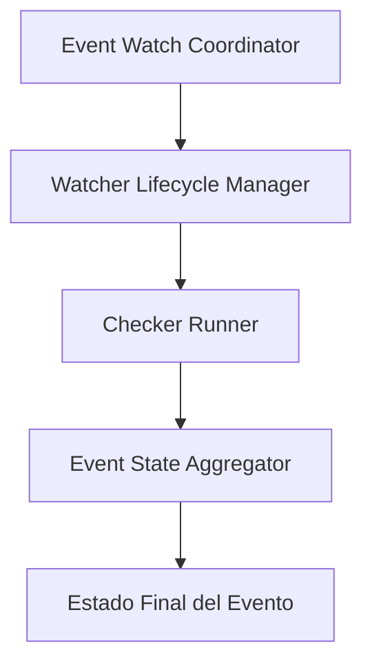
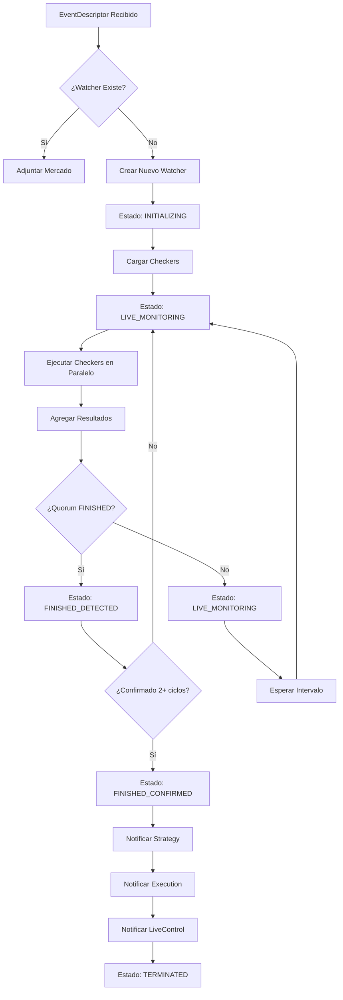

# Event Watch Engine – Motor de Monitoreo de Eventos Reales

**Versión 1.0 - Especificación Técnica para Implementación**

---

## 1. Propósito del Módulo

El **Event Watch Engine** es el sistema responsable de:

1. **Monitorear en tiempo real** el estado de eventos del mundo real (deportivos, políticos, crypto, etc.)
2. **Integrar múltiples checkers externos** (ESPN, FlashScore, AP News, blockchain nodes, etc.)
3. **Determinar con alta precisión** si un evento está: `LIVE`, `FINISHED`, o `UNKNOWN`
4. **Emitir estados confiables** para que Strategy pueda decidir si entrar o no en un mercado
5. **Evitar watchers duplicados** compartiendo watchers entre mercados que dependen del mismo evento
6. **Gestionar cientos de watchers simultáneamente** sin bloquear el backend
7. **Garantizar trazabilidad completa** para auditoría y debugging

### Importancia Crítica

**Es uno de los módulos más importantes del bot** porque determina cuándo un evento ha terminado realmente, lo que dispara las oportunidades de entrada. Sin este módulo, el sistema no puede detectar eventos finalizados antes que Polymarket.

---

## 2. Concepto Fundamental: Watcher por Evento

### 2.1. Arquitectura Event-Centered

**La clave de esta arquitectura es:**

- Un watcher monitorea **UN evento real**, no un mercado
- Si 20 mercados dependen del mismo partido NBA:
  - Se crea **un único SportsWatcher**
  - Ese watcher mantiene un array de mercados dependientes
  - Cuando el watcher detecta `FINISHED`, actualiza todos esos mercados

**Esto evita:**
- ❌ Requests duplicados
- ❌ Watchers innecesarios
- ❌ Problemas de concurrencia
- ❌ Ruido y consumo excesivo de APIs

### 2.2. Ventajas

- **Eficiencia:** Un solo watcher para múltiples mercados
- **Consistencia:** Todos los mercados ven el mismo estado del evento
- **Escalabilidad:** Puede manejar 200-300 watchers simultáneos
- **Mantenibilidad:** Lógica centralizada por tipo de evento

---

## 3. Entradas del Sistema

### 3.1. EventDescriptor del Mapping Layer

El Watch Engine recibe un `EventDescriptor` del Event Mapping Layer:

```python
class EventDescriptor:
    event_id: str                    # ID del evento externo (ej: "401585236" de ESPN)
    event_type: str                 # "sports", "politics", "crypto", etc.
    sport: str | None               # "basketball", "football", etc. (si aplica)
    league: str | None              # "nba", "nfl", etc. (si aplica)
    teams: List[str]                # ["Lakers", "Warriors"]
    starts_at: datetime | None      # Fecha/hora de inicio del evento
    confidence: float               # Confianza del mapping (0.0 - 1.0)
    markets: List[UUID]             # Lista de mercados que dependen de este evento
```

**Ejemplo:**
```json
{
  "event_id": "401585236",
  "event_type": "sports",
  "sport": "basketball",
  "league": "nba",
  "teams": ["Lakers", "Warriors"],
  "starts_at": "2025-01-25T20:00:00Z",
  "confidence": 0.94,
  "markets": ["market-uuid-1", "market-uuid-2", "market-uuid-3"]
}
```

### 3.2. Configuración Global

```python
class WatchEngineConfig:
    # Frecuencias de actualización por tipo
    check_frequency_sports: int = 3      # segundos
    check_frequency_politics: int = 60   # segundos
    check_frequency_crypto: int = 12     # segundos (cada bloque)
    check_frequency_finance: int = 60    # segundos
    
    # Reglas de quorum
    min_checkers_for_confirmed: int = 2  # Mínimo de checkers para FINISHED_CONFIRMED
    min_confidence_threshold: float = 0.8  # Confianza mínima por checker
    
    # Límites
    max_watchers_active: int = 300       # Máximo de watchers simultáneos
    max_watcher_age_hours: int = 24       # Máxima edad de un watcher
    
    # Timeouts
    checker_timeout_seconds: float = 5.0  # Timeout por checker
    watcher_max_duration_hours: int = 48   # Duración máxima de un watcher
```

---

## 4. Salidas del Sistema

### 4.1. Estado del Evento

El módulo produce un estado del evento:

```python
class EventState:
    event_id: str
    state: str                        # "LIVE", "FINISHED_CONFIRMED", 
                                       # "FINISHED_UNCONFIRMED", "UNKNOWN"
    confidence: float                  # 0.0 - 1.0
    sources: Dict[str, str]            # {
                                       #   "espn": "FINISHED",
                                       #   "flashscore": "FINISHED",
                                       #   "api3": "LIVE"
                                       # }
    last_update: datetime
    finished_at: datetime | None       # Si está FINISHED
    checker_results: List[CheckerResult]  # Resultados individuales
```

### 4.2. Notificaciones Internas

El Watch Engine notifica a otros módulos:

1. **Strategy Engine:**
   - Evento finalizado → "revisar mercados asociados"
   - Estado cambió de LIVE → FINISHED_CONFIRMED

2. **Execution Engine:**
   - Cancelar órdenes si evento se resolvió
   - Actualizar estado de órdenes pendientes

3. **LiveControl UI:**
   - Actualización en tiempo real de watchers
   - Cambios de estado visibles inmediatamente

---

## 5. Arquitectura del Watch Engine

### 5.1. Componentes Principales

El Watch Engine tiene cuatro componentes internos:



#### 5.1.1. Event Watch Coordinator

**Es el cerebro del sistema.**

**Responsabilidades:**
- Recibir nuevos `EventDescriptor` del Mapping Layer
- Verificar si ya existe un watcher para ese `event_id`
- Crear nuevo watcher o adjuntar mercados al existente
- Detener watchers cuando ya no sean necesarios
- Manejar errores y reinicios
- Gestionar límites (max watchers activos)

**Implementación:**
```python
class EventWatchCoordinator:
    async def register_event(descriptor: EventDescriptor) -> Watcher
    async def unregister_event(event_id: str) -> bool
    async def get_active_watchers() -> List[Watcher]
    async def cleanup_finished_watchers()
```

#### 5.1.2. Watcher Lifecycle Manager

**Gestiona el ciclo de vida de cada watcher.**

**Estados del Watcher:**
- `INITIALIZING`: Watcher recién creado, inicializando checkers
- `LIVE_MONITORING`: Monitoreando evento activo
- `FINISHED_DETECTED`: Detectó que evento terminó (verificando quorum)
- `FINISHED_CONFIRMED`: Confirmado que evento terminó (quorum cumplido)
- `TERMINATED`: Watcher terminado y limpiado
- `ERROR_RETRYING`: Error temporal, reintentando

**El Lifecycle Manager previene:**
- Watchers que corren sin razón
- Watchers que nunca terminan
- Watchers duplicados
- Fugas de memoria

#### 5.1.3. Checker Runner

**Ejecuta los checkers específicos del tipo de evento.**

**Ejemplos de checkers por tipo:**

**Deportivos:**
- ESPN Scoreboard
- FlashScore
- TheScore
- mcpmarket.com server

**Políticos:**
- AP Elections API
- Reuters
- The Guardian feed

**Crypto:**
- RPC node (Ethereum, Polygon)
- GeckoTerminal
- Binance API

**El Checker Runner ejecuta cada checker y retorna:**
```python
class CheckerResult:
    checker_name: str                 # "espn", "flashscore", etc.
    result: str                       # "FINISHED", "LIVE", "UNKNOWN"
    confidence: float                  # 0.0 - 1.0
    latency_ms: float                 # Tiempo de respuesta
    raw_data: dict | None             # Datos crudos (opcional)
    error: str | None                 # Si hubo error
    timestamp: datetime
```

#### 5.1.4. Event State Aggregator

**Combina los resultados de los checkers usando:**

- **Reglas de quorum:** Requiere N checkers coincidiendo
- **Ponderación por confiabilidad:** Checkers más confiables tienen más peso
- **Recency:** Resultados más recientes tienen prioridad
- **Estabilidad del estado:** Estados consistentes tienen más confianza

**Ejemplo de agregación:**
```
Checker      | Estado    | Confianza
-------------|-----------|-----------
ESPN         | FINISHED  | 0.95
FlashScore   | FINISHED  | 0.92
API3         | LIVE      | 0.50

Quorum = 2 checkers → Resultado final:
FINAL_STATE = FINISHED_CONFIRMED
FINAL_CONFIDENCE = 0.94 (promedio ponderado)
```

---

## 6. Reglas de Quorum

### 6.1. Estados Base

- **`LIVE`:** Evento sigue activo
- **`FINISHED`:** Evento terminó
- **`UNKNOWN`:** No se pudo determinar

### 6.2. Reglas de Decisión

#### FINISHED_CONFIRMED
**Se obtiene cuando:**
- 2+ checkers dicen `FINISHED`
- Cada uno con confianza >= `min_confidence_threshold` (0.8)
- Estado estable por al menos 2 ciclos consecutivos

**Uso:** Strategy puede crear órdenes con alta confianza

#### FINISHED_UNCONFIRMED
**Se obtiene cuando:**
- 1 checker dice `FINISHED` con confianza >= 0.8
- Otros checkers dicen `UNKNOWN` o fallan
- O 2+ checkers dicen `FINISHED` pero con confianza < 0.8

**Uso:** Strategy puede crear órdenes pero con tamaño reducido

#### LIVE
**Se obtiene cuando:**
- Ningún checker detecta `FINISHED`
- Al menos 1 checker dice `LIVE`
- Evento continúa en vivo según checkers

**Uso:** No crear órdenes, seguir monitoreando

#### UNKNOWN
**Se obtiene cuando:**
- Todos los checkers fallan
- Inconsistencias internas
- No hay datos suficientes

**Uso:** No crear órdenes, esperar más datos

---

## 7. Frecuencias de Actualización

El Watch Engine evalúa eventos según tipo con diferentes frecuencias:

| Tipo de Evento | Frecuencia | Razón |
|----------------|------------|-------|
| **Sports** | Cada 3-5s | Eventos deportivos cambian rápido |
| **Politics** | Cada 60-120s | Eventos políticos son más lentos |
| **Crypto** | Cada bloque (12s ETH) | Sincronizado con blockchain |
| **Finance** | Cada 60s | Datos financieros se actualizan periódicamente |
| **Weather** | Cada 10-15min | Eventos climáticos son lentos |
| **Custom** | Configurable | Según necesidades específicas |

**Esto permite escalar** sin sobrecargar APIs externas.

---

## 8. Estado Interno del Watcher

Cada watcher mantiene:

```python
class Watcher:
    # Identificadores
    event_id: str
    event_type: str
    trace_id: UUID                    # Para trazabilidad
    
    # Mercados asociados
    markets: List[UUID]                # Mercados que dependen de este evento
    
    # Estado actual
    last_state: str                   # "LIVE", "FINISHED_CONFIRMED", etc.
    confidence: float
    state_history: List[StateSnapshot] # Historial de cambios
    
    # Métricas
    last_check_latency_ms: float
    check_failures: int               # Fallos consecutivos
    total_checks: int                 # Total de checks realizados
    
    # Timestamps
    created_at: datetime
    last_update: datetime
    finished_at: datetime | None
    
    # Checker results
    last_checker_results: List[CheckerResult]
    
    # Configuración
    check_interval_seconds: int        # Frecuencia de checks
    max_duration_hours: int           # Duración máxima
```

**Ejemplo de estado:**
```json
{
  "event_id": "401585236",
  "markets": ["m1", "m2", "m3"],
  "last_state": "LIVE",
  "confidence": 0.91,
  "state_history": [
    { "state": "LIVE", "timestamp": "2025-01-25T20:00:00Z", "confidence": 0.89 },
    { "state": "LIVE", "timestamp": "2025-01-25T20:00:05Z", "confidence": 0.91 }
  ],
  "last_check_latency_ms": 320,
  "check_failures": 0,
  "total_checks": 45
}
```

---

## 9. Ciclo de Vida de un Watcher

### 9.1. Secuencia Completa



### 9.2. Loop Principal del Watcher

```python
async def _watch_loop(self):
    """Loop principal de monitoreo."""
    while self._active:
        try:
            # 1. Ejecutar checkers en paralelo
            checker_results = await self._run_checkers()
            
            # 2. Agregar resultados
            aggregated_state = await self._aggregate_results(checker_results)
            
            # 3. Verificar cambio de estado
            if aggregated_state.state != self.last_state:
                await self._handle_state_transition(aggregated_state)
            
            # 4. Actualizar estado
            self.last_state = aggregated_state.state
            self.confidence = aggregated_state.confidence
            self.last_checker_results = checker_results
            
            # 5. Verificar condiciones de terminación
            if self._should_terminate():
                await self._terminate()
                break
            
            # 6. Esperar intervalo
            await asyncio.sleep(self.check_interval_seconds)
            
        except asyncio.CancelledError:
            break
        except Exception as e:
            await self._handle_error(e)
            await asyncio.sleep(5.0)  # Backoff en error
```

---

## 10. Condiciones de Terminación

Un watcher termina cuando:

### 10.1. Evento Confirmado FINISHED
- Estado = `FINISHED_CONFIRMED`
- Quorum cumplido
- **Acción:** Notificar módulos, limpiar recursos

### 10.2. Mercado Cerrado en Polymarket
- Todos los mercados asociados están cerrados/resueltos
- **Acción:** Terminar watcher (ya no es necesario)

### 10.3. Timeout Máximo
- `watcher_max_duration_hours` excedido
- **Acción:** Terminar watcher (evento muy antiguo)

### 10.4. Error Crítico Persistente
- `check_failures` > 10 consecutivos
- Todos los checkers fallan
- **Acción:** Terminar watcher, loggear error crítico

### 10.5. Manual Override
- Usuario detiene watcher desde LiveControl
- Sistema pausado
- **Acción:** Terminar watcher inmediatamente

### 10.6. Limpieza al Terminar

Cuando un watcher termina:

1. **Libera memoria:**
   - Cancela tareas asíncronas
   - Limpia referencias
   - Cierra conexiones

2. **Actualiza DB:**
   - Guarda estado final
   - Actualiza eventos asociados
   - Registra historial

3. **Actualiza LiveControl:**
   - Notifica que watcher terminó
   - Actualiza UI en tiempo real

4. **Notifica módulos:**
   - Strategy recibe estado final
   - Execution puede cancelar órdenes si aplica

---

## 11. Trazabilidad y Logging

### 11.1. Logging Estructurado

**Cada ciclo del watcher genera logs:**

```json
{
  "timestamp": "2025-01-25T20:00:05.123Z",
  "level": "INFO",
  "component": "event_watch_engine",
  "event_type": "watcher_tick",
  "trace_id": "b3c1e7fc-2a5f-4b7a-9c90-1b...",
  "event_id": "401585236",
  "watcher_id": "watcher-uuid",
  "checker_results": {
    "espn": { "result": "FINISHED", "confidence": 0.95, "latency_ms": 340 },
    "flashscore": { "result": "FINISHED", "confidence": 0.92, "latency_ms": 280 }
  },
  "final_state": "FINISHED_CONFIRMED",
  "confidence": 0.94,
  "total_latency_ms": 350
}
```

**Cada cambio de estado:**

```json
{
  "timestamp": "2025-01-25T20:15:30.123Z",
  "level": "INFO",
  "component": "event_watch_engine",
  "event_type": "state_transition",
  "trace_id": "...",
  "event_id": "401585236",
  "transition": "LIVE → FINISHED_CONFIRMED",
  "confidence": 0.96,
  "checker_agreement": 2,
  "message": "Event finished confirmed by quorum"
}
```

**Cada error:**

```json
{
  "timestamp": "2025-01-25T20:00:05.123Z",
  "level": "ERROR",
  "component": "event_watch_engine",
  "event_type": "watcher_error",
  "trace_id": "...",
  "event_id": "401585236",
  "error_type": "CHECKER_TIMEOUT",
  "checker_name": "espn",
  "attempt": 3,
  "message": "ESPN checker timeout after 5s"
}
```

### 11.2. Trazabilidad Completa

**Cada watcher tiene:**
- `trace_id` único (heredado del EventDescriptor)
- Historial completo de estados
- Logs de todos los checks
- Resultados de todos los checkers
- Métricas de latencia y errores

**Esto permite:**
- Reconstruir el flujo completo de un evento
- Auditar decisiones de quorum
- Depurar problemas de checkers
- Analizar performance

---

## 12. Escalabilidad

### 12.1. Diseño para Escala

El Watch Engine se diseña para:

- **Manejar 200-300 watchers simultáneos**
- **Sin bloquear el loop principal** (usando asyncio)
- **Con throttling automático por API** (rate limiting)
- **Pooling de checkers** (reutilizar conexiones)

### 12.2. Optimizaciones

**Cada watcher usa:**
- **Colas internas:** Para gestionar requests sin bloquear
- **Pooling de checkers:** Reutilizar instancias de checkers
- **Control de latencia:** Priorizar checkers rápidos
- **Batching:** Agrupar requests cuando sea posible

**Ejemplo de pooling:**
```python
# En lugar de crear nuevo cliente HTTP por watcher
# Compartir pool de clientes HTTP
http_pool = AsyncClientPool(max_connections=50)

# Cada checker usa el pool compartido
async def check_espn(event_id: str):
    async with http_pool.get_client() as client:
        response = await client.get(f"https://espn.com/api/event/{event_id}")
        return parse_response(response)
```

### 12.3. Throttling por API

**Cada API externa tiene su propio rate limiter:**

```python
# ESPN: 100 req/min
espn_rate_limiter = RateLimiter(requests=100, window=60)

# FlashScore: 50 req/min
flashscore_rate_limiter = RateLimiter(requests=50, window=60)

# Checker Runner respeta estos límites
async def run_checker(checker_name: str, event_id: str):
    rate_limiter = get_rate_limiter_for_checker(checker_name)
    await rate_limiter.wait_for_capacity()
    return await checker.check(event_id)
```

---

## 13. Manejo de Errores

### 13.1. Tipos de Errores

#### Error de Checker Individual
**Ejemplos:**
- Timeout del checker
- API no disponible
- Respuesta inválida

**Acción:**
- Marcar resultado como `UNKNOWN` o `ERROR`
- Continuar con otros checkers
- Incrementar `check_failures` del watcher
- Loggear error

#### Error de Todos los Checkers
**Ejemplos:**
- Todas las APIs fallan
- Red no disponible
- Rate limit global

**Acción:**
- Estado → `UNKNOWN`
- Esperar y reintentar en siguiente ciclo
- Si persiste > 10 ciclos → terminar watcher

#### Error Crítico del Watcher
**Ejemplos:**
- Excepción no manejada
- Fuga de memoria
- Deadlock

**Acción:**
- Terminar watcher inmediatamente
- Loggear error crítico
- Notificar administradores
- Continuar con otros watchers

### 13.2. Resiliencia

**Principios:**
- Un watcher que falla no debe afectar a otros
- Errores temporales se manejan con retry
- Errores persistentes terminan el watcher
- El sistema continúa operando aunque algunos watchers fallen

---

## 14. Estructura de Archivos a Implementar

```
backend/app/
├── core/
│   ├── event_watch_engine.py    # Motor principal (NUEVO)
│   └── watcher_lifecycle.py     # Gestión de ciclo de vida (NUEVO)
│
├── services/
│   └── checker_runner.py        # Ejecutor de checkers (NUEVO)
│
└── aggregators/
    └── state_aggregator.py      # Agregador de estados (NUEVO)
```

### 14.1. Módulos Principales

**`app/core/event_watch_engine.py`:**
- Clase `EventWatchEngine`
- Clase `EventWatchCoordinator`
- Método `register_event(descriptor: EventDescriptor) -> Watcher`
- Método `unregister_event(event_id: str) -> bool`
- Gestión de watchers activos

**`app/core/watcher_lifecycle.py`:**
- Clase `WatcherLifecycleManager`
- Estados y transiciones
- Método `initialize_watcher()`
- Método `terminate_watcher()`
- Prevención de fugas de memoria

**`app/services/checker_runner.py`:**
- Clase `CheckerRunner`
- Método `run_checkers(event_id: str, event_type: str) -> List[CheckerResult]`
- Pooling de checkers
- Rate limiting por API
- Manejo de timeouts

**`app/aggregators/state_aggregator.py`:**
- Clase `EventStateAggregator`
- Método `aggregate(checker_results: List[CheckerResult]) -> EventState`
- Reglas de quorum
- Ponderación por confiabilidad
- Cálculo de confianza final

---

## 15. Integración con Otros Módulos

### 15.1. Event Mapping Layer

**Flujo:**
```
Mapping Layer detecta evento → Crea EventDescriptor → Watch Engine registra evento
```

### 15.2. Strategy Engine

**Flujo:**
```
Watch Engine detecta FINISHED_CONFIRMED → Notifica Strategy → Strategy revisa mercados
```

### 15.3. Execution Engine

**Flujo:**
```
Watch Engine detecta FINISHED → Notifica Execution → Execution cancela órdenes si aplica
```

### 15.4. LiveControl UI

**Flujo:**
```
Watch Engine actualiza estado → Push a LiveControl → UI se actualiza en tiempo real
```

---

## 16. Resumen

El **Event Watch Engine** es un módulo crítico que:

- ✅ **Identifica** qué watcher usar por tipo de evento
- ✅ **Crea watchers** solo cuando el mapping es confiable
- ✅ **Ejecuta checkers** constantemente en paralelo
- ✅ **Calcula el estado real** del evento mediante quorum
- ✅ **Expone resultados** a Strategy y Execution
- ✅ **Mantiene trazabilidad** completa
- ✅ **Optimiza uso de APIs** mediante pooling y rate limiting
- ✅ **Es adaptable** a cualquier tipo de evento futuro

**Con esto, el backend pasa de ser un bot simple → a una plataforma profesional de event-driven trading.**

---

## 17. Próximos Pasos

1. **Revisar documentación de APIs externas** (ESPN, FlashScore, etc.)
2. **Implementar CheckerRunner** con pooling y rate limiting
3. **Implementar StateAggregator** con reglas de quorum
4. **Implementar EventWatchCoordinator** para gestión de watchers
5. **Implementar WatcherLifecycleManager** para ciclo de vida
6. **Integrar con Event Mapping Layer**
7. **Implementar notificaciones** a Strategy, Execution y LiveControl
8. **Crear tests unitarios** para cada componente
9. **Crear tests de integración** para flujo completo
10. **Configurar métricas y alertas**
