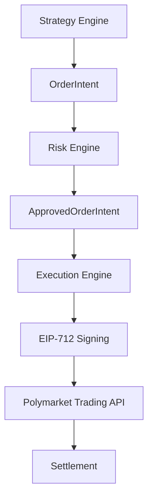
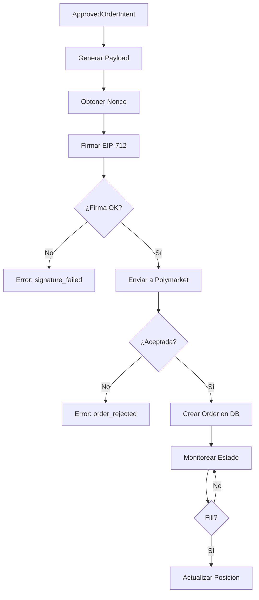
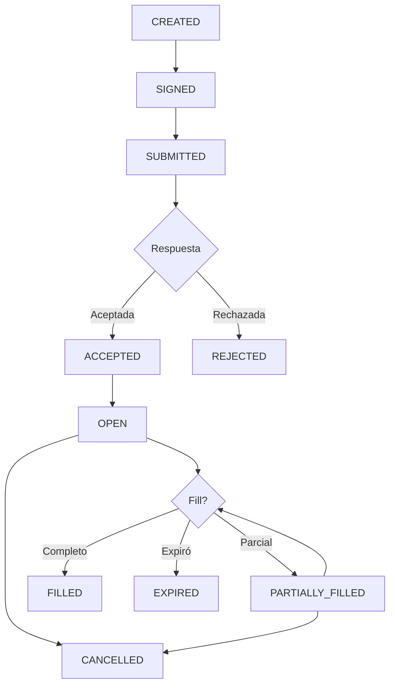

# Execution Engine – Firma, Envío, Gestión y Confirmación de Órdenes

**Versión 1.0 - Especificación Técnica para Implementación**

**PolyLiquidity Desk – Arquitectura de Ejecución de Alto Rendimiento**

---

## 1. Propósito del Módulo

El **Execution Engine** es el módulo encargado de:

1. **Firmar órdenes EIP-712** con la wallet del bot
2. **Enviar órdenes** a los endpoints de trading de Polymarket
3. **Controlar el ciclo de vida** de las órdenes:
   - Creación
   - Aceptación
   - Colocación
   - Ejecución (fills)
   - Expiración
   - Cancelación
4. **Monitorizar latencia y errores** en tiempo real
5. **Mantener trazabilidad completa** suficiente para auditorías y debugging profundo

### Importancia Crítica

**El Execution Engine es la parte más delicada del sistema:**  
> Aquí se mueve dinero real. Todo debe ser seguro, determinista y monitoreable.

**Es el módulo que convierte cálculos del bot en acciones reales sobre dinero real.**

---

## 2. Posición en la Arquitectura

### 2.1. Flujo Completo



### 2.2. Responsabilidades

**El Execution Engine:**
- ✅ Firma órdenes con EIP-712
- ✅ Envía órdenes a Polymarket
- ✅ Monitorea estado de órdenes
- ✅ Gestiona fills y actualiza posiciones
- ✅ Cancela órdenes cuando es necesario
- ✅ Mantiene trazabilidad completa

**El Execution Engine NO:**
- ❌ Decide cuándo entrar (eso lo hace Strategy Engine)
- ❌ Valida riesgo (eso lo hace Risk Engine)
- ❌ Solo actúa después de una aprobación de Risk

---

## 3. Entradas del Sistema

### 3.1. ApprovedOrderIntent (del Risk Engine)

```python
class ApprovedOrderIntent:
    """Orden aprobada que pasó validación de riesgo."""
    market_id: UUID
    side: str = "BUY"                   # Solo compras en esta estrategia
    price: float                        # Precio objetivo
    size: float                         # Tamaño final (puede ser ajustado)
    original_size: float                # Tamaño original del intent
    adjustments: Dict                   # Ajustes aplicados por Risk
```

**Ejemplo:**
```json
{
  "market_id": "pm123",
  "side": "BUY",
  "price": 0.979,
  "size": 5000,
  "original_size": 5000,
  "adjustments": {
    "final_size": 5000,
    "latency_adjusted": false
  }
}
```

### 3.2. Wallet (Wallet Service)

```python
class Wallet:
    """Wallet activa para firmar órdenes."""
    address: str                        # Dirección de la wallet
    private_key: str                    # Clave privada (descifrada, cacheada)
    provider: str                       # Provider de blockchain
    signer: EIP712Signer                # Signer EIP-712
    nonce_manager: NonceManager         # Gestor de nonces
```

**Obtención:**
```python
wallet = wallet_service.get_active_wallet()
if not wallet:
    # No ejecutar órdenes
    return
```

### 3.3. TradingConfig (Configuración)

```python
class TradingConfig:
    """Configuración de trading."""
    polymarket_trading_endpoint: str    # Endpoint de trading de Polymarket
    trading_api_keys: Dict | None       # API keys (si aplica)
    gas_parameters: Dict | None         # Parámetros de gas (si aplica)
    timeout: float = 30.0               # Timeout de requests
    retry_strategy: RetryStrategy       # Estrategia de reintentos
    order_ttl_seconds: int = 3600       # TTL de órdenes (1 hora)
    max_retries: int = 3                # Máximo de reintentos
```

---

## 4. Salidas del Sistema

### 4.1. Orden Creada con Éxito

```json
{
  "status": "submitted",
  "order_id": "order_xyz",
  "polymarket_order_id": "pm_order_123",
  "market_id": "pm123",
  "side": "BUY",
  "price": 0.979,
  "size": 5000,
  "signature": "0x...",
  "submitted_at": "2025-01-25T20:15:30.123Z"
}
```

### 4.2. Orden Ejecutada Completamente

```json
{
  "status": "filled",
  "order_id": "order_xyz",
  "polymarket_order_id": "pm_order_123",
  "fills": [
    { "price": 0.979, "size": 3000, "timestamp": "..." },
    { "price": 0.979, "size": 2000, "timestamp": "..." }
  ],
  "avg_price": 0.979,
  "total_size": 5000,
  "filled_at": "2025-01-25T20:16:00.123Z"
}
```

### 4.3. Orden Cancelada

```json
{
  "status": "cancelled",
  "order_id": "order_xyz",
  "polymarket_order_id": "pm_order_123",
  "reason": "system_pause",
  "cancelled_at": "2025-01-25T20:17:00.123Z"
}
```

### 4.4. Error de Ejecución

```json
{
  "status": "error",
  "order_id": "order_xyz",
  "error_type": "signature_failed",
  "error_details": "invalid EIP-712 domain",
  "retry_count": 2,
  "timestamp": "2025-01-25T20:15:30.123Z"
}
```

---

## 5. Flujo Completo de Ejecución

### 5.1. Secuencia Paso a Paso



### 5.2. Paso 1: Generar Payload de Orden

**Ejemplo conceptual:**
```json
{
  "market": "pm123",
  "currency": "USD",
  "type": "BUY",
  "outcome": "YES",
  "amount": 5000,
  "price": 0.979,
  "nonce": 1045,
  "expiration": 1737840000
}
```

**El payload es EXACTO** según las especificaciones de Polymarket.

**Implementación:**
```python
def build_order_payload(intent: ApprovedOrderIntent, nonce: int) -> Dict:
    """Construye payload de orden según especificación de Polymarket."""
    return {
        "market": str(intent.market_id),
        "currency": "USD",
        "type": intent.side,
        "outcome": "YES",  # O "NO" según lógica
        "amount": intent.size,
        "price": intent.price,
        "nonce": nonce,
        "expiration": int(time.time()) + order_ttl_seconds
    }
```

---

## 6. Firma EIP-712

EIP-712 permite firmar datos estructurados con protección anti-manipulación.

### 6.1. Domain

```json
{
  "name": "PolymarketTrading",
  "version": "1",
  "chainId": 137,
  "verifyingContract": "0x..."
}
```

**Carga desde configuración:**
- `name`: "Polymarket Exchange" (o según documentación)
- `version`: "1" (o según documentación)
- `chainId`: 137 (Polygon) o según red
- `verifyingContract`: Dirección del contrato verificador

### 6.2. Types

```json
{
  "Order": [
    { "name": "market", "type": "string" },
    { "name": "outcome", "type": "string" },
    { "name": "amount", "type": "uint256" },
    { "name": "price", "type": "uint256" },
    { "name": "nonce", "type": "uint256" },
    { "name": "expiration", "type": "uint256" }
  ]
}
```

### 6.3. Message (la Orden Real)

```python
message = {
    "market": "pm123",
    "outcome": "YES",
    "amount": 5000,
    "price": 979000,  # En wei o unidades base
    "nonce": 1045,
    "expiration": 1737840000
}
```

### 6.4. Firma

**El signer produce:**
```python
signature = signTypedData(domain, types, message)
```

**Si la firma falla:**
- Se registra el error
- Se reintenta N veces
- Si no funciona → se aborta orden y se alerta

**Implementación:**
```python
def sign_order_payload(payload: Dict, private_key: str) -> str:
    """Firma payload usando EIP-712."""
    domain = get_eip712_domain()
    types = get_eip712_types()
    message = payload
    
    # Usar librería eth_account o similar
    signature = Account.sign_typed_data(private_key, domain, types, message)
    return signature.hex()
```

---

## 7. Envío a Polymarket Trading API

### 7.1. Request

**El Execution Engine envía:**
```http
POST /trades
Content-Type: application/json

{
  "order": {
    "market": "pm123",
    "outcome": "YES",
    "amount": 5000,
    "price": 0.979,
    "nonce": 1045,
    "expiration": 1737840000
  },
  "signature": "0x..."
}
```

### 7.2. Response

**El servidor devuelve:**
```json
{
  "order_id": "order_xyz",
  "polymarket_order_id": "pm_order_123",
  "status": "accepted",
  "received_at": "2025-01-25T20:15:30.123Z"
}
```

### 7.3. Rate Limiting

**Trading API:** 2400 req / 10s

**Implementación:**
```python
# Adquirir permiso de rate limit
if not await rate_limiter.wait_for_capacity(EndpointType.TRADING_ORDER, timeout=2.0):
    return None  # Timeout

# Enviar orden
response = await client.post(f"{endpoint}/trades", json=payload)

# Verificar rate limit
if response.status_code == 429:
    await rate_limiter.record_violation(EndpointType.TRADING_ORDER)
    raise RateLimitError()
```

---

## 8. Order Lifecycle Manager

Cada orden pasa por varios estados.

### 8.1. Estados de la Orden

| Estado | Significado |
|--------|-------------|
| `CREATED` | Order intent creado |
| `SIGNED` | Firmado por EIP-712 |
| `SUBMITTED` | Enviado a Polymarket |
| `ACCEPTED` | Polymarket lo aceptó |
| `OPEN` | Orden viva en orderbook |
| `PARTIALLY_FILLED` | Ejecutado parcialmente |
| `FILLED` | Ejecutado completamente |
| `EXPIRED` | Expiró sin fill |
| `CANCELLED` | Cancelado por el sistema |
| `REJECTED` | Rechazado por Polymarket |
| `ERROR` | Error en ejecución |

### 8.2. State Machine



### 8.3. Transiciones de Estado

**Implementación:**
```python
def update_order_state(order_id: UUID, new_status: str, reason: str = None):
    """Actualiza estado de orden con validación de transiciones."""
    current_status = get_order_status(order_id)
    
    # Validar transición
    if not is_valid_transition(current_status, new_status):
        raise InvalidStateTransitionError()
    
    # Actualizar estado
    order.status = new_status
    order.updated_at = datetime.utcnow()
    
    # Loggear transición
    log_state_transition(order_id, current_status, new_status, reason)
```

---

## 9. Monitoreo de Fills

El Execution Engine consulta periódicamente el estado de las órdenes.

### 9.1. Polling de Estado

**Endpoints:**
```http
GET /orders/:id
GET /fills?order_id=:id
```

**Para detectar:**
- Fills parciales
- Fills completos
- Expiraciones
- Cancelaciones externas

### 9.2. Procesamiento de Fills

**Cuando ocurre un fill:**
```python
def handle_fill(order_id: UUID, fill_data: Dict):
    """Procesa un fill de orden."""
    # 1. Actualizar orden
    order.filled_size += fill_data["size"]
    if order.filled_size >= order.size:
        order.status = "FILLED"
    else:
        order.status = "PARTIALLY_FILLED"
    
    # 2. Actualizar posición
    update_position(order.market_id, fill_data["size"], fill_data["price"])
    
    # 3. Actualizar exposición
    update_exposure(order.market_id, fill_data["size"] * fill_data["price"])
    
    # 4. Crear trade record
    create_trade_record(order_id, fill_data)
    
    # 5. Loggear fill
    log_fill(order_id, fill_data)
```

**Ejemplo de fill:**
```json
{
  "fill_id": "fill_001",
  "order_id": "order_xyz",
  "price": 0.979,
  "size": 3000,
  "timestamp": "2025-01-25T20:16:00.123Z"
}
```

### 9.3. Rate Limiting para Polling

**Data API:** 200 req / 10s

**Implementación:**
```python
# Adquirir permiso de rate limit
if not await rate_limiter.wait_for_capacity(EndpointType.DATA_API, timeout=1.0):
    return  # Skip este poll, reintentar en siguiente tick

# Consultar estado
response = await client.get(f"{endpoint}/orders/{order_id}")

# Verificar rate limit
if response.status_code == 429:
    await rate_limiter.record_violation(EndpointType.DATA_API)
    return
```

---

## 10. Cancelación de Órdenes

El sistema puede cancelar órdenes por múltiples razones.

### 10.1. Razones de Cancelación

- **Pausa del sistema:** `system_active == False`
- **Latencia roja:** `latency_status == RED`
- **Shutdown seguro:** Sistema se está cerrando
- **Resolución del mercado:** Mercado se resolvió
- **Invalidación de estrategia:** Evento cambió de estado

### 10.2. Proceso de Cancelación

**Llamada:**
```http
DELETE /orders/:order_id
```

**Implementación:**
```python
async def cancel_order(order_id: UUID, reason: str):
    """Cancela una orden en Polymarket."""
    order = get_order(order_id)
    
    if order.status in ("FILLED", "CANCELLED"):
        return  # Ya terminada
    
    # Adquirir permiso de rate limit
    if not await rate_limiter.wait_for_capacity(EndpointType.TRADING_ORDER, timeout=1.0):
        return
    
    # Enviar cancelación
    try:
        response = await client.delete(f"{endpoint}/orders/{order.polymarket_order_id}")
        response.raise_for_status()
        
        # Actualizar estado
        await update_order_state(order_id, "CANCELLED", reason)
    except Exception as e:
        log_error("cancel_failed", order_id=order_id, error=str(e))
```

### 10.3. Cancelación Masiva

**Cancelar todas las órdenes abiertas:**
```python
async def cancel_all_open_orders(market_id: UUID = None):
    """Cancela todas las órdenes abiertas, opcionalmente de un mercado."""
    query = db.query(Order).filter(Order.status.in_(["NEW", "PARTIALLY_FILLED"]))
    if market_id:
        query = query.filter(Order.market_id == market_id)
    
    orders = query.all()
    for order in orders:
        await cancel_order(order.id, reason="system_pause")
```

---

## 11. Seguridad en Ejecución

### 11.1. Nonce Manager

**Evita replay attacks y mantiene coherencia:**

```python
class NonceManager:
    """Gestor de nonces para órdenes."""
    
    def get_next_nonce(self) -> int:
        """Obtiene siguiente nonce."""
        # Consultar nonce actual desde Polymarket API
        # O usar contador interno si Polymarket no requiere nonce
        current_nonce = self._get_current_nonce()
        return current_nonce + 1
    
    def sync_nonce(self):
        """Sincroniza nonce desde blockchain si una orden falla."""
        # Consultar nonce actual desde blockchain
        # Actualizar contador interno
        pass
```

**Reglas:**
- Cada orden incrementa nonce
- Si una orden falla → nonce se sincroniza vía blockchain
- Nonces nunca se reutilizan

### 11.2. Retry Logic

**El Execution Engine aplica exponential backoff:**

```python
retry_delays = [0.2, 0.5, 1.0, 2.0, 4.0]  # segundos

for attempt in range(max_retries):
    try:
        response = await send_order(payload)
        return response
    except RetryableError as e:
        if attempt < max_retries - 1:
            await asyncio.sleep(retry_delays[attempt])
            continue
        else:
            raise
```

**Errores críticos NO se reintentan:**
- Firma inválida
- Precio fuera de rango
- Orden rechazada por Polymarket
- Wallet no disponible

### 11.3. Circuit Breaker (Trading)

**Si hay más de X errores en Y segundos:**

```python
class TradingCircuitBreaker:
    """Circuit breaker para trading."""
    
    def __init__(self, failure_threshold: int = 5, window_seconds: int = 60):
        self.failure_threshold = failure_threshold
        self.window_seconds = window_seconds
        self.failure_count = 0
        self.last_failure_time = None
        self.state = "CLOSED"  # CLOSED, OPEN, HALF_OPEN
    
    def record_failure(self):
        """Registra un fallo."""
        self.failure_count += 1
        self.last_failure_time = time.time()
        
        if self.failure_count >= self.failure_threshold:
            self.state = "OPEN"
            # Pausar trading
            # Cancelar órdenes abiertas
            # Enviar alertas
```

**Acciones cuando está OPEN:**
- No nuevas órdenes hasta enfriamiento
- Cancelar órdenes abiertas
- Alertas al sistema

---

## 12. Logs y Trazabilidad

Cada acción queda registrada como JSON estructurado.

### 12.1. Orden Creada

```json
{
  "timestamp": "2025-01-25T20:15:30.123Z",
  "level": "INFO",
  "component": "execution",
  "event": "order_created",
  "order_id": "order_xyz",
  "intent": {
    "market_id": "pm123",
    "price": 0.979,
    "size": 5000
  },
  "trace_id": "b3c1e7fc-2a5f-4b7a-9c90-1b..."
}
```

### 12.2. Orden Firmada

```json
{
  "timestamp": "2025-01-25T20:15:30.200Z",
  "level": "INFO",
  "component": "execution",
  "event": "order_signed",
  "order_id": "order_xyz",
  "signature": "0x...",
  "nonce": 1045,
  "domain_hash": "0x...",
  "message_hash": "0x...",
  "trace_id": "b3c1e7fc-2a5f-4b7a-9c90-1b..."
}
```

### 12.3. Orden Enviada

```json
{
  "timestamp": "2025-01-25T20:15:30.300Z",
  "level": "INFO",
  "component": "execution",
  "event": "order_submitted",
  "order_id": "order_xyz",
  "polymarket_order_id": "pm_order_123",
  "submitted_at": "2025-01-25T20:15:30.300Z",
  "latency_ms": 100,
  "trace_id": "b3c1e7fc-2a5f-4b7a-9c90-1b..."
}
```

### 12.4. Fill Detectado

```json
{
  "timestamp": "2025-01-25T20:16:00.123Z",
  "level": "INFO",
  "component": "execution",
  "event": "fill",
  "order_id": "order_xyz",
  "fill_id": "fill_001",
  "price": 0.979,
  "size": 2000,
  "remaining": 3000,
  "trace_id": "b3c1e7fc-2a5f-4b7a-9c90-1b..."
}
```

### 12.5. Orden Completada

```json
{
  "timestamp": "2025-01-25T20:16:30.123Z",
  "level": "INFO",
  "component": "execution",
  "event": "filled_complete",
  "order_id": "order_xyz",
  "avg_price": 0.979,
  "total_size": 5000,
  "fills_count": 2,
  "trace_id": "b3c1e7fc-2a5f-4b7a-9c90-1b..."
}
```

### 12.6. Cancelación

```json
{
  "timestamp": "2025-01-25T20:17:00.123Z",
  "level": "INFO",
  "component": "execution",
  "event": "cancelled",
  "order_id": "order_xyz",
  "reason": "latency_red",
  "trace_id": "b3c1e7fc-2a5f-4b7a-9c90-1b..."
}
```

### 12.7. Campos de Trazabilidad

**Cada log incluye:**
- `trace_id`: Para rastrear el flujo completo
- `order_id`: ID único de la orden
- `polymarket_order_id`: ID en Polymarket
- `latency_ms`: Latencia de ejecución
- `payload_hash`: Hash del payload (para verificación)
- `signature`: Firma EIP-712 (para auditoría)

---

## 13. Integración con Risk & Strategy

El Execution Engine no decide nada, solo ejecuta órdenes:

```
Strategy → decide
Risk → aprueba
Execution → firma y envía
```

### 13.1. Fail-Safe de Ejecución

**Si Execution detecta situaciones peligrosas:**
- Errores en cadena
- Latencia alta
- Rechazos masivos

**Puede activar:**
```python
system_fail_safe("execution_error")
```

**Esto pausa todo el trading.**

### 13.2. Validaciones Adicionales

**Antes de ejecutar:**
```python
# 1. Verificar wallet disponible
if not wallet_service.get_active_wallet():
    return  # No ejecutar

# 2. Verificar sistema activo
if not state.system_active:
    return  # No ejecutar

# 3. Verificar latencia
if latency_monitor.get_status() == LatencyStatus.RED:
    return  # No ejecutar
```

---

## 14. Estructura de Archivos a Implementar

```
backend/app/core/
├── execution.py                    # Execution Engine principal
├── order_lifecycle.py              # Gestión de ciclo de vida
├── eip712_signer.py               # Firma EIP-712
├── nonce_manager.py               # Gestor de nonces
└── order_monitor.py               # Monitor de órdenes (polling)
```

### 14.1. Módulos Principales

**`app/core/execution.py`:**
- Clase `Execution`
- Método `tick(approved_intents: List[ApprovedOrderIntent])`
- Métodos privados:
  - `_sign_order_payload()`
  - `_send_order_to_polymarket()`
  - `_create_order_in_db()`
  - `_update_order_state()`
  - `_handle_fill()`
  - `_cancel_order()`

**`app/core/eip712_signer.py`:**
- Clase `EIP712Signer`
- Método `sign(domain, types, message, private_key) -> str`
- Validación de domain y types

**`app/core/nonce_manager.py`:**
- Clase `NonceManager`
- Método `get_next_nonce() -> int`
- Método `sync_nonce()`

**`app/core/order_monitor.py`:**
- Clase `OrderMonitor`
- Método `poll_order_status(order_id)`
- Método `detect_fills(order_id)`

---

## 15. Integración con Otros Módulos

### 15.1. Risk Engine

**Flujo:**
```
Risk Engine → ApprovedOrderIntent → Execution Engine
```

### 15.2. Wallet Service

**Flujo:**
```
Execution Engine → WalletService → Wallet → EIP-712 Signing
```

### 15.3. Rate Limiter

**Flujo:**
```
Execution Engine → RateLimiter → Polymarket API
```

### 15.4. Latency Monitor

**Flujo:**
```
Execution Engine → LatencyMonitor → Record Execution Latency
```

---

## 16. Resumen

El **Execution Engine** garantiza:

- ✅ **Integridad cryptográfica:** Firma EIP-712 correcta
- ✅ **Entrega fiable:** Órdenes enviadas a Polymarket con rate limiting
- ✅ **Seguimiento transparente:** Monitoreo de fills y estado
- ✅ **Control robusto:** State machine para ciclo de vida
- ✅ **Seguridad:** Nonce management, retry logic, circuit breaker
- ✅ **Trazabilidad total:** Logs estructurados para auditorías

**Es el módulo que convierte cálculos del bot en acciones reales sobre dinero real.**

---

## 17. Próximos Pasos

1. **Implementar Execution Engine base** con todas las funciones
2. **Implementar EIP-712 signing** con domain y types correctos
3. **Implementar Nonce Manager** con sincronización
4. **Implementar Order Lifecycle Manager** con state machine
5. **Implementar Order Monitor** con polling eficiente
6. **Integrar con Wallet Service** para firmas
7. **Integrar con Rate Limiter** para control de rate limits
8. **Implementar Circuit Breaker** para protección
9. **Implementar logging estructurado** con trace_id
10. **Crear tests unitarios** para cada componente
11. **Crear tests de integración** para flujo completo
12. **Configurar métricas y alertas** para monitoreo
13. **Documentar casos edge** y cómo se manejan
