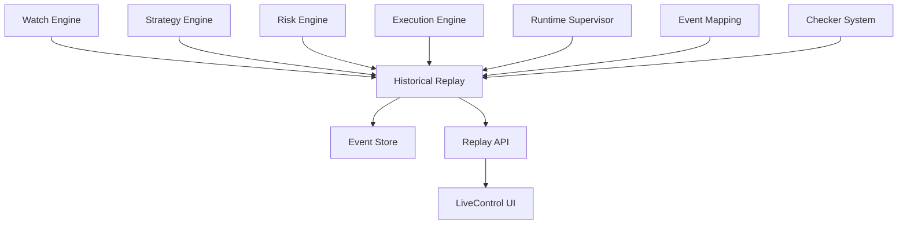

# Historical Replay & Event History System

**Versión 1.0 - Especificación Técnica para Implementación**

**PolyLiquidity Desk – Auditoría, Diagnóstico y Reproducción de Escenarios**

---

## 1. Propósito del Módulo

El módulo de **Historical Replay** permite:

1. **Registrar la historia completa** de eventos, decisiones, métricas y fills
2. **Consultar el historial completo** para auditorías o investigación
3. **Reconstruir el estado del sistema** en un momento pasado
4. **Reproducir paso a paso** cómo el bot actuó ante un evento real
5. **Comparar la decisión tomada** con decisiones que tomaría una versión nueva
6. **Detectar fallos de lógica**, latencia, fallos de checkers o errores externos

**En definitiva**, convierte el sistema en un motor trazable, auditable y reproducible.

### Importancia Crítica

**Sin este módulo**, un bot serio que gestiona >100k EUR sería una caja negra peligrosa.

**Con él**, tienes un sistema financiero profesional totalmente trazable.

---

## 2. Posición en la Arquitectura

### 2.1. Flujo de Registro



### 2.2. Responsabilidades

**El Historical Replay:**
- ✅ Registra todos los eventos críticos del sistema
- ✅ Almacena historial completo en Event Store
- ✅ Proporciona API para consultar y reproducir eventos
- ✅ Permite comparación de versiones de estrategia
- ✅ Facilita auditoría y debugging

**El Historical Replay NO:**
- ❌ Interfiere con el flujo operativo
- ❌ Bloquea decisiones del sistema
- ❌ Es 100% pasivo (solo observa y registra)

---

## 3. ¿Qué se Registra?

El sistema genera **event logs estructurados** con timestamp preciso.

**Se registra absolutamente TODO lo crítico:**

### 3.1. Eventos del Watch Engine

```json
{
  "type": "watcher_event_state",
  "event_id": "sports:nba:401585236",
  "state": "FINISHED_CONFIRMED",
  "confidence": 0.97,
  "sources": {
    "espn": "FINISHED",
    "flashscore": "FINISHED"
  },
  "timestamp": "2025-01-25T20:15:30.123Z",
  "trace_id": "b3c1e7fc-2a5f-4b7a-9c90-1b..."
}
```

### 3.2. Intents Generados por Strategy

```json
{
  "type": "strategy_intent_created",
  "market_id": "pm555",
  "event_state": "FINISHED_CONFIRMED",
  "target_price": 0.979,
  "size": 5000,
  "reason": "event_finished_and_price_threshold_met",
  "timestamp": "2025-01-25T20:15:30.200Z",
  "trace_id": "b3c1e7fc-2a5f-4b7a-9c90-1b..."
}
```

### 3.3. Decisiones del Risk Engine

```json
{
  "type": "risk_decision",
  "market_id": "pm555",
  "approved": true,
  "final_size": 5000,
  "risk_context": {
    "exposure_market": 5000,
    "exposure_global": 25000,
    "latency_mode": "GREEN"
  },
  "timestamp": "2025-01-25T20:15:30.250Z",
  "trace_id": "b3c1e7fc-2a5f-4b7a-9c90-1b..."
}
```

### 3.4. Eventos del Execution Engine

**Incluye:**
- Órdenes enviadas
- Órdenes rechazadas
- Fills recibidos
- Cancelaciones
- Errores en ejecución

**Ejemplo:**
```json
{
  "type": "execution_order_filled",
  "order_id": "order_xyz",
  "market_id": "pm555",
  "fills": [
    { "size": 3000, "price": 0.979, "timestamp": "2025-01-25T20:16:00.123Z" }
  ],
  "timestamp": "2025-01-25T20:16:00.123Z",
  "trace_id": "b3c1e7fc-2a5f-4b7a-9c90-1b..."
}
```

### 3.5. Cambios de Estado del Runtime Supervisor

```json
{
  "type": "runtime_mode_changed",
  "from": "GREEN",
  "to": "RED",
  "reason": "execution_errors_exceeded_threshold",
  "timestamp": "2025-01-25T20:15:30.300Z",
  "trace_id": "b3c1e7fc-2a5f-4b7a-9c90-1b..."
}
```

### 3.6. Métricas Críticas

**Cada X segundos:**
```json
{
  "type": "metrics_snapshot",
  "exposure_total": 32000,
  "latency_p95": 44,
  "errors_last_60s": 1,
  "watchers_active": 12,
  "runtime_mode": "GREEN",
  "timestamp": "2025-01-25T20:15:30.000Z"
}
```

### 3.7. Eventos de Event Mapping

```json
{
  "type": "event_mapping_created",
  "market_id": "pm555",
  "event_id": "sports:nba:401585236",
  "confidence": 0.94,
  "mapper": "sports",
  "timestamp": "2025-01-25T20:00:00.000Z",
  "trace_id": "b3c1e7fc-2a5f-4b7a-9c90-1b..."
}
```

### 3.8. Resultados de Checkers

```json
{
  "type": "checker_result",
  "checker_id": "espn",
  "event_id": "sports:nba:401585236",
  "result": "FINISHED",
  "confidence": 0.95,
  "latency_ms": 340,
  "timestamp": "2025-01-25T20:15:30.100Z",
  "trace_id": "b3c1e7fc-2a5f-4b7a-9c90-1b..."
}
```

---

## 4. Índice de Tipos de Eventos

Los eventos se clasifican y etiquetan sistemáticamente:

| Categoría | Prefix en type | Ejemplos |
|-----------|----------------|----------|
| **Watch Events** | `watcher_*` | `watcher_event_state`, `watcher_started`, `watcher_stopped` |
| **Event Mapping** | `event_mapping_*` | `event_mapping_created`, `event_mapping_updated` |
| **Checker Outputs** | `checker_*` | `checker_result`, `checker_error`, `checker_timeout` |
| **Strategy** | `strategy_*` | `strategy_intent_created`, `strategy_intent_rejected` |
| **Risk Engine** | `risk_*` | `risk_decision`, `risk_fail_safe_triggered` |
| **Execution** | `execution_*` | `execution_order_submitted`, `execution_order_filled` |
| **Runtime Supervisor** | `runtime_*` | `runtime_mode_changed`, `runtime_circuit_opened` |
| **System Metrics** | `metrics_*` | `metrics_snapshot`, `metrics_latency_update` |

**Esto facilita búsqueda, filtrado y análisis.**

---

## 5. Estructura del Storage

El sistema puede guardar los logs en múltiples formatos.

### 5.1. Base de Datos Ligera (SQLite)

**Ideal para MVP:**
- ✅ Fácil de transportar
- ✅ Fácil de consultar
- ✅ Rápida
- ✅ Relacional
- ✅ Permite índices eficientes

**Esquema:**
```sql
CREATE TABLE event_logs (
    id INTEGER PRIMARY KEY AUTOINCREMENT,
    type TEXT NOT NULL,
    timestamp TEXT NOT NULL,
    trace_id TEXT,
    event_data JSON NOT NULL,
    created_at TEXT NOT NULL
);

CREATE INDEX idx_type ON event_logs(type);
CREATE INDEX idx_timestamp ON event_logs(timestamp);
CREATE INDEX idx_trace_id ON event_logs(trace_id);
```

### 5.2. Archivo Append-Only (*.jsonl)

**Para volúmenes grandes:**
- ✅ Cada línea es un JSON
- ✅ Muy eficiente en escritura
- ✅ Se puede comprimir
- ✅ Ideal para análisis offline

**Formato:**
```jsonl
{"type":"strategy_intent_created","market_id":"pm555",...}
{"type":"execution_order_filled","order_id":"order_xyz",...}
{"type":"watcher_event_state","event_id":"sports:nba:401585236",...}
```

### 5.3. EventStore Híbrido (Opcional)

**Permite replay extremadamente rápido:**
- Base de datos para consultas rápidas
- Archivos comprimidos para almacenamiento a largo plazo
- Índices en memoria para búsquedas frecuentes

---

## 6. API de Replay

### 6.1. Obtener el Historial Completo de un Mercado

**Endpoint:**
```http
GET /history/market/:market_id
```

**Devuelve:**
- Estados del evento
- Decisiones de strategy
- Decisiones de risk
- Órdenes enviadas
- Fills
- Latencia real durante esos pasos

**Ejemplo de respuesta:**
```json
{
  "market_id": "pm555",
  "events": [
    {
      "type": "watcher_event_state",
      "state": "FINISHED_CONFIRMED",
      "timestamp": "2025-01-25T20:15:30.123Z"
    }
  ],
  "intents": [
    {
      "type": "strategy_intent_created",
      "target_price": 0.979,
      "size": 5000,
      "timestamp": "2025-01-25T20:15:30.200Z"
    }
  ],
  "risk": [
    {
      "type": "risk_decision",
      "approved": true,
      "final_size": 5000,
      "timestamp": "2025-01-25T20:15:30.250Z"
    }
  ],
  "execution": [
    {
      "type": "execution_order_submitted",
      "order_id": "order_xyz",
      "timestamp": "2025-01-25T20:15:30.300Z"
    },
    {
      "type": "execution_order_filled",
      "fills": [{"size": 3000, "price": 0.979}],
      "timestamp": "2025-01-25T20:16:00.123Z"
    }
  ],
  "runtime_updates": [
    {
      "type": "runtime_mode_changed",
      "from": "GREEN",
      "to": "GREEN",
      "timestamp": "2025-01-25T20:15:30.000Z"
    }
  ]
}
```

### 6.2. Obtener el Historial de un Evento Externo

**Endpoint:**
```http
GET /history/event/:event_id
```

**Muy útil cuando hay desincronización con el proveedor de datos deportivos.**

**Ejemplo de respuesta:**
```json
{
  "event_id": "sports:nba:401585236",
  "mappings": [
    {
      "type": "event_mapping_created",
      "market_id": "pm555",
      "confidence": 0.94,
      "timestamp": "2025-01-25T20:00:00.000Z"
    }
  ],
  "watcher_events": [
    {
      "type": "watcher_event_state",
      "state": "LIVE",
      "timestamp": "2025-01-25T20:00:00.000Z"
    },
    {
      "type": "watcher_event_state",
      "state": "FINISHED_CONFIRMED",
      "timestamp": "2025-01-25T20:15:30.123Z"
    }
  ],
  "checker_results": [
    {
      "type": "checker_result",
      "checker_id": "espn",
      "result": "FINISHED",
      "timestamp": "2025-01-25T20:15:30.100Z"
    }
  ]
}
```

### 6.3. Replay Completo Secuencial

**Endpoint:**
```http
GET /history/replay?market_id=pm555&format=timeline
```

**Devuelve un timeline ordenado:**
```json
[
  {
    "t": "00:00:01",
    "relative_time_ms": 1000,
    "type": "watcher_event_state",
    "event_id": "sports:nba:401585236",
    "state": "FINISHED_CONFIRMED",
    "timestamp": "2025-01-25T20:15:30.123Z"
  },
  {
    "t": "00:00:03",
    "relative_time_ms": 3000,
    "type": "strategy_intent_created",
    "market_id": "pm555",
    "target_price": 0.979,
    "size": 5000,
    "timestamp": "2025-01-25T20:15:30.200Z"
  },
  {
    "t": "00:00:03",
    "relative_time_ms": 3050,
    "type": "risk_decision",
    "market_id": "pm555",
    "approved": true,
    "timestamp": "2025-01-25T20:15:30.250Z"
  },
  {
    "t": "00:00:04",
    "relative_time_ms": 4000,
    "type": "execution_order_submitted",
    "order_id": "order_xyz",
    "timestamp": "2025-01-25T20:15:30.300Z"
  },
  {
    "t": "00:00:05",
    "relative_time_ms": 5000,
    "type": "execution_order_filled",
    "fills": [{"size": 3000, "price": 0.979}],
    "timestamp": "2025-01-25T20:16:00.123Z"
  }
]
```

### 6.4. Rewind a un Timestamp

**Endpoint:**
```http
GET /history/rewind?timestamp=2025-01-25T20:15:22Z
```

**Esto permite reconstruir:**
- Exposición total
- Estado del runtime supervisor
- Estado del event mapping
- Mercados activos

**Ejemplo de respuesta:**
```json
{
  "timestamp": "2025-01-25T20:15:22Z",
  "system_state": {
    "exposure_total": 25000,
    "runtime_mode": "GREEN",
    "active_markets": ["pm555", "pm123"],
    "watchers_active": 5
  },
  "event_mappings": {
    "pm555": {
      "event_id": "sports:nba:401585236",
      "confidence": 0.94
    }
  },
  "risk_state": {
    "market_exposure": {
      "pm555": 5000,
      "pm123": 20000
    },
    "global_exposure": 25000
  }
}
```

### 6.5. Replay Step-by-Step

**Endpoint:**
```http
GET /history/replay/step/:step_number?market_id=pm555
```

**Permite reproducir 1 evento por paso:**

**Ejemplo:**
```json
{
  "step": 1,
  "event": {
    "type": "watcher_event_state",
    "state": "FINISHED_CONFIRMED",
    "timestamp": "2025-01-25T20:15:30.123Z"
  },
  "system_state_at_step": {
    "exposure_total": 20000,
    "runtime_mode": "GREEN"
  }
}
```

---

## 7. Motor de Replay (Backend)

### 7.1. Event Store

**Clase principal:**
```python
class EventStore:
    """Almacén de eventos históricos."""
    
    def __init__(self, storage_type: str = "sqlite"):
        self.storage_type = storage_type
        self.db = None  # SQLite connection
        self.jsonl_file = None  # JSONL file handle
    
    async def store_event(self, event: Dict):
        """Almacena un evento."""
        # Validar evento
        # Guardar en DB
        # Guardar en JSONL (opcional)
        pass
    
    async def get_events(
        self,
        market_id: str = None,
        event_id: str = None,
        event_type: str = None,
        start_time: datetime = None,
        end_time: datetime = None
    ) -> List[Dict]:
        """Obtiene eventos filtrados."""
        pass
    
    async def get_timeline(
        self,
        market_id: str,
        start_time: datetime = None,
        end_time: datetime = None
    ) -> List[Dict]:
        """Obtiene timeline ordenado."""
        pass
```

### 7.2. Replay Engine

**Clase principal:**
```python
class ReplayEngine:
    """Motor de replay de eventos históricos."""
    
    def __init__(self, event_store: EventStore):
        self.event_store = event_store
    
    async def replay_market(
        self,
        market_id: str,
        start_time: datetime = None,
        end_time: datetime = None
    ) -> List[Dict]:
        """Reproduce eventos de un mercado."""
        events = await self.event_store.get_timeline(
            market_id=market_id,
            start_time=start_time,
            end_time=end_time
        )
        return events
    
    async def replay_step_by_step(
        self,
        market_id: str,
        step: int
    ) -> Dict:
        """Reproduce un paso específico."""
        events = await self.event_store.get_timeline(market_id=market_id)
        if step < len(events):
            return events[step]
        return None
    
    async def rewind_to_timestamp(
        self,
        timestamp: datetime
    ) -> Dict:
        """Reconstruye estado del sistema en un timestamp."""
        # Obtener todos los eventos hasta timestamp
        # Reconstruir estado
        pass
```

---

## 8. Comparación de Versiones de Estrategia (A/B Testing de Replay)

**Una funcionalidad clave:**

### 8.1. Flujo de Comparación

1. **Se ejecuta el replay real del histórico**
2. **Se pide a la versión nueva de Strategy que tome decisiones** para esos eventos históricos
3. **Se comparan:**
   - Intents generados
   - Tamaños propuestos
   - Precios objetivo
   - Trading realizado
   - PnL simulado

**Esto te permite mejorar el bot sin riesgo ni coste real.**

### 8.2. Implementación

```python
class StrategyComparator:
    """Comparador de versiones de estrategia."""
    
    def __init__(self, event_store: EventStore):
        self.event_store = event_store
    
    async def compare_strategies(
        self,
        market_id: str,
        original_strategy: Strategy,
        new_strategy: Strategy
    ) -> Dict:
        """Compara dos versiones de estrategia."""
        # 1. Obtener eventos históricos
        events = await self.event_store.get_timeline(market_id=market_id)
        
        # 2. Ejecutar replay con estrategia original
        original_intents = []
        for event in events:
            if event["type"] == "watcher_event_state":
                intent = original_strategy.generate_intent(event)
                original_intents.append(intent)
        
        # 3. Ejecutar replay con nueva estrategia
        new_intents = []
        for event in events:
            if event["type"] == "watcher_event_state":
                intent = new_strategy.generate_intent(event)
                new_intents.append(intent)
        
        # 4. Comparar resultados
        comparison = {
            "original_intents": original_intents,
            "new_intents": new_intents,
            "differences": self._calculate_differences(
                original_intents,
                new_intents
            ),
            "simulated_pnl_original": self._simulate_pnl(original_intents),
            "simulated_pnl_new": self._simulate_pnl(new_intents)
        }
        
        return comparison
```

### 8.3. Endpoint de Comparación

**Endpoint:**
```http
POST /history/compare-strategies
```

**Request:**
```json
{
  "market_id": "pm555",
  "original_strategy_version": "v1.0",
  "new_strategy_version": "v2.0",
  "start_time": "2025-01-25T20:00:00Z",
  "end_time": "2025-01-25T21:00:00Z"
}
```

**Response:**
```json
{
  "comparison": {
    "original_intents_count": 5,
    "new_intents_count": 7,
    "original_total_size": 25000,
    "new_total_size": 30000,
    "simulated_pnl_original": 1500,
    "simulated_pnl_new": 2100,
    "improvement": 600
  },
  "differences": [
    {
      "event_timestamp": "2025-01-25T20:15:30.123Z",
      "original": {"size": 5000, "target_price": 0.979},
      "new": {"size": 6000, "target_price": 0.978},
      "reason": "New strategy more aggressive"
    }
  ]
}
```

---

## 9. Integración con el Live Control

El Historical Replay puede mostrarse dentro del Dashboard.

### 9.1. Funcionalidades en UI

- **Reproductor tipo timeline:** Reproducir eventos paso a paso
- **Vista dual "decisión original" vs "decisión nueva":** Comparar estrategias
- **Heatmaps de latencia:** Visualizar latencia durante eventos
- **Árboles de decisión:** Ver cómo se tomaron las decisiones

### 9.2. Cargar Sesiones Pasadas

**Flujo:**
```
LiveControl → Replay Mode → load(session_id)
```

**Ejemplo de UI:**
```typescript
// En LiveControl
const loadReplay = async (sessionId: string) => {
  const replay = await api.get(`/history/replay?session_id=${sessionId}`);
  // Mostrar timeline
  // Permitir reproducir paso a paso
  // Mostrar comparación de estrategias
};
```

---

## 10. Trazabilidad Completa

El sistema garantiza trazabilidad:

**Cada decisión del bot es reproducible usando:**
- El estado del event mapping
- Las lecturas de checkers
- Los precios del mercado
- El runtime_mode
- Los límites de riesgo

**Esto significa:**
> Puedes explicar exactamente por qué el bot hizo algo, incluso meses después.

### 10.1. Cadena de Trazabilidad

```
trace_id (generado en Strategy)
  └─> intent_id (OrderIntent)
      └─> signed_order_id (SignedOrder)
          └─> execution_id (ExecutionRecord)
              └─> polymarket_order_id (de Polymarket)
                  └─> order_state_history_id (OrderStateHistory)
```

**Cada evento incluye:**
- `trace_id`: UUID único para correlación
- `timestamp`: Timestamp preciso
- `component`: Componente que generó el evento
- `event_type`: Tipo de evento
- `metadata`: Datos adicionales

---

## 11. Ejemplo Completo de Replay

### 11.1. Evento Real

**Lakers vs Warriors:**
- Evento termina a las 02:30
- Bot compra a 0.979
- Mercado se resuelve a 1.00

### 11.2. Replay

**Timeline:**
1. **00:00:00** - Watcher detecta FINISHED_CONFIRMED
2. **00:00:03** - Strategy crea intent (target_price: 0.979, size: 5000)
3. **00:00:03** - Risk aprueba (final_size: 5000)
4. **00:00:04** - Execution envía orden
5. **00:00:05** - Polymarket la llena parcialmente (3000 @ 0.979)
6. **00:00:10** - Mercado se resuelve a 1.00
7. **00:00:10** - P&L esperado se calcula (3000 * (1.00 - 0.979) = 63)

**Puedes reproducirlo como si fuera un vídeo.**

---

## 12. Estructura de Archivos a Implementar

```
backend/app/
├── core/
│   └── historical_replay/
│       ├── __init__.py
│       ├── event_store.py          # Event Store
│       ├── replay_engine.py        # Replay Engine
│       └── strategy_comparator.py  # Strategy Comparator
│
├── api/
│   └── history.py                  # History API endpoints
│
└── models/
    └── event_log.py                 # Event Log model
```

### 12.1. Módulos Principales

**`app/core/historical_replay/event_store.py`:**
- Clase `EventStore`
- Métodos:
  - `store_event(event: Dict)`
  - `get_events(...)`
  - `get_timeline(...)`
  - `rewind_to_timestamp(...)`

**`app/core/historical_replay/replay_engine.py`:**
- Clase `ReplayEngine`
- Métodos:
  - `replay_market(...)`
  - `replay_step_by_step(...)`
  - `rewind_to_timestamp(...)`

**`app/api/history.py`:**
- Endpoints REST:
  - `GET /history/market/:market_id`
  - `GET /history/event/:event_id`
  - `GET /history/replay`
  - `GET /history/rewind`
  - `GET /history/replay/step/:step`
  - `POST /history/compare-strategies`

---

## 13. Integración con Otros Módulos

### 13.1. Watch Engine

**Flujo:**
```
Watch Engine → Event Bus → Historical Replay → Event Store
```

### 13.2. Strategy Engine

**Flujo:**
```
Strategy Engine → Event Bus → Historical Replay → Event Store
```

### 13.3. Risk Engine

**Flujo:**
```
Risk Engine → Event Bus → Historical Replay → Event Store
```

### 13.4. Execution Engine

**Flujo:**
```
Execution Engine → Event Bus → Historical Replay → Event Store
```

### 13.5. LiveControl

**Flujo:**
```
Historical Replay → Replay API → LiveControl → UI
```

---

## 14. Resumen

El **Historical Replay System** convierte el backend en:

- ✅ **Un sistema auditable profesional:** Cada decisión es trazable
- ✅ **Un entorno de investigación y análisis:** Permite analizar decisiones pasadas
- ✅ **Una herramienta de debugging avanzada:** Reproduce eventos paso a paso
- ✅ **Un simulador realista basado en datos concretos:** Usa datos reales
- ✅ **Un motor de backtesting sobre datos reales:** Permite probar nuevas estrategias sin riesgo

**Permite:**
- Detectar errores
- Explicar decisiones
- Justificar trades
- Mejorar el sistema con seguridad
- Entrenar versiones nuevas del bot

**Sin este módulo**, un bot serio que gestiona >100k EUR sería una caja negra peligrosa.

**Con él**, tienes un sistema financiero profesional totalmente trazable.

---

## 15. Próximos Pasos

1. **Implementar Event Store** con SQLite y JSONL
2. **Implementar Replay Engine** con métodos de replay
3. **Implementar Strategy Comparator** para A/B testing
4. **Crear API endpoints** para consultar historial
5. **Integrar con módulos** para capturar eventos
6. **Implementar logging estructurado** con trace_id
7. **Crear UI en LiveControl** para visualizar replay
8. **Implementar compresión** de logs antiguos
9. **Crear tests unitarios** para cada componente
10. **Crear tests de integración** para flujo completo
11. **Configurar rotación de logs** (archivos antiguos)
12. **Implementar búsqueda avanzada** por múltiples criterios
13. **Crear dashboard de métricas** históricas
14. **Documentar formato de eventos** para desarrolladores
