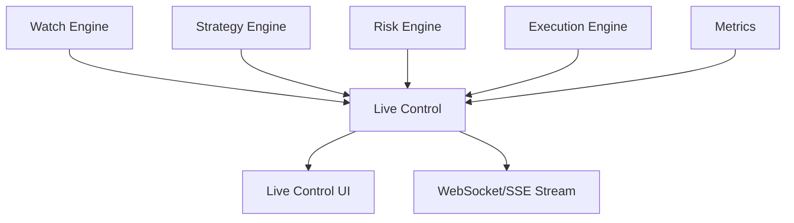

# Live Control – Visualización y Supervisión en Tiempo Real del Sistema

**Versión 1.0 - Especificación Técnica para Implementación**

**PolyLiquidity Desk – Panel en vivo para operación, monitoreo y debugging**

---

## 1. Propósito del Módulo

El **Live Control** es el módulo responsable de proporcionar una **vista en tiempo real** del comportamiento del bot:

1. **Qué eventos está vigilando** el sistema
2. **Qué mercados están asociados** a cada evento
3. **Estados LIVE/FINISHED reales** según los checkers
4. **Estados de watchers** (activo, detenido, error)
5. **Señales de estrategia** (intents generados)
6. **Decisiones del Risk Engine** (aprobaciones/rechazos)
7. **Órdenes enviadas, fills y ejecuciones**
8. **Latencia del sistema y health checks**

### Importancia Crítica

**Es la herramienta principal para:**
- ✅ **Operar el bot** en tiempo real
- ✅ **Supervisar comportamiento** del sistema
- ✅ **Debuggear eventos en vivo** cuando algo falla
- ✅ **Identificar fallos** antes de que causen problemas
- ✅ **Validar decisiones** del sistema
- ✅ **Auditar el sistema** para cumplimiento

**El Live Control no es opcional:**  
> Es la herramienta de control de misión del bot.

---

## 2. Posición en la Arquitectura

### 2.1. Flujo de Observación



### 2.2. Responsabilidades

**El Live Control:**
- ✅ Observa y muestra estado del sistema
- ✅ Proporciona vista en tiempo real
- ✅ Permite debugging y auditoría
- ✅ Muestra métricas y health checks

**El Live Control NO:**
- ❌ Forma parte del pipeline operativo del bot
- ❌ Influye en decisiones del bot
- ❌ Bloquea operaciones del sistema
- ❌ Es 100% pasivo (solo observa)

**Importante:**  
El Live Control **NUNCA influye en decisiones del bot**. Es 100% pasivo.

---

## 3. Estructura del Live Control

El Live Control se compone de:

1. **Live Control API Layer (backend)** - Endpoints REST y SSE
2. **WebSocket/SSE Layer (streaming)** - Actualizaciones en tiempo real
3. **Live Control State Store (in-memory)** - Estado agregado
4. **UI LiveControlPage (frontend)** - Interfaz de usuario

---

## 4. Live Control API (Backend)

La API expone endpoints REST + Server-Sent Events (SSE).

### 4.1. REST Endpoints

#### `GET /live/events`

**Devuelve todos los eventos actualmente monitoreados:**

```json
[
  {
    "event_id": "sports:nba:401585236",
    "event_type": "sports",
    "status": "LIVE",
    "confidence": 0.94,
    "watcher_status": "active",
    "markets": ["pm123", "pm555"],
    "sources": {
      "espn": "LIVE",
      "flashscore": "LIVE"
    },
    "last_update": "2025-01-25T20:15:30.123Z"
  }
]
```

#### `GET /live/markets`

**Devuelve todos los mercados activos:**

```json
[
  {
    "market_id": "pm555",
    "event_id": "sports:nba:401585236",
    "state": "FINISHED_CONFIRMED",
    "best_ask": 0.98,
    "best_bid": 0.97,
    "exposure": 5000,
    "last_intent": {
      "target_price": 0.979,
      "size": 5000,
      "status": "approved"
    }
  }
]
```

#### `GET /live/watchers`

**Devuelve estado detallado de watchers:**

```json
[
  {
    "event_id": "sports:nba:401585236",
    "event_name": "Lakers vs Warriors",
    "market_id": "pm555",
    "status": "active",
    "checks_per_minute": 30,
    "last_check": "2025-01-25T20:15:22.123Z",
    "sources": {
      "espn": "FINISHED",
      "flashscore": "FINISHED"
    },
    "last_polymarket_response": {...},
    "last_sports_response": {...},
    "estimated_remaining_seconds": 300
  }
]
```

#### `GET /live/execution`

**Flujo reciente de órdenes:**

```json
[
  {
    "order_id": "order_xyz",
    "market_id": "pm555",
    "state": "filled",
    "fills": [
      { "size": 3000, "price": 0.979, "timestamp": "..." }
    ],
    "avg_price": 0.979,
    "timestamp": "2025-01-25T20:16:00.123Z"
  }
]
```

#### `POST /live/watchers/start`

**Inicia un nuevo watcher:**

```json
{
  "event_id": "sports:nba:401585236",
  "event_name": "Lakers vs Warriors",
  "market_id": "pm555"
}
```

#### `POST /live/watchers/{event_id}/stop`

**Detiene un watcher:**

```json
{
  "status": "stopped",
  "event_id": "sports:nba:401585236"
}
```

### 4.2. Server-Sent Events (SSE) Stream

**Ruta:**
```
GET /live/watchers/stream?token=<auth_token>
```

**El Live Control envía actualizaciones en tiempo real mediante SSE:**

**Tipos principales de mensajes:**

#### `event_update`
```json
{
  "type": "event_update",
  "event_id": "sports:nba:401585236",
  "status": "FINISHED",
  "confidence": 0.97,
  "sources": {
    "espn": "FINISHED",
    "flashscore": "FINISHED"
  },
  "timestamp": "2025-01-25T20:15:30.123Z"
}
```

#### `market_update`
```json
{
  "type": "market_update",
  "market_id": "pm555",
  "state": "FINISHED_CONFIRMED",
  "best_ask": 0.98,
  "best_bid": 0.96,
  "timestamp": "2025-01-25T20:15:30.123Z"
}
```

#### `strategy_intent`
```json
{
  "type": "strategy_intent",
  "market_id": "pm555",
  "intent": {
    "target_price": 0.979,
    "size": 5000
  },
  "timestamp": "2025-01-25T20:15:30.123Z"
}
```

#### `risk_decision`
```json
{
  "type": "risk_decision",
  "market_id": "pm555",
  "approved": true,
  "final_size": 5000,
  "reason": "approved",
  "timestamp": "2025-01-25T20:15:30.123Z"
}
```

#### `execution_update`
```json
{
  "type": "execution_update",
  "order_id": "order_xyz",
  "status": "fill",
  "size": 3000,
  "price": 0.979,
  "timestamp": "2025-01-25T20:16:00.123Z"
}
```

#### `latency_update`
```json
{
  "type": "latency_update",
  "mode": "GREEN",
  "latency_ms": 32,
  "timestamp": "2025-01-25T20:15:30.123Z"
}
```

### 4.3. Implementación SSE

```python
@router.get("/watchers/stream")
async def stream_watchers(token: str = Query(...)):
    """Server-Sent Events stream para actualizaciones en tiempo real."""
    # Autenticar usuario
    user = await authenticate_sse_user(token)
    
    async def event_generator():
        """Genera eventos SSE."""
        while True:
            # Obtener estado actual
            watchers = await watcher_manager.get_watchers()
            events = await get_recent_events()
            markets = await get_active_markets()
            
            # Enviar actualización
            data = {
                "watchers": watchers,
                "events": events,
                "markets": markets,
                "timestamp": datetime.utcnow().isoformat()
            }
            
            yield f"data: {json.dumps(data)}\n\n"
            
            # Esperar 2 segundos antes de siguiente actualización
            await asyncio.sleep(2.0)
    
    return StreamingResponse(
        event_generator(),
        media_type="text/event-stream",
        headers={
            "Cache-Control": "no-cache",
            "Connection": "keep-alive",
            "X-Accel-Buffering": "no"
        }
    )
```

---

## 5. Estado Interno – LiveControlStore

El Live Control mantiene un estado en memoria agregado:

```python
class LiveControlStore:
    """Estado agregado del Live Control."""
    events: Dict[str, EventState] = {}      # Estados de eventos
    markets: Dict[str, MarketState] = {}   # Estados de mercados
    watchers: Dict[str, WatcherState] = {} # Estados de watchers
    orders: Dict[str, OrderState] = {}     # Estados de órdenes
    latency: LatencyState = None           # Estado de latencia
    system_health: SystemHealth = None     # Health del sistema
```

**Este estado se actualiza mediante:**
- Eventos del Watch Engine
- Eventos del Strategy Engine
- Eventos del Risk Engine
- Eventos del Execution Engine
- Un Metrics sampler periódico

**Ejemplo de estado:**
```json
{
  "events": {
    "sports:nba:401585236": {
      "status": "FINISHED",
      "confidence": 0.97,
      "last_update": "2025-01-25T20:15:30.123Z"
    }
  },
  "markets": {
    "pm555": {
      "state": "FINISHED_CONFIRMED",
      "best_ask": 0.98,
      "exposure": 5000
    }
  },
  "watchers": {
    "sports:nba:401585236": {
      "status": "active",
      "checks_per_minute": 30
    }
  },
  "orders": {
    "order_xyz": {
      "status": "filled",
      "avg_price": 0.979
    }
  },
  "latency": {
    "mode": "GREEN",
    "latency_ms": 32
  }
}
```

---

## 6. Vista en el Dashboard (UI)

El dashboard `LiveControlPage` debe mostrar múltiples vistas.

### 6.1. Vista de Eventos Activos

**Tabla:**
| Event ID | Status | Confidence | Checkers | Markets Linked | Last Update |
|----------|--------|------------|----------|----------------|-------------|
| `sports:nba:401585236` | FINISHED | 0.97 | ESPN/FScore | pm555, pm123 | 20:31:12 |

**Características:**
- Ordenable por columna
- Filtrable por estado
- Indicadores visuales de riesgo
- Enlaces a detalles

### 6.2. Vista de Mercados Activos

**Tabla:**
| Market | Price | Event State | Exposure | Last Intent | Status |
|--------|-------|-------------|----------|-------------|--------|
| `pm555` | 0.98 | FINISHED_CONFIRMED | 5000 | 0.979/5000 | Approved |

**Características:**
- Precios en tiempo real
- Estados de eventos sincronizados
- Exposición actual
- Historial de intents

### 6.3. Watchers (por tipo)

**Cada watcher muestra:**
- **Estado:** `active`, `idle`, `error`
- **Eventos asignados:** Lista de eventos monitoreados
- **Frecuencia de checks:** Checks por minuto
- **Resultados de checkers:** Estado de cada checker
- **Latencia por checker:** Tiempo de respuesta
- **Logs recientes:** Últimos logs del watcher

**Ejemplo:**
```json
{
  "watcher_id": "sports:nba:401585236",
  "status": "active",
  "event_type": "sports",
  "events_assigned": ["sports:nba:401585236"],
  "checks_per_minute": 30,
  "checker_results": {
    "espn": {
      "status": "FINISHED",
      "latency_ms": 340,
      "last_check": "2025-01-25T20:15:30.123Z"
    },
    "flashscore": {
      "status": "FINISHED",
      "latency_ms": 280,
      "last_check": "2025-01-25T20:15:30.123Z"
    }
  },
  "recent_logs": [...]
}
```

### 6.4. Stream de Decisiones

**Una consola/terminal en vivo mostrando decisiones:**

```
[20:15:30] [Strategy] Intent created for pm555 @ 0.979 size=5000
[20:15:30] [Risk] Approved intent pm555 size=5000
[20:15:30] [Execution] Order order_xyz submitted
[20:16:00] [Execution] order_xyz fill 3000 @ 0.979
[20:16:30] [Execution] order_xyz fill 2000 @ 0.979 (complete)
[20:17:00] [Event] sports:nba:401585236 FINISHED_CONFIRMED
```

**Características:**
- Tiempo real con timestamps
- Filtrable por componente
- Búsqueda de texto
- Exportable a logs

**Esta vista es crítica para debugging en tiempo real.**

### 6.5. Estado Global del Sistema

**Panel resumen con métricas clave:**

| Métrica | Valor | Estado |
|---------|-------|--------|
| **Latencia del sistema** | 32ms | 🟢 GREEN |
| **Exposición total** | 25,000 USDC | 🟢 OK |
| **Mercados activos** | 5 | 🟢 OK |
| **Último fill** | 2,000 @ 0.979 | 🟢 OK |
| **Último error** | None | 🟢 OK |
| **Último evento resuelto** | sports:nba:401585236 | 🟢 OK |
| **Estado del circuito** | CLOSED | 🟢 OK |
| **Estado del trading** | ACTIVE | 🟢 OK |

**Características:**
- Indicadores visuales (🟢/🟡/🔴)
- Actualización en tiempo real
- Alertas cuando métricas están fuera de rango

---

## 7. Integración con el Backend

El Live Control escucha eventos emitidos por todos los módulos.

### 7.1. Watch Engine

**Eventos:**
- `watcher_state_change` - Cambio de estado de watcher
- `event_state_change` - Cambio de estado de evento
- `checker_result` - Resultado de checker

**Ejemplo:**
```python
# En Watch Engine
live_control.emit("event_state_change", {
    "event_id": "sports:nba:401585236",
    "old_state": "LIVE",
    "new_state": "FINISHED_CONFIRMED",
    "confidence": 0.97
})
```

### 7.2. Strategy Engine

**Eventos:**
- `intent_created` - Nuevo intent creado

**Ejemplo:**
```python
# En Strategy Engine
live_control.emit("intent_created", {
    "market_id": "pm555",
    "target_price": 0.979,
    "size": 5000,
    "reason": "event_finished_confirmed"
})
```

### 7.3. Risk Engine

**Eventos:**
- `intent_approved` - Intent aprobado
- `intent_rejected` - Intent rechazado

**Ejemplo:**
```python
# En Risk Engine
live_control.emit("intent_approved", {
    "market_id": "pm555",
    "final_size": 5000,
    "adjustments": {}
})
```

### 7.4. Execution Engine

**Eventos:**
- `order_submitted` - Orden enviada
- `order_filled` - Orden ejecutada
- `order_cancelled` - Orden cancelada
- `execution_error` - Error en ejecución

**Ejemplo:**
```python
# En Execution Engine
live_control.emit("order_filled", {
    "order_id": "order_xyz",
    "fill_size": 3000,
    "fill_price": 0.979
})
```

### 7.5. Procesamiento de Eventos

**Cada evento se convierte en:**
1. **Actualización del LiveControlStore** (en memoria)
2. **Mensaje WebSocket/SSE** hacia la UI

**Implementación:**
```python
class LiveControlEventBus:
    """Event bus para Live Control."""
    
    def __init__(self):
        self.store = LiveControlStore()
        self.subscribers: List[Callable] = []
    
    def emit(self, event_type: str, data: Dict):
        """Emite un evento."""
        # 1. Actualizar store
        self.store.update(event_type, data)
        
        # 2. Notificar suscriptores (SSE streams)
        for subscriber in self.subscribers:
            subscriber(event_type, data)
    
    def subscribe(self, callback: Callable):
        """Suscribe un callback a eventos."""
        self.subscribers.append(callback)
```

---

## 8. Performance y Escalabilidad

### 8.1. Diseño No Bloqueante

**El Live Control:**
- ✅ Se ejecuta fuera del pipeline decisional (no bloquea nada)
- ✅ Usa lock-free atomic updates para el store
- ✅ Soporta cientos de mercados simultáneos
- ✅ Envía deltas incrementales, no snapshots completos
- ✅ Se auto-limita a N mensajes/segundo para la UI

### 8.2. Optimizaciones

**Throttling de mensajes:**
```python
class MessageThrottler:
    """Throttle de mensajes para UI."""
    
    def __init__(self, max_messages_per_second: int = 10):
        self.max_messages = max_messages_per_second
        self.message_queue = []
        self.last_send = time.time()
    
    async def send(self, message: Dict):
        """Envía mensaje con throttling."""
        self.message_queue.append(message)
        
        now = time.time()
        if now - self.last_send >= 1.0 / self.max_messages:
            # Enviar batch de mensajes
            batch = self.message_queue
            self.message_queue = []
            self.last_send = now
            return batch
        return None
```

**Deltas incrementales:**
```python
# En lugar de enviar todo el estado:
# ❌ {"watchers": [...all watchers...]}

# Enviar solo cambios:
# ✅ {"type": "watcher_update", "event_id": "...", "status": "FINISHED"}
```

---

## 9. Modo Debug Avanzado

El Live Control permite habilitar modos de debug avanzados.

### 9.1. Raw Feeds

**Permite habilitar:**
- `raw-checker-feed` - Feed crudo de checkers
- `raw-market-feed` - Feed crudo de mercados
- `raw-intent-feed` - Feed crudo de intents

**Endpoint:**
```http
GET /live/debug/raw-feed?type=checker&event_id=sports:nba:401585236
```

### 9.2. Replay de Eventos Históricos

**Permite reproducir eventos históricos:**

```http
GET /live/replay?event_id=sports:nba:401585236
```

**Devuelve:**
```json
{
  "event_id": "sports:nba:401585236",
  "timeline": [
    {
      "timestamp": "2025-01-25T20:00:00.000Z",
      "event": "watcher_started",
      "data": {...}
    },
    {
      "timestamp": "2025-01-25T20:15:30.123Z",
      "event": "event_state_change",
      "data": {
        "old_state": "LIVE",
        "new_state": "FINISHED_CONFIRMED"
      }
    },
    {
      "timestamp": "2025-01-25T20:15:30.200Z",
      "event": "intent_created",
      "data": {
        "target_price": 0.979,
        "size": 5000
      }
    }
  ]
}
```

**Ideal para entender por qué el bot tomó una decisión.**

---

## 10. Estructura de Archivos a Implementar

```
backend/app/
├── api/
│   └── live.py                    # Live Control API endpoints
│
├── core/
│   └── live_control/
│       ├── __init__.py
│       ├── store.py              # LiveControlStore
│       ├── event_bus.py          # Event bus para eventos
│       └── metrics_sampler.py    # Sampler de métricas
│
frontend/app/
└── livecontrol/
    └── page.tsx                   # LiveControlPage UI
```

### 10.1. Módulos Principales

**`app/api/live.py`:**
- Endpoints REST (`/live/events`, `/live/markets`, etc.)
- Endpoint SSE (`/live/watchers/stream`)
- Autenticación para SSE

**`app/core/live_control/store.py`:**
- Clase `LiveControlStore`
- Métodos de actualización
- Estado agregado

**`app/core/live_control/event_bus.py`:**
- Clase `LiveControlEventBus`
- Método `emit(event_type, data)`
- Suscripciones

**`frontend/app/livecontrol/page.tsx`:**
- Componente `LiveControlPage`
- Conexión SSE
- Tablas y visualizaciones
- Formularios de control

---

## 11. Integración con Otros Módulos

### 11.1. Watch Engine

**Flujo:**
```
Watch Engine → Event Bus → Live Control → UI
```

### 11.2. Strategy Engine

**Flujo:**
```
Strategy Engine → Event Bus → Live Control → UI
```

### 11.3. Risk Engine

**Flujo:**
```
Risk Engine → Event Bus → Live Control → UI
```

### 11.4. Execution Engine

**Flujo:**
```
Execution Engine → Event Bus → Live Control → UI
```

---

## 12. Resumen

El **Live Control** es:

- ✅ **Monitor en tiempo real** del estado del sistema
- ✅ **Visualizador de eventos y mercados** con actualizaciones en vivo
- ✅ **Trazador de decisiones** (strategy + risk + execution)
- ✅ **Health dashboard** con métricas clave
- ✅ **Debugger a nivel de producción** para análisis en vivo

**Es crítico para operar el bot con confianza y detectar:**
- Problemas de checkers
- Latencia real del sistema
- Oportunidades fallidas
- Watchers duplicados
- Fills inesperados
- Exposición incorrecta

**El Live Control no es opcional:**  
> Es la herramienta de control de misión del bot.

---

## 13. Próximos Pasos

1. **Implementar Live Control API** con endpoints REST y SSE
2. **Implementar LiveControlStore** con estado agregado
3. **Implementar Event Bus** para eventos de módulos
4. **Integrar con Watch Engine** para eventos de watchers
5. **Integrar con Strategy Engine** para intents
6. **Integrar con Risk Engine** para decisiones
7. **Integrar con Execution Engine** para órdenes
8. **Implementar UI LiveControlPage** con tablas y visualizaciones
9. **Implementar SSE stream** con autenticación
10. **Implementar modo debug** con raw feeds y replay
11. **Implementar throttling** de mensajes
12. **Crear tests unitarios** para cada componente
13. **Crear tests de integración** para flujo completo
14. **Configurar métricas y alertas** para monitoreo
