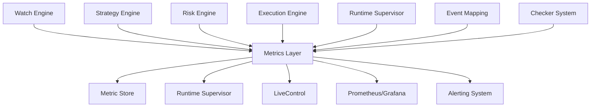

# Metrics & Observability Layer

**Versión 1.0 - Especificación Técnica para Implementación**

**PolyLiquidity Desk – Supervisión, Análisis y Alerta Temprana**

---

## 1. Propósito del Módulo

El **Metrics & Observability Layer** proporciona la infraestructura necesaria para:

1. **Monitorizar** el estado del sistema en tiempo real
2. **Registrar métricas históricas** de performance, riesgo y ejecución
3. **Detectar anomalías** antes de que causen pérdidas
4. **Alimentar el Runtime Supervisor** con datos de latencia y errores
5. **Alimentar el Live Control** con métricas visuales
6. **Exponer datos de observabilidad** para dashboards externos (Grafana, Prometheus, etc.)

**Este módulo convierte el bot en una plataforma operable al nivel de un sistema profesional de trading.**

### Importancia Crítica

**Sin métricas**, el bot sería una caja negra.

**Con métricas**, es una plataforma profesional operable.

---

## 2. Posición en la Arquitectura

### 2.1. Flujo de Métricas



### 2.2. Responsabilidades

**El Metrics & Observability Layer:**
- ✅ Recolecta métricas de todos los módulos
- ✅ Almacena métricas históricas
- ✅ Expone métricas vía API y streaming
- ✅ Detecta anomalías y dispara alertas
- ✅ Alimenta Runtime Supervisor y LiveControl

**El Metrics & Observability Layer NO:**
- ❌ Interfiere con el flujo operativo
- ❌ Bloquea decisiones del sistema
- ❌ Es 100% pasivo (solo observa y registra)

---

## 3. ¿Qué Métricas Se Registran?

Las métricas se dividen en 5 categorías principales.

### 3.1. Métricas de Sistema Interno

**Métricas:**
- Duración del tick principal (ms)
- CPU, RAM (opcional)
- Número de watchers activos
- Número de mercados activos
- Latencia del loop (p50, p95, p99)
- Latencia de procesamiento interno

**Ejemplo:**
```json
{
  "metric": "tick_duration_ms",
  "value": 42,
  "p50": 38,
  "p95": 65,
  "p99": 120,
  "timestamp": "2025-01-25T20:15:30.123Z"
}
```

### 3.2. Métricas del Watch Engine

**Métricas:**
- Latencia por evento: tiempo desde la consulta de checkers → actualización del estado
- Tiempo medio de llamada a cada checker
- Errores por checker
- Retrasos detectados en las APIs deportivas
- Número de eventos monitoreados

**Ejemplo:**
```json
{
  "metric": "checker_latency_ms",
  "checker": "espn",
  "p50": 95,
  "p95": 120,
  "p99": 180,
  "error_count": 2,
  "timestamp": "2025-01-25T20:15:30.123Z"
}
```

### 3.3. Métricas de Trading / Execution

**Métricas:**
- Tiempo desde intent → order sent
- Latencia de API de Polymarket Trading
- Latencia de respuesta por orden
- Ratio de fills parciales vs completos
- Fails por firma
- Errores de red
- Ratio de órdenes rechazadas
- Estado del circuito de trading

**Ejemplo:**
```json
{
  "metric": "execution_latency_ms",
  "p50": 120,
  "p90": 140,
  "p95": 190,
  "p99": 310,
  "rejection_rate": 0.05,
  "fill_rate": 0.85,
  "timestamp": "2025-01-25T20:15:30.123Z"
}
```

### 3.4. Métricas de Mercado y Riesgo

**Métricas:**
- Exposición total actual
- Exposición por mercado
- Número de mercados por encima del límite
- Márgenes y spreads típicos por mercado
- Intentos creados por Strategy
- Intentos aprobados vs rechazados por Risk Engine

**Ejemplo:**
```json
{
  "metric": "risk_exposure_total",
  "value": 32000,
  "market_exposure": {
    "pm555": 5000,
    "pm123": 27000
  },
  "intents_created": 15,
  "intents_approved": 12,
  "intents_rejected": 3,
  "approval_rate": 0.8,
  "timestamp": "2025-01-25T20:15:30.123Z"
}
```

### 3.5. Métricas del Runtime Supervisor

**Métricas:**
- Runtime Mode actual (GREEN/YELLOW/RED)
- Cambios de modo y razones
- Circuit breakers abiertos/cerrados
- Ventanas de errores

**Ejemplo:**
```json
{
  "metric": "runtime_mode",
  "value": "YELLOW",
  "reason": "latency_p95_above_threshold",
  "circuit_breakers": {
    "trading": "CLOSED",
    "checkers": "CLOSED"
  },
  "error_rate": 3.2,
  "timestamp": "2025-01-25T20:15:30.123Z"
}
```

---

## 4. Recolección de Métricas

El módulo se compone de tres piezas principales.

### 4.1. Metric Samplers

**Tareas periódicas que miden:**
- Latencia de componentes
- Contadores internos
- Estado del runtime

**Ejemplo loop cada 2 segundos:**
```python
async def metrics_collection_loop():
    """Loop de recolección de métricas."""
    while True:
        # Recolectar métricas
        await metrics.collect_tick_duration()
        await metrics.collect_checker_stats()
        await metrics.collect_execution_latency()
        await metrics.collect_risk_exposure()
        await metrics.collect_runtime_metrics()
        
        # Esperar 2 segundos
        await asyncio.sleep(2)
```

**Implementación:**
```python
class MetricSampler:
    """Sampler de métricas periódicas."""
    
    async def collect_tick_duration(self):
        """Recolecta duración del tick."""
        tick_duration = self._measure_tick_duration()
        await self._store_metric(
            "tick_duration_ms",
            tick_duration,
            labels={}
        )
    
    async def collect_checker_stats(self):
        """Recolecta estadísticas de checkers."""
        for checker_id in self.checkers:
            latency = await self._measure_checker_latency(checker_id)
            error_count = self._get_checker_errors(checker_id)
            
            await self._store_metric(
                "checker_latency_ms",
                latency,
                labels={"checker": checker_id}
            )
            
            await self._store_metric(
                "checker_errors",
                error_count,
                labels={"checker": checker_id}
            )
```

### 4.2. Event Hooks

**Cada módulo emite eventos que registran métricas operativas:**

| Módulo | Evento | Métrica |
|--------|--------|---------|
| **Strategy** | `intent_created` | `strategy_intents_total` |
| **Risk** | `intent_approved` | `risk_intents_approved` |
| **Risk** | `intent_rejected` | `risk_intents_rejected` |
| **Execution** | `order_filled` | `execution_orders_filled` |
| **Execution** | `order_rejected` | `execution_orders_rejected` |
| **Supervisor** | `runtime_mode_changed` | `runtime_mode` |
| **Watcher** | `event_state_change` | `watcher_state_changes` |

**Ejemplo:**
```python
# En Execution Engine
async def on_order_filled(order_id: str, fills: List[Fill]):
    """Hook cuando una orden se ejecuta."""
    # Registrar métrica
    await metrics.record_event(
        "execution_order_filled",
        {
            "order_id": order_id,
            "fills": fills,
            "total_size": sum(f.size for f in fills),
            "avg_price": sum(f.price * f.size for f in fills) / sum(f.size for f in fills)
        }
    )
```

**Ejemplo de métrica:**
```json
{
  "metric": "order_filled",
  "market_id": "pm555",
  "price": 0.979,
  "size": 3000,
  "timestamp": "2025-01-25T20:16:00.123Z"
}
```

### 4.3. Metric Store

**Un almacén ligero:**
- En memoria (para métricas recientes)
- Persistente (SQLite o Postgres para histórico)
- Indexado por:
  - timestamp
  - metric_type
  - component

**Implementación:**
```python
class MetricStore:
    """Almacén de métricas."""
    
    def __init__(self):
        self.in_memory_store: Dict = {}  # Últimas N métricas
        self.persistent_store = None  # SQLite/Postgres
    
    async def store_metric(
        self,
        metric_name: str,
        value: float,
        labels: Dict = None,
        timestamp: datetime = None
    ):
        """Almacena una métrica."""
        metric = {
            "metric_name": metric_name,
            "value": value,
            "labels": labels or {},
            "timestamp": timestamp or datetime.utcnow()
        }
        
        # Almacenar en memoria
        self._store_in_memory(metric)
        
        # Almacenar en persistente
        await self._store_in_db(metric)
```

---

## 5. Exposición de Métricas

El sistema soporta 3 superficies de salida.

### 5.1. API REST

**Endpoints:**
```http
GET /metrics/runtime
GET /metrics/execution/p95_latency
GET /metrics/risk/exposure
GET /metrics/checkers/status
GET /metrics/system/health
```

**Ejemplo de respuesta:**
```json
{
  "runtime_mode": "GREEN",
  "tick_duration_ms": {
    "p50": 38,
    "p95": 65,
    "p99": 120
  },
  "execution_latency_ms": {
    "p50": 120,
    "p95": 190,
    "p99": 310
  },
  "risk_exposure": {
    "total": 32000,
    "by_market": {
      "pm555": 5000,
      "pm123": 27000
    }
  },
  "checkers": {
    "espn": {
      "latency_p95": 120,
      "error_count": 2
    }
  },
  "timestamp": "2025-01-25T20:15:30.123Z"
}
```

### 5.2. Streaming por WebSocket/SSE (Live Control)

**Cada 1–2 segundos se envía un paquete:**
```json
{
  "type": "metrics_update",
  "latency_mode": "GREEN",
  "tick_ms": 41,
  "watchers": 12,
  "exposure_total": 31000,
  "runtime_mode": "GREEN",
  "execution_latency_p95": 190,
  "checker_errors": 0,
  "timestamp": "2025-01-25T20:15:30.123Z"
}
```

**Implementación:**
```python
@router.get("/metrics/stream")
async def stream_metrics(token: str = Query(...)):
    """Stream de métricas en tiempo real."""
    async def event_generator():
        while True:
            # Obtener métricas actuales
            metrics_data = await metrics.get_current_metrics()
            
            # Enviar actualización
            yield f"data: {json.dumps(metrics_data)}\n\n"
            
            # Esperar 2 segundos
            await asyncio.sleep(2.0)
    
    return StreamingResponse(
        event_generator(),
        media_type="text/event-stream"
    )
```

### 5.3. Exporter para Prometheus / Grafana

**Endpoint:**
```http
GET /metrics/prometheus
```

**Formato Prometheus:**
```prometheus
# HELP tick_duration_ms Duration of main tick in milliseconds
# TYPE tick_duration_ms gauge
tick_duration_ms 41

# HELP checker_latency_ms Latency of checker in milliseconds
# TYPE checker_latency_ms gauge
checker_latency_ms{checker="espn"} 120

# HELP execution_latency_p95 95th percentile execution latency
# TYPE execution_latency_p95 gauge
execution_latency_p95 190

# HELP runtime_mode Runtime mode (1=GREEN, 2=YELLOW, 3=RED)
# TYPE runtime_mode gauge
runtime_mode 1
```

**Esto permite dashboards full enterprise.**

---

## 6. Alarmas & Alerting

Las métricas alimentan un sistema de alertas.

### 6.1. Alarmas de Latencia

**Reglas:**
- `latency_p95 > 200ms` → **WARNING**
- `latency_p95 > 500ms` → **CRITICAL**

**Implementación:**
```python
class LatencyAlert:
    """Alerta de latencia."""
    
    WARNING_THRESHOLD = 200  # ms
    CRITICAL_THRESHOLD = 500  # ms
    
    async def check_latency(self, latency_p95: float):
        """Verifica latencia y dispara alertas."""
        if latency_p95 > self.CRITICAL_THRESHOLD:
            await self._send_alert(
                level="CRITICAL",
                message=f"Critical latency: {latency_p95}ms",
                metric="latency_p95",
                value=latency_p95
            )
        elif latency_p95 > self.WARNING_THRESHOLD:
            await self._send_alert(
                level="WARNING",
                message=f"High latency: {latency_p95}ms",
                metric="latency_p95",
                value=latency_p95
            )
```

### 6.2. Alarmas de Trading

**Reglas:**
- Ratio de rechazos > 30%
- Fills inconsistentes
- Firmas fallidas repetidas

**Implementación:**
```python
class TradingAlert:
    """Alerta de trading."""
    
    REJECTION_RATE_THRESHOLD = 0.30
    
    async def check_trading_health(self, rejection_rate: float):
        """Verifica salud de trading."""
        if rejection_rate > self.REJECTION_RATE_THRESHOLD:
            await self._send_alert(
                level="WARNING",
                message=f"High rejection rate: {rejection_rate * 100}%",
                metric="rejection_rate",
                value=rejection_rate
            )
```

### 6.3. Alarmas de Exposición

**Reglas:**
- Exposición > límite global
- Exposición por mercado > límite
- Número de mercados activos > límite

**Implementación:**
```python
class ExposureAlert:
    """Alerta de exposición."""
    
    async def check_exposure(self, exposure: float, limit: float):
        """Verifica exposición."""
        if exposure > limit:
            await self._send_alert(
                level="CRITICAL",
                message=f"Exposure limit exceeded: {exposure} > {limit}",
                metric="exposure",
                value=exposure,
                limit=limit
            )
```

### 6.4. Alarmas de Watchers

**Reglas:**
- Más de 2 checkers caídos
- API apagada
- Eventos sin actualizar por X tiempo

**Implementación:**
```python
class WatcherAlert:
    """Alerta de watchers."""
    
    MAX_FAILED_CHECKERS = 2
    MAX_STALE_EVENTS_SECONDS = 300
    
    async def check_watchers(self, failed_checkers: int, stale_events: int):
        """Verifica salud de watchers."""
        if failed_checkers > self.MAX_FAILED_CHECKERS:
            await self._send_alert(
                level="WARNING",
                message=f"Multiple checkers failed: {failed_checkers}",
                metric="failed_checkers",
                value=failed_checkers
            )
```

### 6.5. Alarmas del Runtime Supervisor

**Reglas:**
- Entrada en modo RED
- Apertura de circuit breaker
- Picos bruscos de error rate

**Implementación:**
```python
class RuntimeAlert:
    """Alerta de runtime supervisor."""
    
    async def on_runtime_mode_changed(self, from_mode: str, to_mode: str):
        """Alerta cuando cambia el modo."""
        if to_mode == "RED":
            await self._send_alert(
                level="CRITICAL",
                message=f"Runtime mode changed to RED",
                metric="runtime_mode",
                value=to_mode
            )
```

### 6.6. Sistema de Alertas

**Alertas posibles:**
- Slack webhook
- Discord
- Correo
- Logging persistente

**Implementación:**
```python
class AlertingSystem:
    """Sistema de alertas."""
    
    def __init__(self):
        self.slack_webhook = os.getenv("SLACK_WEBHOOK_URL")
        self.discord_webhook = os.getenv("DISCORD_WEBHOOK_URL")
        self.email_config = os.getenv("EMAIL_CONFIG")
    
    async def send_alert(
        self,
        level: str,
        message: str,
        metric: str,
        value: float,
        **kwargs
    ):
        """Envía alerta a todos los canales configurados."""
        alert = {
            "level": level,
            "message": message,
            "metric": metric,
            "value": value,
            "timestamp": datetime.utcnow().isoformat(),
            **kwargs
        }
        
        # Enviar a Slack
        if self.slack_webhook:
            await self._send_to_slack(alert)
        
        # Enviar a Discord
        if self.discord_webhook:
            await self._send_to_discord(alert)
        
        # Enviar email
        if self.email_config and level == "CRITICAL":
            await self._send_email(alert)
        
        # Logging persistente
        await self._log_alert(alert)
```

---

## 7. Dashboards Sugeridos

Se recomiendan dashboards tipo "control de misión".

### 7.1. Dashboard Principal

**Métricas:**
- Latencia del sistema (p50, p95, p99)
- Estados por componente
- Circuit breakers
- Exposición total
- Mercados activos
- Número de intents/minuto
- Ratio de fills
- Error Rate

### 7.2. Dashboard de Checkers

**Métricas:**
- Latencia por checker
- Errores últimos 10 min
- Confidence del quorum
- Comparación ESPN vs otros proveedores

### 7.3. Dashboard de Estrategia

**Métricas:**
- Intents creados por tipo
- Distribución de precios objetivo
- Tamaño por mercado
- Decisiones aprobadas vs rechazadas

### 7.4. Dashboard de Ejecución

**Métricas:**
- Fills por minuto
- Latencia de trading API
- Órdenes abiertas
- Rechazos
- Estado de la wallet
- Tiempos de firma

### 7.5. Dashboard del Runtime Supervisor

**Métricas:**
- Runtime mode timeline
- Circuit breakers timeline
- Error bursts
- Stability score

---

## 8. Trazabilidad y Auditoría

El sistema asegura:

- ✅ Cada métrica tiene timestamp
- ✅ Las métricas se incluyen en el Historical Replay
- ✅ Puedes reconstruir el perfil de latencia durante un evento
- ✅ Puedes explicar por qué Risk rechazó una orden
- ✅ Puedes ver si Execution estaba saturado en ese momento

**Métricas + Historical Replay = Trazabilidad nivel institución financiera.**

---

## 9. Estructura de los Datos

### 9.1. Storage Schema para SQLite

```sql
CREATE TABLE metrics (
    id INTEGER PRIMARY KEY AUTOINCREMENT,
    timestamp TEXT NOT NULL,
    metric_name TEXT NOT NULL,
    value REAL NOT NULL,
    labels TEXT,  -- JSON
    component TEXT,
    created_at TEXT NOT NULL
);

CREATE INDEX idx_timestamp ON metrics(timestamp);
CREATE INDEX idx_metric_name ON metrics(metric_name);
CREATE INDEX idx_component ON metrics(component);
```

**Ejemplo labels:**
```json
{
  "market_id": "pm555",
  "checker": "espn",
  "runtime_mode": "GREEN"
}
```

### 9.2. Modelo de Datos

```python
class Metric:
    """Modelo de métrica."""
    id: int
    timestamp: datetime
    metric_name: str
    value: float
    labels: Dict[str, str]
    component: str
    created_at: datetime
```

---

## 10. Integración con Runtime Supervisor

El Runtime Supervisor se alimenta de las métricas:

- p95 de latencia
- error rate
- número de órdenes fallidas
- salud de checkers

**Si las métricas superan umbrales:**
- Activa modo YELLOW/RED
- Abre circuit breakers

**Las métricas son el input que determina la seguridad del bot.**

**Implementación:**
```python
# En Runtime Supervisor
async def tick(self):
    """Tick del supervisor."""
    # Obtener métricas
    latency_p95 = await metrics.get_latency_p95()
    error_rate = await metrics.get_error_rate()
    failed_orders = await metrics.get_failed_orders_count()
    
    # Evaluar umbrales
    if latency_p95 > self.latency_red_threshold:
        self.set_mode(RuntimeMode.RED)
    elif latency_p95 > self.latency_yellow_threshold:
        self.set_mode(RuntimeMode.YELLOW)
    else:
        self.set_mode(RuntimeMode.GREEN)
```

---

## 11. Estructura de Archivos a Implementar

```
backend/app/
├── core/
│   └── metrics/
│       ├── __init__.py
│       ├── collector.py          # Metric Collector
│       ├── sampler.py            # Metric Sampler
│       ├── store.py              # Metric Store
│       ├── alerting.py           # Alerting System
│       └── prometheus_exporter.py # Prometheus Exporter
│
├── api/
│   └── metrics.py                # Metrics API endpoints
│
└── models/
    └── metric.py                 # Metric model
```

### 11.1. Módulos Principales

**`app/core/metrics/collector.py`:**
- Clase `MetricCollector`
- Métodos:
  - `collect_tick_duration()`
  - `collect_checker_stats()`
  - `collect_execution_latency()`
  - `collect_risk_exposure()`

**`app/core/metrics/sampler.py`:**
- Clase `MetricSampler`
- Loop de recolección periódica

**`app/core/metrics/store.py`:**
- Clase `MetricStore`
- Almacenamiento en memoria y persistente

**`app/core/metrics/alerting.py`:**
- Clase `AlertingSystem`
- Envío de alertas a múltiples canales

**`app/api/metrics.py`:**
- Endpoints REST
- Endpoint Prometheus
- Endpoint SSE streaming

---

## 12. Integración con Otros Módulos

### 12.1. Watch Engine

**Flujo:**
```
Watch Engine → Event Bus → Metrics Layer → Metric Store
```

### 12.2. Strategy Engine

**Flujo:**
```
Strategy Engine → Event Bus → Metrics Layer → Metric Store
```

### 12.3. Risk Engine

**Flujo:**
```
Risk Engine → Event Bus → Metrics Layer → Metric Store
```

### 12.4. Execution Engine

**Flujo:**
```
Execution Engine → Event Bus → Metrics Layer → Metric Store
```

### 12.5. Runtime Supervisor

**Flujo:**
```
Metrics Layer → Runtime Supervisor (consulta métricas)
```

### 12.6. LiveControl

**Flujo:**
```
Metrics Layer → SSE Stream → LiveControl → UI
```

---

## 13. Resumen

El **Metrics & Observability Layer** es el sistema nervioso del bot.

**Permite:**
- ✅ Ver si el sistema está sano
- ✅ Detectar problemas antes de perder dinero
- ✅ Alimentar dashboards
- ✅ Activar protecciones automáticas
- ✅ Registrar historial completo
- ✅ Explicar por qué se tomó una decisión
- ✅ Afinar la estrategia con datos reales

**Sin métricas**, el bot sería una caja negra.

**Con métricas**, es una plataforma profesional operable.

---

## 14. Próximos Pasos

1. **Implementar Metric Collector** con recolección de métricas
2. **Implementar Metric Sampler** con loop periódico
3. **Implementar Metric Store** con almacenamiento en memoria y persistente
4. **Implementar Alerting System** con múltiples canales
5. **Crear API endpoints** para consultar métricas
6. **Implementar Prometheus Exporter** para dashboards externos
7. **Implementar SSE streaming** para LiveControl
8. **Integrar con módulos** para capturar eventos
9. **Configurar alertas** (Slack, Discord, Email)
10. **Crear dashboards** en Grafana/Prometheus
11. **Implementar detección de anomalías** automática
12. **Crear tests unitarios** para cada componente
13. **Crear tests de integración** para flujo completo
14. **Documentar formato de métricas** para desarrolladores
