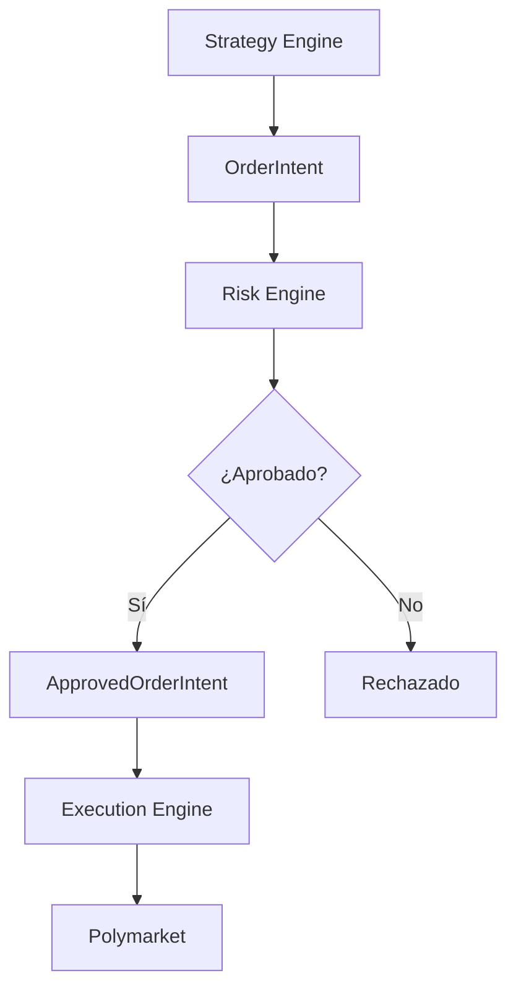

# Risk Engine – Control de Exposiciones, Entradas y Seguridad Operacional

**Versión 1.0 - Especificación Técnica para Implementación**

**PolyLiquidity Desk – Arquitectura MVP escalable a capital institucional**

---

## 1. Propósito del Módulo

El **Risk Engine** controla **TODO el riesgo operativo y financiero** asociado al trading automático en Polymarket.

### Funciones Principales

1. **Validar cada Order Intent** generado por el Strategy Engine
2. **Permitir operaciones seguras** y bloquear aquellas que exceden parámetros
3. **Mantener un estado actualizado** de:
   - Exposición por mercado
   - Exposición global
   - Mercados activos
   - Órdenes abiertas y pendientes
   - Estado de latencia y salud del sistema

### Importancia Crítica

**El Risk Engine es la barrera final** antes de enviar órdenes reales a blockchain.

Si Strategy pregunta *"¿Es buena idea entrar?"*,  
Risk responde:  
> *"Solo si es seguro según nuestras reglas."*

**Es la capa que convierte un bot agresivo en un sistema institucional, estable y confiable.**

---

## 2. Posición en la Arquitectura

### 2.1. Flujo Completo



### 2.2. Responsabilidades

**El Risk Engine:**
- ✅ Valida Order Intents según reglas de riesgo
- ✅ Ajusta tamaños cuando es necesario
- ✅ Mantiene estado de exposición
- ✅ Implementa fail-safes de emergencia
- ✅ Bloquea órdenes peligrosas

**El Risk Engine NO:**
- ❌ Envía órdenes (eso lo hace Execution Engine)
- ❌ Decide cuándo entrar (eso lo hace Strategy Engine)
- ❌ Ejecuta órdenes (eso lo hace Execution Engine)

**Solo aprueba o rechaza intents.**

---

## 3. Entradas del Sistema

### 3.1. OrderIntent (del Strategy Engine)

```python
class OrderIntent(BaseModel):
    """Intención de orden antes de validación de riesgo."""
    market_id: UUID
    side: str = "BUY"                  # Solo compras en esta estrategia
    price: float                       # Precio objetivo
    size: float                        # Tamaño en shares
    reason: str                        # Razón de la entrada
    metadata: Dict = {}                # Metadata adicional
```

**Ejemplo:**
```json
{
  "market_id": "pm123",
  "side": "BUY",
  "price": 0.979,
  "size": 5000,
  "reason": "event_finished_confirmed",
  "metadata": {
    "best_ask": 0.98,
    "latency_mode": "GREEN"
  }
}
```

### 3.2. ExposureState (Estado Actual)

```python
class ExposureState:
    """Estado de exposición actual."""
    market_exposure: Dict[UUID, float]  # Exposición por mercado
    global_exposure: float               # Exposición global total
    active_markets: Set[UUID]            # Mercados con posiciones/órdenes
    pending_orders: Dict[str, float]     # Órdenes pendientes
```

**Ejemplo:**
```json
{
  "market_exposure": {
    "pm1": 4000,
    "pm2": 7000
  },
  "global_exposure": 11000,
  "active_markets": ["pm1", "pm2", "pm3"],
  "pending_orders": {
    "order_abc": 5000
  }
}
```

### 3.3. RuntimeState (Estado del Sistema)

```python
class RuntimeState:
    """Estado del sistema en tiempo de ejecución."""
    latency_status: str                  # "GREEN" | "YELLOW" | "RED"
    system_load: float                   # Carga del sistema (0.0 - 1.0)
    recent_errors: List[Dict]             # Errores recientes
    watch_engine_health: Dict             # Health checks del Watch Engine
```

### 3.4. Config (Parámetros de Riesgo)

```python
class RiskConfig:
    """Configuración de riesgo."""
    max_market_exposure: float = 10000.0      # Exposición máxima por mercado
    max_global_exposure: float = 200000.0     # Exposición global máxima
    max_markets_active: int = 10               # Máximo de mercados activos
    max_order_size: float = 5000.0            # Tamaño máximo por orden
    latency_fail_mode: str = "strict"         # "strict" | "lenient"
    reduce_size_in_yellow: bool = True        # Reducir tamaño en YELLOW
    cancel_on_red: bool = True                 # Cancelar órdenes en RED
    exposure_method: str = "notional"         # "notional" | "capital_at_risk" | "weighted"
    min_order_size: float = 100.0             # Tamaño mínimo por orden
```

---

## 4. Salidas del Sistema

### 4.1. ApprovedOrderIntent (Si Aprueba)

```python
class ApprovedOrderIntent:
    """Orden aprobada que pasó validación de riesgo."""
    market_id: UUID
    side: str
    price: float
    size: float                           # Tamaño final (puede ser ajustado)
    original_size: float                  # Tamaño original del intent
    adjustments: Dict                     # Ajustes aplicados
```

**Ejemplo:**
```json
{
  "approved": true,
  "market_id": "pm123",
  "side": "BUY",
  "price": 0.979,
  "size": 5000,
  "original_size": 5000,
  "adjustments": {
    "final_size": 5000,
    "latency_adjusted": false,
    "market_exposure_limit": null,
    "global_exposure_limit": null
  }
}
```

### 4.2. Rechazo (Si Rechaza)

```json
{
  "approved": false,
  "market_id": "pm123",
  "reason": "exceeds_market_exposure_limit",
  "limits": {
    "current_market_exposure": 9500,
    "new_market_exposure": 14500,
    "max_market_exposure": 10000
  },
  "trace_id": "b3c1e7fc-2a5f-4b7a-9c90-1b..."
}
```

---

## 5. Reglas de Riesgo

El Risk Engine aplica un conjunto estricto de validaciones en orden de prioridad.

### 5.1. Regla 1: Exposición Máxima por Mercado

**Objetivo:** Limitar exposición en un solo mercado.

**Cálculo:**
```python
new_market_exposure = current_exposure(market_id) + intent.size * intent.price
```

**Validación:**
```python
if new_market_exposure > max_market_exposure:
    return (False, "exceeds_market_exposure_limit")
```

**Ejemplo:**
```python
current_exposure = 9500
intent_size = 5000
intent_price = 0.979
new_exposure = 9500 + (5000 * 0.979) = 14395

if 14395 > 10000:
    return False  # RECHAZAR
```

### 5.2. Regla 2: Exposición Global Máxima

**Objetivo:** Proteger contra situaciones donde demasiados mercados simultáneamente están cerca de resolverse.

**Cálculo:**
```python
new_global_exposure = global_exposure + intent.size * intent.price
```

**Validación:**
```python
if new_global_exposure > max_global_exposure:
    return (False, "exceeds_global_exposure_limit")
```

**Ejemplo:**
```python
current_global = 195000
intent_exposure = 5000 * 0.979 = 4895
new_global = 195000 + 4895 = 199895

if 199895 > 200000:
    return False  # RECHAZAR
```

### 5.3. Regla 3: Máximo de Mercados Activos

**Objetivo:** Evitar que el sistema disperse capital en demasiados mercados simultáneamente.

**Cálculo:**
```python
active_markets = set()
# Mercados con posiciones
for pos_id in positions:
    active_markets.add(pos.market_id)
# Mercados con órdenes pendientes
for order_id in pending_orders:
    active_markets.add(order.market_id)
# Si es un nuevo mercado, agregarlo al conteo
if intent.market_id not in active_markets:
    active_markets.add(intent.market_id)
```

**Validación:**
```python
if len(active_markets) > max_markets_active:
    return (False, "exceeds_max_markets_active")
```

**Ejemplo:**
```python
active_markets = {"pm1", "pm2", "pm3", "pm4", "pm5", "pm6", "pm7", "pm8", "pm9", "pm10"}
new_market = "pm11"

if len(active_markets) + 1 > 10:
    return False  # RECHAZAR
```

### 5.4. Regla 4: Tamaño Máximo por Orden

**Objetivo:** Limitar tamaño individual de órdenes, incluso si hay más exposición disponible.

**Validación:**
```python
if intent.size > max_order_size:
    # Reducir tamaño, no rechazar
    adjusted_size = max_order_size
    adjustments["size_limit"] = max_order_size
```

**El Risk Engine reduce, no rechaza.**  
Solo si es demasiado grande incluso tras reducir → rechaza.

**Ejemplo:**
```python
intent_size = 8000
max_order_size = 5000

if 8000 > 5000:
    adjusted_size = 5000  # Reducir
    # Continuar validación con tamaño ajustado
```

### 5.5. Regla 5: Control de Latencia

**Objetivo:** Crítico para evitar compras erróneas por retraso del sistema.

**Validación por Estado:**

| Latencia | Acción |
|----------|--------|
| **GREEN** | ✅ OK, operar normal |
| **YELLOW** | ⚠️ Reducir tamaño: `final_size = intent.size * reduce_factor` (ej: 0.5) |
| **RED** | ❌ RECHAZAR TODAS LAS ÓRDENES |

**Implementación:**
```python
latency_status = latency_monitor.get_status()

if latency_status == LatencyStatus.RED:
    return (False, "latency_too_high")  # RECHAZAR TODAS
elif latency_status == LatencyStatus.YELLOW:
    if reduce_size_in_yellow:
        adjusted_size = intent.size * 0.5
        adjustments["latency_factor"] = 0.5
```

**Si `cancel_on_red = true`:**
- Ordena cancelar todas las órdenes abiertas
- Bloquea nuevas entradas hasta recuperar estado GREEN

### 5.6. Regla 6: Swings Abruptos del Mercado (Protección Anti-Manipulación)

**Objetivo:** Proteger contra manipulación de mercado.

**Detección:**
```python
# Si el precio cambia más del X% en menos de Y segundos
price_change_pct = abs(current_price - previous_price) / previous_price
time_diff = now() - previous_price_timestamp

if price_change_pct > max_price_swing_pct and time_diff < max_swing_time:
    return (False, "suspicious_price_movement")
```

**O si hay órdenes sospechosas:**
```python
# Spread artificialmente estrecho
if spread < min_realistic_spread:
    return (False, "suspicious_spread")
```

**Esto protege contra:**
- Ballenas intentando cazar bots
- Fake liquidity
- Spikes artificiales

### 5.7. Regla 7: Validación del Estado del Evento

**Objetivo:** Strategy puede equivocarse ocasionalmente si recibe señales momentáneas.

**Validación:**
```python
event_state = get_event_state(intent.market_id)

if event_state.status != "FINISHED_CONFIRMED":
    if event_state.status == "FINISHED_UNCONFIRMED":
        if event_state.confidence < 0.85:
            return (False, "event_not_confirmed")
    else:
        return (False, "event_not_finished")
```

### 5.8. Regla 8: Reglas Personalizadas por Mercado

**Objetivo:** Permitir reglas específicas por mercado.

**Ejemplos:**
- Mercados con mala liquidez histórica → tamaño limitado
- Mercados con mucho ruido → bloquear hasta confirmaciones adicionales
- Eventos con alta probabilidad de revisión oficial (e.g., política)

**Implementación:**
```python
risk_overrides = {
    "pm123": {
        "max_exposure": 5000,  # Reducir límite
        "require_extra_confirmation": True
    }
}

if intent.market_id in risk_overrides:
    override = risk_overrides[intent.market_id]
    # Aplicar reglas personalizadas
```

---

## 6. Ajustes de Tamaño

Después de validar reglas, el Risk Engine puede ajustar tamaño según múltiples restricciones.

### 6.1. Fórmula de Ajuste

```python
final_size = min(
    intent.size,                         # Tamaño original
    max_order_size,                      # Límite por orden
    remaining_market_exposure / price,   # Exposición restante por mercado
    remaining_global_exposure / price,  # Exposición global restante
    intent.size * latency_factor         # Factor de latencia (si YELLOW)
)
```

### 6.2. Validación de Tamaño Mínimo

```python
if final_size < min_order_size:
    return (False, "size_too_small")
```

### 6.3. Ejemplo de Ajuste

**Inputs:**
```python
original_size = 5000
max_order_size = 5000
remaining_market_exposure = 4000
remaining_global_exposure = 10000
latency_factor = 0.8  # YELLOW
price = 0.979
min_order_size = 100
```

**Cálculo:**
```python
size_from_market = 4000 / 0.979 = 4086
size_from_global = 10000 / 0.979 = 10215
size_from_latency = 5000 * 0.8 = 4000

final_size = min(5000, 5000, 4086, 10215, 4000) = 4000
```

**Resultado:**
```json
{
  "original_size": 5000,
  "final_size": 4000,
  "adjustments": {
    "market_exposure_limit": 4000,
    "latency_factor": 0.8
  }
}
```

---

## 7. Registro de Exposición (Exposure State)

El Risk Engine mantiene un estado interno actualizado.

### 7.1. Estructura del Estado

```python
class ExposureState:
    """Estado de exposición por mercado."""
    market_id: UUID
    notional: float                      # size * avg_price
    max_allowed: float                   # Límite máximo
    breached: bool                       # Si se excedió el límite
    updated_at: datetime                 # Última actualización
```

### 7.2. Actualización del Estado

**Después de aprobar un intent:**
```python
market_exposure[market_id] += final_size * price
global_exposure += final_size * price
active_markets.add(market_id)
```

**Ejemplo:**
```json
{
  "market_exposure": {
    "pm1": 4000,
    "pm2": 7000,
    "pm3": 5000  // Nuevo
  },
  "global_exposure": 16000,  // Actualizado
  "active_markets": ["pm1", "pm2", "pm3"],  // Actualizado
  "pending_orders": {
    "order_abc": 5000
  }
}
```

### 7.3. Persistencia

**El estado se persiste en:**
- Memoria (`state.exposures`)
- Base de datos (`exposures` table) con snapshots periódicos

---

## 8. Historial y Trazabilidad

Cada decisión de riesgo produce logs estructurados.

### 8.1. Log de Aprobación

```json
{
  "timestamp": "2025-01-25T20:15:30.123Z",
  "level": "INFO",
  "component": "risk_engine",
  "action": "approved",
  "market_id": "pm123",
  "size": 5000,
  "final_size": 5000,
  "event_status": "FINISHED_CONFIRMED",
  "limits": {
    "market_exposure": "6000/10000",
    "global_exposure": "25000/200000"
  },
  "adjustments": {},
  "trace_id": "b3c1e7fc-2a5f-4b7a-9c90-1b..."
}
```

### 8.2. Log de Rechazo

```json
{
  "timestamp": "2025-01-25T20:15:30.123Z",
  "level": "WARN",
  "component": "risk_engine",
  "action": "rejected",
  "market_id": "pm123",
  "reason": "exceeds_global_exposure_limit",
  "limits": {
    "new_global_exposure": 205000,
    "max_global_exposure": 200000
  },
  "trace_id": "b3c1e7fc-2a5f-4b7a-9c90-1b..."
}
```

### 8.3. Log de Eventos Críticos

```json
{
  "timestamp": "2025-01-25T20:15:30.123Z",
  "level": "ERROR",
  "component": "risk_engine",
  "action": "trigger_fail_safe",
  "reason": "latency_red",
  "orders_cancelled": 7,
  "details": {
    "latency_ms": 5000,
    "threshold_ms": 2000
  },
  "trace_id": "b3c1e7fc-2a5f-4b7a-9c90-1b..."
}
```

**Esto permite:**
- Auditar decisiones del bot
- Reproducir fallos
- Analizar histórico
- Justificar cada acción

---

## 9. Fail-Safes

El Risk Engine implementa tres modos de emergencia.

### 9.1. FS1: Latencia Roja (Autopausa)

**Trigger:** `latency_status == RED`

**Acciones:**
```python
# 1. Bloquear nuevas órdenes
block_new_orders = True

# 2. Cancelar órdenes pendientes
if cancel_on_red:
    cancel_all_pending_orders()

# 3. Loggear evento
log_critical_event("latency_red", orders_cancelled=count)
```

**Recuperación:**
- Sistema se recupera automáticamente cuando latencia vuelve a GREEN
- Bloqueo se levanta automáticamente

### 9.2. FS2: Exposición Desproporcionada

**Trigger:** Un mercado supera accidentalmente la exposición máxima (ej. fill inesperado)

**Acciones:**
```python
# 1. Bloquear más órdenes en ese mercado
blocked_markets.add(market_id)

# 2. Alertar sistema
send_alert("exposure_breach", market_id=market_id, exposure=current_exposure)

# 3. Loggear evento
log_critical_event("exposure_breach", market_id=market_id)
```

**Recuperación:**
- Requiere intervención manual o reducción de exposición

### 9.3. FS3: Watch Engine Desalineado

**Trigger:** Los checkers están desincronizados o fallando

**Acciones:**
```python
# 1. Detener estrategia para ese evento
stop_strategy_for_event(event_id)

# 2. Forzar re-validación
force_revalidation(event_id)

# 3. Loggear evento
log_critical_event("watch_engine_misaligned", event_id=event_id)
```

**Recuperación:**
- Sistema re-valida automáticamente cuando checkers se recuperan

---

## 10. Ejemplo Completo

### 10.1. Inputs

**OrderIntent:**
```json
{
  "market_id": "pm123",
  "side": "BUY",
  "price": 0.979,
  "size": 5000,
  "reason": "event_finished_confirmed"
}
```

**Estado Actual:**
```python
market_exposure_actual = 9500
max_market_exposure = 10000
global_exposure = 195000
max_global_exposure = 200000
latency_status = "GREEN"
```

### 10.2. Validación

**1. Exposición por Mercado:**
```python
new_market_exposure = 9500 + (5000 * 0.979) = 14395
if 14395 > 10000:
    # Excede límite, ajustar tamaño
    remaining = 10000 - 9500 = 500
    max_size = 500 / 0.979 = 510
```

**2. Exposición Global:**
```python
new_global_exposure = 195000 + (510 * 0.979) = 195499
if 195499 <= 200000:
    # OK
```

**3. Latencia:**
```python
if latency_status == "GREEN":
    # OK
```

### 10.3. Ajuste de Tamaño

```python
final_size = min(5000, 510) = 510
```

### 10.4. Resultado

**Aprobación:**
```json
{
  "approved": true,
  "market_id": "pm123",
  "side": "BUY",
  "price": 0.979,
  "size": 510,
  "original_size": 5000,
  "reason": "adjusted_to_market_limit",
  "adjustments": {
    "market_exposure_limit": 500,
    "final_size": 510
  }
}
```

---

## 11. Estructura de Archivos a Implementar

```
backend/app/core/
├── risk_engine.py              # Risk Engine principal
├── risk_config.py              # Configuración de riesgo
└── fail_safes/
    ├── __init__.py
    ├── latency_fail_safe.py   # Fail-safe de latencia
    ├── exposure_fail_safe.py  # Fail-safe de exposición
    └── watch_engine_fail_safe.py  # Fail-safe de Watch Engine
```

### 11.1. Módulos Principales

**`app/core/risk_engine.py`:**
- Clase `RiskEngine`
- Método `tick(intents: List[OrderIntent]) -> List[ApprovedOrderIntent]`
- Métodos privados:
  - `_check_risk_rules()`
  - `_calculate_exposure()`
  - `_adjust_size()`
  - `_update_exposure_state()`

**`app/core/risk_config.py`:**
- Clase `RiskConfig`
- Parámetros configurables
- Validación de configuración

---

## 12. Integración con Otros Módulos

### 12.1. Strategy Engine

**Flujo:**
```
Strategy Engine → OrderIntent → Risk Engine
```

### 12.2. Execution Engine

**Flujo:**
```
Risk Engine → ApprovedOrderIntent → Execution Engine
```

### 12.3. Latency Monitor

**Flujo:**
```
Latency Monitor → LatencyStatus → Risk Engine (fail-safes)
```

### 12.4. Event Watch Engine

**Flujo:**
```
Event Watch Engine → EventState → Risk Engine (validación)
```

---

## 13. Resumen

El **Risk Engine**:

- ✅ **Protege capital:** Limita exposición y previene pérdidas excesivas
- ✅ **Evita sobreexposición:** Controla exposición por mercado y global
- ✅ **Reduce tamaño según latencia:** Ajusta comportamiento según estado del sistema
- ✅ **Bloquea órdenes incorrectas:** Valida todas las condiciones antes de aprobar
- ✅ **Mantiene el sistema seguro incluso bajo estrés:** Fail-safes automáticos
- ✅ **Centraliza la lógica de límites:** Un solo punto de control
- ✅ **Garantiza trazabilidad absoluta:** Cada decisión está documentada

**Es la capa que convierte un bot agresivo en un sistema institucional, estable y confiable.**

---

## 14. Próximos Pasos

1. **Implementar Risk Engine base** con todas las reglas
2. **Implementar cálculo de exposición** (notional, capital at risk, weighted)
3. **Implementar ajustes de tamaño** con todas las restricciones
4. **Implementar fail-safes** (latencia, exposición, Watch Engine)
5. **Integrar con Latency Monitor** para fail-safes dinámicos
6. **Implementar logging estructurado** con trace_id
7. **Implementar persistencia de exposición** en DB
8. **Crear tests unitarios** para cada regla
9. **Crear tests de integración** para flujo completo
10. **Configurar métricas y alertas** para monitoreo
11. **Documentar casos edge** y cómo se manejan
