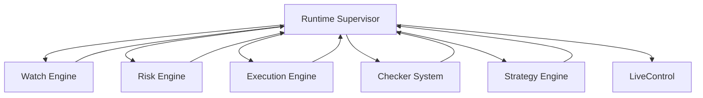

# Runtime Supervisor – Latencia, Circuit Breakers y Fail-Safes Globales

**Versión 1.0 - Especificación Técnica para Implementación**

**PolyLiquidity Desk – Capa de Protección Operacional en Tiempo Real**

---

## 1. Propósito del Módulo

El **Runtime Supervisor** es el "controlador de misión" del sistema.

### Funciones Principales

1. **Monitorizar continuamente el estado de salud** del sistema:
   - Latencia interna
   - Errores de checkers
   - Errores de ejecución
   - Estado de APIs externas
   - Colas, watchers, threads/tasks

2. **Calcular un Runtime Mode global:**
   - `GREEN` → operar normal
   - `YELLOW` → operar de forma conservadora
   - `RED` → pausar el trading

3. **Gestionar circuit breakers:**
   - Trading Circuit Breaker
   - Checker Circuit Breaker
   - API Circuit Breaker

4. **Activar fail-safes:**
   - Cancelación de órdenes
   - Desactivación de nuevas entradas
   - Reinicios controlados de watchers

5. **Comunicar su estado a:**
   - Risk Engine
   - Strategy Engine
   - Execution Engine
   - LiveControl

### Importancia Crítica

**Sin el Runtime Supervisor**, el sistema puede seguir operando incluso cuando:
- La latencia es brutal
- Las APIs externas fallan
- Los checkers están rotos

**→ Se volvería peligroso.**

**Con el Runtime Supervisor**, conviertes el bot en una plataforma operable de forma responsable a nivel "mesa de liquidez seria".

---

## 2. Posición en la Arquitectura

### 2.1. Arquitectura de Supervisión



### 2.2. Responsabilidades

**El Runtime Supervisor:**
- ✅ Monitoriza salud del sistema
- ✅ Calcula Runtime Mode global
- ✅ Gestiona circuit breakers
- ✅ Activa fail-safes automáticos
- ✅ Comunica estado a módulos

**El Runtime Supervisor NO:**
- ❌ Ejecuta trades
- ❌ Hace queries de negocio
- ❌ Decide entradas

**Pero tiene autoridad para:**
- Decir "esto va mal, paramos"
- Decir "esto ha mejorado, podemos reanudar"

---

## 3. Entradas del Sistema

### 3.1. Métricas en Tiempo Real

```python
class RuntimeMetrics:
    """Métricas en tiempo real del sistema."""
    # Latencia
    watch_engine_latency_ms: float
    checker_system_latency_ms: float
    execution_latency_ms: float
    polymarket_trading_latency_ms: float
    polymarket_markets_latency_ms: float
    scanner_latency_ms: float
    
    # Errores por segundo
    http_errors_per_second: float
    timeouts_per_second: float
    signature_failures_per_second: float
    mapping_failures_per_second: float
    
    # Métricas de carga
    active_watchers_count: int
    pending_orders_count: int
    active_markets_count: int
    cpu_usage_percent: float | None
    memory_usage_percent: float | None
```

### 3.2. Eventos de Error

```python
class ErrorEvent:
    """Evento de error del sistema."""
    event_type: str              # "checker_error", "execution_error", etc.
    component: str                # "Watch Engine", "Execution Engine", etc.
    error_message: str
    severity: str                 # "low", "medium", "high", "critical"
    timestamp: datetime
    metadata: Dict
```

**Tipos de eventos:**
- `checker_error` - Error en checker
- `execution_error` - Error en ejecución
- `risk_violation` - Violación de reglas de riesgo
- `watcher_crash` - Crash de watcher
- `circuit_opened` - Circuit breaker abierto (de otros módulos)

### 3.3. Configuración

```python
class RuntimeSupervisorConfig:
    """Configuración del Runtime Supervisor."""
    # Thresholds de latencia (ms)
    latency_green_threshold: float = 200
    latency_yellow_threshold: float = 500
    latency_red_threshold: float = 1000
    
    # Thresholds de errores
    error_rate_yellow: float = 5.0      # errores por segundo
    error_rate_red: float = 10.0        # errores por segundo
    
    # Circuit breakers
    trading_circuit_failure_threshold: int = 5
    trading_circuit_window_seconds: int = 60
    trading_circuit_cooldown_seconds: int = 300
    
    checker_circuit_failure_threshold: int = 3
    checker_circuit_window_seconds: int = 30
    
    # Fail-safes
    auto_cancel_orders_on_red: bool = True
    auto_disable_checkers_on_failure: bool = True
```

---

## 4. Salidas del Sistema

### 4.1. Runtime Mode

```python
class RuntimeMode(str, Enum):
    """Modo de operación del sistema."""
    GREEN = "GREEN"    # Operar normal
    YELLOW = "YELLOW"  # Operar conservador
    RED = "RED"        # Pausar trading
```

### 4.2. Estados de Circuit Breakers

```python
class CircuitBreakerState(str, Enum):
    """Estado de circuit breaker."""
    CLOSED = "CLOSED"      # Funcionando normal
    OPEN = "OPEN"          # Bloqueado
    HALF_OPEN = "HALF_OPEN"  # Probando recuperación
```

**Circuit breakers:**
- `trading_circuit`: `CLOSED` | `OPEN`
- `checkers_circuit`: `CLOSED` | `OPEN`
- `api_circuit[provider]`: `CLOSED` | `OPEN` (por proveedor)

### 4.3. Señales a Otros Módulos

```python
class SupervisorSignal:
    """Señal del Runtime Supervisor."""
    signal_type: str        # "pause_trading", "resume_trading", etc.
    target_module: str     # "Risk", "Strategy", "Execution"
    parameters: Dict       # Parámetros específicos
    timestamp: datetime
```

**Tipos de señales:**
- `pause_trading` - Pausar trading
- `resume_trading` - Reanudar trading
- `reduce_size_factor` - Reducir tamaño (ej: 0.5)
- `disable_checker[id]` - Desactivar checker
- `enable_checker[id]` - Reactivar checker

### 4.4. Eventos hacia LiveControl

```json
{
  "type": "runtime_mode_changed",
  "from": "GREEN",
  "to": "YELLOW",
  "reason": "latency_p95_above_threshold",
  "metrics_snapshot": {
    "latency_p95": 600,
    "error_rate": 3.2
  },
  "timestamp": "2025-01-25T20:15:30.123Z"
}
```

---

## 5. Runtime Modes

### 5.1. GREEN

**Condiciones:**
- Latencia media de tick por debajo de `latency_green_threshold`
- Tasa de error global baja (< `error_rate_yellow`)
- APIs externas respondiendo dentro de SLA
- No hay circuit breakers abiertos

**Comportamiento:**
- **Strategy:** Opera normal
- **Risk:** Aplica reglas normales
- **Execution:** Sin restricciones adicionales

**Significado:**
> "Sistema funcionando normalmente, operar con confianza."

### 5.2. YELLOW

**Se entra en YELLOW cuando:**
- Latencia media supera `latency_yellow_threshold`
- O errores por segundo > `error_rate_yellow`
- O algunas APIs externas están inestables pero no completamente caídas

**Comportamiento:**
- **Strategy:** Sigue generando intents (pero puede reducir agresividad)
- **Risk:** Aplica **modo conservador**:
  - Reduce tamaño (`size_factor` 0.5, por ejemplo)
  - Aumenta safety ticks
- **Execution:** Mantiene trading, pero monitoriza más agresivamente

**YELLOW significa:**
> "Podemos seguir, pero con cuidado."

### 5.3. RED

**Se entra en RED cuando:**
- Latencia > `latency_red_threshold`
- O error rate > `error_rate_red`
- O Polymarket Trading API tiene múltiples fallos críticos
- O Watch Engine no puede obtener estados fiables
- O un número de errores críticos en Execution en ventana corta

**Comportamiento:**
- **Risk:**
  - **Rechaza todas las nuevas órdenes**
- **Execution:**
  - Cancela órdenes abiertas (opcional, según config)
- **Strategy:**
  - No genera nuevos intents (si respeta runtime_mode)
- **Supervisor:**
  - Registra evento crítico
  - Dispara alertas
  - Abre `trading_circuit`

**RED significa:**
> "Se para todo hasta nueva orden."

---

## 6. Circuit Breakers

### 6.1. Trading Circuit Breaker

**Protege contra:**
- Cascadas de errores en Execution
- Bugs en Strategy/Risk
- Problemas con Polymarket API

**Condiciones para abrir:**
- N errores de ejecución críticos en ventana de T segundos
- Ratio de rechazos de Polymarket extremadamente alto
- Problemas de firma repetidos
- Inconsistencias graves en fills

**Estado:**
- `CLOSED` → Trading permitido
- `OPEN` → Trading bloqueado

**Cuando se abre:**
- No se permiten nuevas órdenes
- Se pueden cancelar órdenes open
- Se registra en logs y LiveControl

**Se cierra automáticamente tras:**
- Periodo de enfriamiento (`cooldown_seconds`)
- Y cuando métricas vuelvan a la normalidad

**Implementación:**
```python
class TradingCircuitBreaker:
    """Circuit breaker para trading."""
    
    def __init__(self, failure_threshold: int = 5, window_seconds: int = 60):
        self.failure_threshold = failure_threshold
        self.window_seconds = window_seconds
        self.failure_count = 0
        self.failure_times: List[float] = []
        self.state = CircuitBreakerState.CLOSED
        self.last_failure_time = None
    
    def record_failure(self):
        """Registra un fallo."""
        now = time.time()
        self.failure_times.append(now)
        
        # Limpiar fallos fuera de ventana
        self.failure_times = [
            t for t in self.failure_times
            if now - t < self.window_seconds
        ]
        
        self.failure_count = len(self.failure_times)
        self.last_failure_time = now
        
        if self.failure_count >= self.failure_threshold:
            self.state = CircuitBreakerState.OPEN
            # Pausar trading
            # Cancelar órdenes abiertas
            # Enviar alertas
    
    def try_close(self):
        """Intenta cerrar el circuit breaker."""
        if self.state == CircuitBreakerState.OPEN:
            # Verificar cooldown
            if self.last_failure_time:
                cooldown_elapsed = time.time() - self.last_failure_time
                if cooldown_elapsed >= self.cooldown_seconds:
                    # Verificar métricas normalizadas
                    if self._metrics_normalized():
                        self.state = CircuitBreakerState.HALF_OPEN
                        # Probar con operación pequeña
```

### 6.2. Checker Circuit Breaker

**Por checker o familia de checkers:**
- `espn_circuit`
- `alt_sports_api_circuit`
- `ap_news_circuit`

**Se abre cuando:**
- La API cambia de esquema y devuelve errores constantes
- Timeouts continuos
- Datos inconsistentes repetidos

**Efecto:**
- El checker se marca como `disabled`
- El Watch Engine deja de usarlo
- Se ajusta el quorum (para no depender de ese checker)

**Implementación:**
```python
class CheckerCircuitBreaker:
    """Circuit breaker para checkers."""
    
    def __init__(self, checker_id: str):
        self.checker_id = checker_id
        self.failure_threshold = 3
        self.window_seconds = 30
        self.failure_count = 0
        self.state = CircuitBreakerState.CLOSED
    
    def record_failure(self, error_type: str):
        """Registra un fallo del checker."""
        self.failure_count += 1
        
        if self.failure_count >= self.failure_threshold:
            self.state = CircuitBreakerState.OPEN
            # Marcar checker como disabled
            # Notificar Watch Engine
            # Ajustar quorum
```

### 6.3. API Circuit Breaker (por Proveedor)

**Por cada proveedor crítico:**
- `polymarket_markets_circuit`
- `polymarket_trading_circuit`
- `espn_circuit`
- `flashscore_circuit`
- etc.

**Se gestiona igual que los anteriores.**

---

## 7. Cálculo de Latencia Global

El Runtime Supervisor calcula `latency_mode` en base a múltiples fuentes.

### 7.1. Fuentes de Latencia

**Tiempos medidos:**
- Event Watch Engine (por tick)
- Execution Engine (request → response)
- Checkers (espn, flashscore, etc.)
- Scanner (por scan)

### 7.2. Agregación

**Ejemplo de agregación:**
```python
latency_score = max(
    p95_latency_watch_engine,
    p95_latency_execution,
    p95_latency_checkers,
    p95_latency_scanner
)
```

**Luego:**
```python
if latency_score <= latency_green_threshold:
    runtime_mode = RuntimeMode.GREEN
elif latency_score <= latency_yellow_threshold:
    runtime_mode = RuntimeMode.YELLOW
else:
    runtime_mode = RuntimeMode.RED
```

### 7.3. Implementación

```python
def calculate_latency_score(metrics: RuntimeMetrics) -> float:
    """Calcula score de latencia global."""
    latencies = [
        metrics.watch_engine_latency_ms,
        metrics.execution_latency_ms,
        metrics.checker_system_latency_ms,
        metrics.scanner_latency_ms
    ]
    
    # Filtrar None
    latencies = [l for l in latencies if l is not None]
    
    if not latencies:
        return 0.0
    
    # Usar percentil 95
    return percentile(latencies, 95)
```

---

## 8. Fail-Safes Definidos

### 8.1. FS1: Pausa Automática de Trading (Modo RED)

**Al activarse:**

1. **Abre trading_circuit**
2. **Marca runtime_mode = RED**
3. **Risk empieza a rechazar todo**
4. **Execution cancela órdenes abiertas** (si config así lo establece)
5. **LiveControl muestra estado rojo global**
6. **Se envía alerta** (email/Slack/etc.)

**Implementación:**
```python
def trigger_fail_safe_red():
    """Activa fail-safe de modo RED."""
    # 1. Abrir circuit breaker
    trading_circuit_breaker.open()
    
    # 2. Cambiar runtime mode
    runtime_mode = RuntimeMode.RED
    
    # 3. Notificar módulos
    notify_risk_engine("pause_trading")
    notify_execution_engine("cancel_orders")
    notify_strategy_engine("stop_intents")
    
    # 4. Notificar LiveControl
    live_control.emit("runtime_mode_changed", {
        "from": previous_mode,
        "to": "RED",
        "reason": "fail_safe_triggered"
    })
    
    # 5. Enviar alerta
    send_alert("CRITICAL: Trading paused - RED mode")
```

### 8.2. FS2: Desactivación de Checkers Problemáticos

**Si un checker genera:**
- N errores críticos seguidos, o
- Datos inconsistentes respecto al resto de fuentes

**Entonces:**
1. Se abre `checker_circuit[checker_id]`
2. Se marca `checker.disabled = true`
3. El Watch Engine ya no lo usa en quorum

**Implementación:**
```python
def disable_problematic_checker(checker_id: str, reason: str):
    """Desactiva un checker problemático."""
    # 1. Abrir circuit breaker
    checker_circuit_breaker.open(checker_id)
    
    # 2. Marcar como disabled
    checker = get_checker(checker_id)
    checker.disabled = True
    checker.disabled_reason = reason
    
    # 3. Notificar Watch Engine
    watch_engine.remove_checker(checker_id)
    
    # 4. Ajustar quorum
    adjust_quorum_requirements()
    
    # 5. Loggear
    log_checker_disabled(checker_id, reason)
```

### 8.3. FS3: Protección ante Pérdidas por Bugs Lógicos

**Si el sistema detecta:**
- Un aumento anormal del PnL negativo
- O fills inesperados en mercados no monitorizados
- O incoherencia entre exposición esperada y exposición real

**Entonces:**
1. Abre `trading_circuit`
2. Modo RED
3. Alertas
4. Requiere intervención manual

**Implementación:**
```python
def detect_anomalies():
    """Detecta anomalías en el sistema."""
    # 1. Verificar PnL
    if pnl_negative_spike_detected():
        trigger_fail_safe_red()
        send_alert("CRITICAL: PnL negative spike detected")
        return
    
    # 2. Verificar fills inesperados
    if unexpected_fills_detected():
        trigger_fail_safe_red()
        send_alert("CRITICAL: Unexpected fills detected")
        return
    
    # 3. Verificar exposición
    if exposure_mismatch_detected():
        trigger_fail_safe_red()
        send_alert("CRITICAL: Exposure mismatch detected")
        return
```

---

## 9. Integración con Otros Módulos

### 9.1. Risk Engine

**Risk consulta runtime_mode:**

| Runtime Mode | Acción |
|--------------|--------|
| **GREEN** | Normal |
| **YELLOW** | Reduce tamaños, endurece reglas |
| **RED** | Rechaza todas las órdenes |

**Implementación:**
```python
# En Risk Engine
runtime_mode = runtime_supervisor.get_mode()

if runtime_mode == RuntimeMode.RED:
    return []  # Rechazar todas
elif runtime_mode == RuntimeMode.YELLOW:
    # Reducir tamaño
    size = size * 0.5
```

### 9.2. Strategy Engine

**Strategy puede ajustar:**
- Frecuencia de escaneo
- Agresividad
- Incluso parar intents nuevos si RED

**Implementación:**
```python
# En Strategy Engine
runtime_mode = runtime_supervisor.get_mode()

if runtime_mode == RuntimeMode.RED:
    return []  # No generar intents
elif runtime_mode == RuntimeMode.YELLOW:
    # Reducir agresividad
    min_entry_price = min_entry_price * 1.01  # Más conservador
```

### 9.3. Execution Engine

**Si trading_circuit = OPEN:**
- No envía nuevas órdenes
- Puede cancelar órdenes open

**Implementación:**
```python
# En Execution Engine
if trading_circuit_breaker.is_open():
    # No enviar nuevas órdenes
    return

# Si está en RED, cancelar órdenes abiertas
if runtime_mode == RuntimeMode.RED and auto_cancel_orders_on_red:
    await cancel_all_open_orders()
```

### 9.4. LiveControl

**El Supervisor envía eventos:**
- `runtime_mode_changed`
- `circuit_opened`
- `circuit_closed`
- `fail_safe_triggered`

**Ejemplo:**
```json
{
  "type": "runtime_mode_changed",
  "from": "GREEN",
  "to": "YELLOW",
  "reason": "latency_p95_above_threshold",
  "metrics_snapshot": {
    "latency_p95": 600,
    "error_rate": 3.2
  },
  "timestamp": "2025-01-25T20:15:30.123Z"
}
```

---

## 10. Trazabilidad

Cada cambio de estado se loggea de forma estructurada.

### 10.1. Cambio de Runtime Mode

```json
{
  "timestamp": "2025-01-25T20:15:30.123Z",
  "level": "WARN",
  "component": "runtime_supervisor",
  "event": "runtime_mode_changed",
  "from": "GREEN",
  "to": "RED",
  "reason": "trading_errors_exceeded_threshold",
  "metrics_snapshot": {
    "latency_p95": 1200,
    "execution_errors_last_60s": 14,
    "error_rate": 12.5
  },
  "trace_id": "b3c1e7fc-2a5f-4b7a-9c90-1b..."
}
```

### 10.2. Apertura de Circuit Breaker

```json
{
  "timestamp": "2025-01-25T20:15:30.123Z",
  "level": "ERROR",
  "component": "runtime_supervisor",
  "event": "trading_circuit_open",
  "circuit_type": "trading",
  "reason": "execution_error_burst",
  "failure_count": 5,
  "window_seconds": 60,
  "cooldown_seconds": 300,
  "trace_id": "b3c1e7fc-2a5f-4b7a-9c90-1b..."
}
```

### 10.3. Cierre de Circuit Breaker

```json
{
  "timestamp": "2025-01-25T20:20:30.123Z",
  "level": "INFO",
  "component": "runtime_supervisor",
  "event": "trading_circuit_closed",
  "circuit_type": "trading",
  "reason": "metrics_normalized",
  "cooldown_elapsed": 300,
  "trace_id": "b3c1e7fc-2a5f-4b7a-9c90-1b..."
}
```

### 10.4. Fail-Safe Activado

```json
{
  "timestamp": "2025-01-25T20:15:30.123Z",
  "level": "CRITICAL",
  "component": "runtime_supervisor",
  "event": "fail_safe_triggered",
  "fail_safe_type": "FS1",
  "reason": "latency_red_threshold_exceeded",
  "actions_taken": [
    "trading_circuit_opened",
    "orders_cancelled",
    "alerts_sent"
  ],
  "trace_id": "b3c1e7fc-2a5f-4b7a-9c90-1b..."
}
```

---

## 11. Estructura de Archivos a Implementar

```
backend/app/core/
├── runtime_supervisor.py         # Runtime Supervisor principal
├── circuit_breaker.py           # Circuit Breaker base
├── latency_monitor.py            # Monitor de latencia (ya existe)
└── fail_safes/
    ├── __init__.py
    ├── trading_fail_safe.py     # Fail-safe de trading
    ├── checker_fail_safe.py     # Fail-safe de checkers
    └── anomaly_detector.py     # Detector de anomalías
```

### 11.1. Módulos Principales

**`app/core/runtime_supervisor.py`:**
- Clase `RuntimeSupervisor`
- Método `tick()` - Loop principal de supervisión
- Método `get_mode() -> RuntimeMode`
- Método `get_circuit_state(circuit_id) -> CircuitBreakerState`
- Métodos privados:
  - `_collect_metrics()`
  - `_calculate_runtime_mode()`
  - `_check_circuit_breakers()`
  - `_trigger_fail_safes()`

**`app/core/circuit_breaker.py`:**
- Clase `CircuitBreaker` (base)
- Clase `TradingCircuitBreaker`
- Clase `CheckerCircuitBreaker`
- Clase `APICircuitBreaker`

**`app/core/fail_safes/trading_fail_safe.py`:**
- Clase `TradingFailSafe`
- Método `trigger()`
- Método `recover()`

---

## 12. Integración con Otros Módulos

### 12.1. Risk Engine

**Flujo:**
```
Risk Engine → Runtime Supervisor.get_mode() → Ajustar comportamiento
```

### 12.2. Strategy Engine

**Flujo:**
```
Strategy Engine → Runtime Supervisor.get_mode() → Ajustar agresividad
```

### 12.3. Execution Engine

**Flujo:**
```
Execution Engine → Runtime Supervisor.get_circuit_state() → Bloquear/permite trading
```

### 12.4. LiveControl

**Flujo:**
```
Runtime Supervisor → Event Bus → LiveControl → UI
```

---

## 13. Resumen

El **Runtime Supervisor** es:

- ✅ **El guardián del sistema:** Protege contra operaciones peligrosas
- ✅ **El responsable de que el bot NO opere ciego ni en pánico:** Detecta problemas antes de que causen pérdidas
- ✅ **La capa de protección anti-"modo kamikaze":** Previene operaciones cuando el sistema está inestable

**Su misión:**
- Detectar cuando el entorno es sano → **GREEN**
- Detectar cuando está inestable → **YELLOW**
- Detectar cuando es peligroso → **RED**
- Accionar circuit breakers y fail-safes según corresponda

**Sin este módulo**, el resto del sistema puede ser perfecto, pero un fallo puntual de APIs, latencia o bugs internos podrían provocar pérdidas muy grandes.

**Con el Runtime Supervisor**, conviertes el bot en una plataforma operable de forma responsable a nivel "mesa de liquidez seria".

---

## 14. Próximos Pasos

1. **Implementar Runtime Supervisor base** con loop de supervisión
2. **Implementar cálculo de Runtime Mode** con múltiples métricas
3. **Implementar Circuit Breakers** (Trading, Checker, API)
4. **Implementar Fail-Safes** (FS1, FS2, FS3)
5. **Integrar con Latency Monitor** existente
6. **Integrar con Risk Engine** para consultar runtime mode
7. **Integrar con Strategy Engine** para ajustar agresividad
8. **Integrar con Execution Engine** para bloquear trading
9. **Integrar con LiveControl** para visualización
10. **Implementar detector de anomalías** (PnL, fills, exposición)
11. **Implementar logging estructurado** con trace_id
12. **Crear tests unitarios** para cada componente
13. **Crear tests de integración** para flujo completo
14. **Configurar alertas** (email, Slack, etc.)
