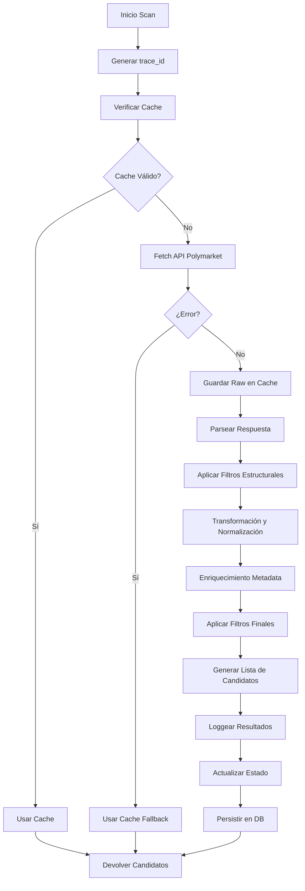
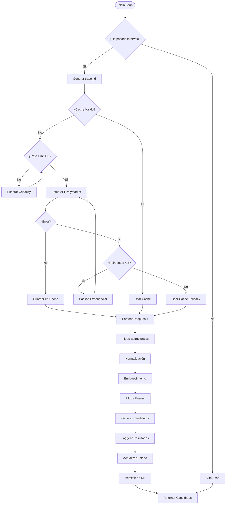

# Módulo Scanner – Detección y Filtrado de Mercados Polymarket

**Versión 1.0 - Especificación Técnica para Implementación**

---

## 1. Propósito del Módulo

El **Scanner** es el módulo encargado de:

1. **Descargar** los mercados activos de Polymarket (API pública)
2. **Filtrar** únicamente los mercados relevantes para el bot
3. **Normalizar** y enriquecer los datos para que el resto del sistema trabaje con un modelo consistente
4. **Reducir consumo de API** mediante caching y control de rate limiting
5. **Mantener trazabilidad completa** sobre:
   - Qué mercados fueron vistos
   - Qué filtros pasaron o fallaron
   - Por qué un mercado entró o no en el sistema

### Importancia Crítica

**El Scanner es la puerta de entrada al sistema.** Si el Scanner falla, todo lo demás falla. Por lo tanto:

- Debe ser **robusto y resiliente** (nunca debe fallar completamente)
- Debe ser **eficiente** (una request cada 10-30 segundos es suficiente)
- Debe tener **trazabilidad total** (cada mercado descartado debe tener razón explícita)
- **NO decide nada** - solo selecciona mercados candidatos

---

## 2. Alcance del Documento

Este documento especifica:

- ✅ Modelo de datos para mercados candidatos
- ✅ Flujo completo de escaneo y filtrado
- ✅ Filtros aplicados (estructurales, de contenido, numéricos)
- ✅ Normalización y enriquecimiento de datos
- ✅ Sistema de caching y rate limiting
- ✅ Logging estructurado y trazabilidad
- ✅ Manejo de errores y fallbacks
- ✅ Estructura de archivos y módulos a implementar

**No incluye:**
- Implementación específica de código Python (se hará después)
- Detalles de la API de Polymarket (se consultará documentación oficial)

---

## 3. Entradas del Sistema

### 3.1. API de Polymarket

**Endpoint principal:**
```
GET https://gamma-api.polymarket.com/markets?limit={limit}
```

**Parámetros configurables:**
- `scanner.api_url`: URL base de la API (default: `https://gamma-api.polymarket.com`)
- `scanner.limit`: Número máximo de mercados a obtener (default: 100)
- `scanner.include_closed_markets`: Incluir mercados cerrados (default: `false`)

**Rate Limits:**
- Polymarket impone: **~200 requests / 10 segundos** para APIs públicas
- El Scanner solo hace **1 request por ciclo** (cada 10-30 segundos)
- Todos los watchers y demás módulos **NO golpean este endpoint**

### 3.2. Configuración del Sistema

El Scanner depende de los siguientes parámetros de configuración:

```python
class ScannerConfig:
    # Filtros de precio
    min_price_threshold: float = 0.97  # Precio mínimo para considerar mercado
    
    # Filtros de categoría
    allowed_categories: List[str] = ["sports"]  # Categorías permitidas
    allowed_subcategories: List[str] = ["basketball", "football", "soccer"]  # Opcional
    
    # Filtros de mercado
    include_markets_without_events: bool = False  # Incluir mercados sin eventos
    max_markets_per_scan: int | None = None  # Límite opcional de mercados
    
    # Caching
    scanner_cache_ttl: int = 5  # TTL del cache en segundos (3-5 recomendado)
    
    # Logging
    log_raw_markets: bool = False  # Loggear mercados raw (solo en debug)
    
    # Intervalo de escaneo
    scan_interval_seconds: int = 30  # Frecuencia de escaneo (10-30 segundos)
```

---

## 4. Salidas del Sistema

### 4.1. CandidateMarket

El Scanner produce una lista normalizada de **Candidate Markets**. Cada mercado candidato es un objeto estandarizado:

```python
class CandidateMarket:
    # Identificadores
    market_id: UUID                    # ID interno del sistema
    polymarket_id: str                 # ID de Polymarket
    trace_id: UUID                     # ID de trazabilidad del scan
    
    # Información básica
    question: str                      # Pregunta del mercado
    description: str | None           # Descripción (opcional)
    category: str                      # Categoría (ej: "sports")
    subcategory: str | None           # Subcategoría (ej: "NBA", "NFL")
    
    # Temporalidad
    created_at: datetime               # Fecha de creación del mercado
    close_time: datetime | None        # Fecha de cierre estimada
    event_start_time: datetime | None  # Fecha de inicio del evento (parseada)
    
    # Outcomes (siempre 2 para mercados binarios)
    outcomes: List[Outcome]            # [
                                        #   {
                                        #     "name": "YES",
                                        #     "price": 0.98,
                                        #     "liquidity": 12345.0,
                                        #     "volume_24h": 50000.0
                                        #   },
                                        #   {
                                        #     "name": "NO",
                                        #     "price": 0.02,
                                        #     "liquidity": 200.0,
                                        #     "volume_24h": 1000.0
                                        #   }
                                        # ]
    
    # Precios consolidados
    best_yes_price: float              # Mejor precio YES
    best_no_price: float               # Mejor precio NO
    spread: float                      # Spread (best_yes - best_no)
    
    # Estado
    status: str                        # "OPEN", "CLOSED", "RESOLVED"
    is_binary: bool                    # True si es mercado binario
    
    # Metadata del evento (enriquecimiento)
    event_metadata: EventMetadata       # {
                                        #   "detected_teams": ["Lakers", "Celtics"],
                                        #   "detected_sport": "basketball",
                                        #   "event_start_time_parsed": datetime,
                                        #   "timezone": "ET",
                                        #   "raw_text": "Lakers vs Celtics - Who will win?",
                                        #   "confidence": 0.95  # Confianza en el parsing
                                        # }
    
    # Metadatos adicionales
    volume_24h: float                  # Volumen en últimas 24h
    liquidity_total: float             # Liquidez total
    market_hash: str                   # Hash para tracking (SHA256 de datos clave)
    
    # Timestamps
    scanned_at: datetime               # Cuándo fue escaneado
    updated_at: datetime               # Última actualización
```

### 4.2. Consumidores del Output

Estos objetos son consumidos por:

1. **Event Mapping Layer** - Para mapear mercados a eventos reales (ESPN)
2. **Event Engine** - Para verificar estado de eventos
3. **Event Watch Engine** - Para crear watchers de eventos
4. **Strategy Engine** - Para decidir órdenes
5. **LiveControl** - Para mostrar mercados en tiempo real

---

## 5. Arquitectura del Scanner

### 5.1. Flujo Completo

El Scanner sigue esta secuencia:



### 5.2. Pasos Detallados

#### Paso 1: Inicio del Scan
- Generar `trace_id` único para este ciclo
- Verificar si ha pasado suficiente tiempo desde último scan (`scan_interval_seconds`)
- Si no, retornar lista vacía o última conocida

#### Paso 2: Fetch de Mercados
- Verificar cache primero (TTL: 3-5 segundos)
- Si cache válido → usar cache
- Si cache expirado → hacer request a Polymarket
- Manejar rate limiting y errores

#### Paso 3: Filtrado Estructural
- Filtrar mercados que no cumplan estructura básica:
  - `status == "OPEN"`
  - `outcomes.length == 2` (binarios)
  - Outcomes tienen precio válido

#### Paso 4: Transformación y Normalización
- Normalizar nombres de outcomes (YES, NO)
- Convertir precios a float
- Ordenar outcomes por precio
- Normalizar category/subcategory a minúsculas
- Generar hashes internos para tracking

#### Paso 5: Enriquecimiento
- Extraer equipos mediante heurísticas y regex
- Parsear fecha del evento si aparece en el título
- Detectar tipo de deporte
- Calcular metadata del evento

#### Paso 6: Filtros Finales
- Precio >= `min_price_threshold`
- Categoría en `allowed_categories`
- Verificar que no esté resuelto

#### Paso 7: Registro y Persistencia
- Loggear resultados estructurados
- Actualizar estado en memoria
- Persistir mercados nuevos/actualizados en DB
- Retornar lista de candidatos

---

## 6. Filtros Aplicados

Los filtros se dividen en **estructurales**, **de contenido** y **numéricos**.

### 6.1. Filtros Estructurales

Estos filtros verifican la estructura básica del mercado:

| Filtro | Razón | Implementación |
|--------|-------|----------------|
| `market.status == "OPEN"` | Solo operamos mercados abiertos | Verificar campo `status` |
| `market.outcomes.length == 2` | Solo mercados binarios | Verificar array `outcomes` |
| Outcomes tienen precio | Necesario para estrategia | Verificar `outcome.price` existe y es > 0 |
| Mercado tiene `polymarket_id` | Necesario para tracking | Verificar campo `id` existe |

**Orden de aplicación:** Estos filtros se aplican **primero** porque son rápidos y eliminan la mayoría de mercados inválidos.

### 6.2. Filtros por Categoría

**Por defecto solo:**
- `sports` / `basketball` / `football` / `soccer` / etc.

**Configuración:**
```python
allowed_categories = ["sports"]
allowed_subcategories = ["basketball", "football", "soccer", "nfl", "nba"]
```

**Implementación:**
- Verificar `market.category` está en `allowed_categories`
- Si `subcategory` existe, verificar que esté en `allowed_subcategories` (si está configurado)

**Nota:** El sistema puede configurarse para otras categorías, pero para MVP → solo deportes.

### 6.3. Filtros por Precio

**Filtro principal:**
```python
best_yes_price >= min_price_threshold  # Ej: 0.97
```

**O alternativamente:**
```python
best_no_price >= min_price_threshold  # Según estrategia
```

**Razón:** Esto reduce ruido y evita que Strategy tenga que manejar mercados "inútiles" (precios muy bajos).

**Implementación:**
- Calcular `best_yes_price` y `best_no_price` desde outcomes
- Aplicar filtro según configuración
- Loggear razón si se descarta por precio

### 6.4. Filtros por Temporalidad

Un mercado es interesante solo si:

1. **Tiene un evento asociado** que está por terminar (mapping + watchers), o
2. **La fecha final está cerca** (para mercados no deportivos)

**El scanner debe extraer metadata temporal del título:**

**Ejemplo:**
```
"Lakers vs Celtics – Jan 25th 8 PM ET"
```

**Se detecta:**
- Fecha: `2025-01-25`
- Hora: `20:00`
- Timezone: `ET` (Eastern Time)
- Equipos: `["Lakers", "Celtics"]`
- Tipo de deporte: `basketball` (inferido)

**Implementación:**
- Usar regex y heurísticas para parsear fechas
- Normalizar timezones
- Calcular `event_start_time` y `close_time`
- Filtrar mercados con fechas muy lejanas (opcional, configurable)

---

## 7. Normalización y Enriquecimiento

### 7.1. Normalización de Datos

Antes de entregar el mercado al siguiente módulo:

1. **Normalizar nombres de outcomes:**
   - `"Yes"` → `"YES"`
   - `"No"` → `"NO"`
   - `"True"` → `"YES"`
   - `"False"` → `"NO"`

2. **Convertir precios a float:**
   - Asegurar que todos los precios sean `float` (no string)
   - Validar que estén en rango [0.0, 1.0]

3. **Ordenar outcomes por precio:**
   - Ordenar de mayor a menor precio
   - Asegurar que YES siempre tiene precio >= NO

4. **Normalizar category/subcategory:**
   - Convertir a minúsculas
   - Remover espacios extra
   - Normalizar variantes (ej: "NBA" → "nba")

5. **Generar hashes internos:**
   - `market_hash = SHA256(polymarket_id + question + outcomes)`
   - Usado para tracking y detección de duplicados

### 7.2. Enriquecimiento de Metadata

**Extracción de equipos:**
- Usar regex para detectar patrones: `"Team A vs Team B"`
- Normalizar nombres de equipos (ej: "Los Angeles Lakers" → "Lakers")
- Detectar abreviaciones (ej: "LAL" → "Lakers")

**Parsing de fechas:**
- Detectar formatos comunes:
  - `"Jan 25th 8 PM ET"`
  - `"2025-01-25 20:00 ET"`
  - `"January 25, 2025 at 8:00 PM"`
- Convertir a `datetime` con timezone
- Calcular `event_start_time` y `close_time`

**Detección de deporte:**
- Inferir desde subcategoría
- O desde nombres de equipos conocidos
- O desde palabras clave en el título

**Ejemplo de metadata enriquecida:**
```python
event_metadata = {
    "detected_teams": ["Lakers", "Celtics"],
    "detected_sport": "basketball",
    "event_start_time_parsed": datetime(2025, 1, 25, 20, 0),
    "timezone": "ET",
    "raw_text": "Lakers vs Celtics – Jan 25th 8 PM ET",
    "confidence": 0.95  # Confianza en el parsing
}
```

---

## 8. Caching

### 8.1. Estrategia de Caching

El Scanner debe tener un **cache interno** para:

- Evitar hits excesivos a Polymarket
- Reducir ruido
- Acelerar tiempo del ciclo principal
- Proporcionar fallback en caso de error

### 8.2. Configuración del Cache

**Caché recomendado:**
- **TTL:** 3-5 segundos
- **Clave:** `scanner:markets_raw`
- **Contenido:** JSON completo recibido de Polymarket

**Implementación:**
```python
cache_key = "scanner:markets_raw"
cache_ttl = 5  # segundos

# Verificar cache
cached = await api_cache.get(cache_key)
if cached and not cache_bypass:
    return cached

# Si no hay cache o expiró, hacer fetch
markets = await fetch_from_polymarket()

# Guardar en cache
await api_cache.set(cache_key, markets, ttl=cache_ttl)
```

### 8.3. Condiciones de Refetch

El scanner solo hace refetch si:

1. **TTL expiró** (cache inválido)
2. **Se ejecuta manualmente** (forzar refresh)
3. **`cache_bypass` está activo** (modo debug)

**En todos los demás casos:** Usar cache para reducir carga en Polymarket.

---

## 9. Rate Limiting

### 9.1. Límites de Polymarket

Polymarket impone:
- **~200 requests / 10 segundos** para APIs públicas

### 9.2. Estrategia del Scanner

Para evitar problemas:

1. **Scanner solo hace 1 request por ciclo** (cada 10-30 segundos)
2. **Todos los watchers y demás módulos NO golpean este endpoint**
3. **Estrategias nunca llaman al scanner directamente**

### 9.3. Manejo de Throttling

Si ocurre throttling (429):

1. **Backoff exponencial:**
   - Primer retry: esperar 2 segundos
   - Segundo retry: esperar 4 segundos
   - Tercer retry: esperar 8 segundos
   - Máximo 3 reintentos

2. **Registrar evento:**
   ```json
   {
     "event_type": "rate_limited",
     "component": "scanner",
     "trace_id": "...",
     "retry_count": 1,
     "backoff_seconds": 2
   }
   ```

3. **Fallback:**
   - Si todos los reintentos fallan → devolver última versión cacheada
   - Loggear evento crítico
   - Continuar con ciclo siguiente

### 9.4. Integración con Rate Limiter

El Scanner debe usar el `rate_limiter` del sistema:

```python
from app.core.rate_limiter import rate_limiter, EndpointType

# Antes de hacer request
if not await rate_limiter.wait_for_capacity(EndpointType.DATA_API, timeout=5.0):
    # Usar cache como fallback
    return await get_cached_markets()

# Hacer request
response = await client.get(url)

# Si hay rate limit error
if response.status_code == 429:
    await rate_limiter.record_violation(EndpointType.DATA_API)
    # Manejar error
```

---

## 10. Logging y Trazabilidad

### 10.1. Logging Estructurado

Cada ejecución del Scanner genera un **registro estructurado en JSON**:

**Log principal (scan completo):**
```json
{
  "timestamp": "2025-01-18T10:25:00.123Z",
  "level": "INFO",
  "component": "scanner",
  "event_type": "scan_complete",
  "trace_id": "b3c1e7fc-2a5f-4b7a-9c90-1b...",
  "found_markets": 124,
  "filtered_structural": 98,
  "filtered_category": 12,
  "filtered_price": 8,
  "candidates": 6,
  "cache_used": false,
  "latency_ms": 132,
  "api_endpoint": "https://gamma-api.polymarket.com/markets",
  "extra": {
    "scan_interval_seconds": 30,
    "cache_hit": false
  }
}
```

### 10.2. Logs por Mercado Descartado

Además existen logs por cada mercado descartado (opcional, configurable):

```json
{
  "timestamp": "2025-01-18T10:25:00.123Z",
  "level": "DEBUG",
  "component": "scanner",
  "event_type": "market_filtered_out",
  "trace_id": "...",
  "market_id": "pm_market_123",
  "polymarket_id": "0x...",
  "reason": "not_binary",
  "filter_stage": "structural",
  "market_data": {
    "question": "...",
    "status": "CLOSED",
    "outcomes_count": 3
  }
}
```

**Razones comunes:**
- `not_binary`: Mercado no es binario (no tiene 2 outcomes)
- `not_open`: Mercado no está abierto
- `price_too_low`: Precio menor que `min_price_threshold`
- `category_not_allowed`: Categoría no permitida
- `no_price`: Outcomes no tienen precio válido
- `already_resolved`: Mercado ya resuelto

### 10.3. Trazabilidad

**Cada ciclo produce un `trace_id` único** que permite:

- Correlacionar todos los logs de un scan
- Rastrear qué mercados fueron procesados
- Auditar decisiones de filtrado
- Reconstruir el flujo completo si hay problemas

**El `trace_id` se propaga a:**
- Logs del Scanner
- Mercados candidatos generados
- Eventos creados/actualizados
- Logs de módulos downstream

### 10.4. Auditoría

Los logs permiten auditar:

- **Por qué un mercado se ignoró:**
  - Query por `market_id` o `polymarket_id`
  - Ver todos los logs con `reason = "..."`

- **Si el scanner está filtrando demasiado:**
  - Comparar `found_markets` vs `candidates`
  - Ver distribución de razones de descarte

- **Si los datos brutos de Polymarket están cambiando:**
  - Monitorear cambios en estructura de respuesta
  - Alertar si hay cambios inesperados

---

## 11. Manejo de Errores y Fallbacks

### 11.1. Tipos de Errores

#### Error de Red
**Ejemplos:**
- Timeout de conexión
- DNS resolution failed
- Connection refused

**Acción:**
1. Usar último cache válido
2. Loggear evento crítico:
   ```json
   {
     "event_type": "network_error",
     "error_type": "CONNECTION_ERROR",
     "fallback_to_cache": true
   }
   ```
3. Continuar con ciclo siguiente
4. No detener el sistema

#### Polymarket responde 500/503
**Ejemplos:**
- Internal Server Error
- Service Unavailable
- Gateway Timeout

**Acción:**
1. Backoff + retry limitado a 3 intentos
2. Si persiste después de 3 intentos: usar cache
3. Loggear evento:
   ```json
   {
     "event_type": "api_error",
     "http_status": 500,
     "retry_count": 3,
     "fallback_to_cache": true
   }
   ```

#### Respuesta Corrupta o Inválida
**Ejemplos:**
- JSON malformado
- Estructura inesperada
- Campos faltantes críticos

**Acción:**
1. Loggear payload (o hash del payload)
2. Descartar respuesta
3. Usar cache como fallback
4. Loggear evento:
   ```json
   {
     "event_type": "invalid_response",
     "error_type": "JSON_PARSE_ERROR",
     "fallback_to_cache": true
   }
   ```

#### Estructura Inesperada
**Ejemplos:**
- Campo `outcomes` no es array
- Precio no es número
- Faltan campos requeridos

**Acción:**
1. Log de alerta (level=WARN)
2. Filtrar mercado individual (no descartar todo el scan)
3. Continuar con siguiente mercado
4. Loggear evento:
   ```json
   {
     "event_type": "market_structure_error",
     "market_id": "...",
     "error_field": "outcomes",
     "action": "filtered_individual"
   }
   ```

### 11.2. Principio de Resiliencia

**Regla de oro:** **Nada debe detener el Scanner.**

- Siempre debe entregar alguna lista, aunque sea la última conocida
- Si hay error → usar cache como fallback
- Si no hay cache → retornar lista vacía (mejor que crashear)
- Loggear todos los errores pero continuar operación

---

## 12. Flujo Completo del Scanner

### 12.1. Secuencia Detallada

```
1. Inicio del ciclo
   ├─> Verificar si ha pasado scan_interval_seconds
   ├─> Si no → retornar (skip scan)
   └─> Generar trace_id único

2. Verificar cache
   ├─> Consultar api_cache.get("scanner:markets_raw")
   ├─> Si cache válido y no bypass → usar cache
   └─> Si cache expirado o bypass → continuar a fetch

3. Fetch de Polymarket
   ├─> Verificar rate limit capacity
   ├─> Hacer GET request a API
   ├─> Manejar errores (retry con backoff)
   └─> Guardar en cache si exitoso

4. Parsear respuesta
   ├─> Validar JSON
   ├─> Extraer array de mercados
   └─> Validar estructura básica

5. Aplicar filtros estructurales
   ├─> Filtrar por status == "OPEN"
   ├─> Filtrar por outcomes.length == 2
   ├─> Filtrar por outcomes tienen precio
   └─> Loggear mercados descartados

6. Transformación y normalización
   ├─> Normalizar nombres de outcomes
   ├─> Convertir precios a float
   ├─> Ordenar outcomes
   ├─> Normalizar category/subcategory
   └─> Generar hashes

7. Enriquecimiento de metadata
   ├─> Extraer equipos (regex)
   ├─> Parsear fechas
   ├─> Detectar deporte
   └─> Calcular event_metadata

8. Aplicar filtros finales
   ├─> Filtrar por precio >= min_price_threshold
   ├─> Filtrar por categoría permitida
   └─> Verificar que no esté resuelto

9. Generar lista de candidatos
   ├─> Crear objetos CandidateMarket
   ├─> Asignar trace_id
   └─> Calcular métricas

10. Loggear resultados
    ├─> Log principal (scan_complete)
    ├─> Logs individuales (si configurado)
    └─> Métricas agregadas

11. Actualizar estado
    ├─> Actualizar state.markets
    └─> Persistir en DB (nuevos/actualizados)

12. Retornar candidatos
    └─> List[CandidateMarket]
```

### 12.2. Diagrama de Flujo



---

## 13. Reglas de Oro del Scanner

### 13.1. Principios Fundamentales

1. **El Scanner NO decide nada.**
   - Solo selecciona mercados candidatos
   - La estrategia se ejecuta después
   - No tiene lógica de trading

2. **El Scanner debe ser barato y confiable.**
   - Una request cada 10-30 segundos es suficiente
   - Usar cache agresivamente
   - Nunca debe fallar completamente

3. **Logs muy detallados.**
   - Cada mercado descartado debe tener razón explícita
   - Cada ciclo debe tener trace_id
   - Logs estructurados en JSON

4. **Trazabilidad total.**
   - Cada ciclo produce un trace_id
   - Todos los mercados tienen market_hash
   - Historial completo de scans

5. **El Scanner no ejecuta watchers.**
   - Solo encuentra mercados
   - Los mercados disparan la fase Event Engine
   - Event Watch Engine crea watchers después

---

## 14. Estructura de Archivos a Implementar

```
backend/app/
├── core/
│   ├── scanner.py              # Scanner principal (actualizar existente)
│   └── market_normalizer.py    # Normalización y enriquecimiento (NUEVO)
│
├── services/
│   └── polymarket_client.py    # Cliente para API de Polymarket (NUEVO)
│
└── utils/
    └── market_parser.py        # Parsing de fechas, equipos, etc. (NUEVO)
```

### 14.1. Módulos Principales

**`app/core/scanner.py`:**
- Clase `Scanner` (actualizar existente)
- Método `tick()` - Ciclo principal de escaneo
- Método `_fetch_markets_from_polymarket()` - Fetch de API
- Método `_filter_candidate_markets()` - Aplicar filtros
- Integración con cache y rate limiter

**`app/core/market_normalizer.py`:**
- Clase `MarketNormalizer`
- Método `normalize(market: dict) -> CandidateMarket`
- Método `enrich_metadata(market: dict) -> EventMetadata`
- Normalización de outcomes, precios, categorías

**`app/services/polymarket_client.py`:**
- Clase `PolymarketClient`
- Método `get_markets(limit: int) -> List[dict]`
- Manejo de rate limiting
- Manejo de errores y retries

**`app/utils/market_parser.py`:**
- Funciones de parsing:
  - `parse_teams(text: str) -> List[str]`
  - `parse_date(text: str) -> datetime | None`
  - `detect_sport(text: str) -> str | None`
  - `normalize_team_name(name: str) -> str`

---

## 15. Modelo de Datos en Base de Datos

### 15.1. Tabla `markets`

El Scanner actualiza/crea registros en la tabla `markets`:

```python
class Market:
    id: UUID                    # PK interno
    polymarket_id: str          # ID de Polymarket (único)
    question: str
    description: str | None
    category: str
    subcategory: str | None
    status: str                # "OPEN", "CLOSED", "RESOLVED"
    last_price: float | None
    best_yes_price: float | None
    best_no_price: float | None
    spread: float | None
    volume_24h: float | None
    liquidity_total: float | None
    created_at: datetime
    updated_at: datetime
    scanned_at: datetime        # Última vez que fue escaneado
```

### 15.2. Relación con Eventos

Cada mercado puede tener un `Event` asociado:

```python
class Event:
    id: UUID
    market_id: UUID            # FK a Market
    external_event_id: str | None  # ID del evento externo (ESPN, etc.)
    state: str                  # "LIVE", "FINISHED_CONFIRMED", etc.
    # ... otros campos
```

El Scanner crea un `Event` con `state="LIVE"` para cada mercado nuevo.

---

## 16. Métricas y Monitoreo

### 16.1. Métricas del Scanner

**Métricas por scan:**
- `found_markets`: Total de mercados encontrados
- `filtered_structural`: Mercados descartados por filtros estructurales
- `filtered_category`: Mercados descartados por categoría
- `filtered_price`: Mercados descartados por precio
- `candidates`: Mercados candidatos finales
- `latency_ms`: Latencia del scan completo
- `cache_hit`: Si se usó cache

**Métricas agregadas (últimas 24h):**
- Total de scans ejecutados
- Promedio de mercados encontrados
- Promedio de candidatos generados
- Tasa de éxito de scans
- Tasa de uso de cache
- Errores por tipo

### 16.2. Alertas

**Alertas críticas:**
- Scanner falla 3+ veces consecutivas
- Tasa de candidatos < 1% de mercados encontrados
- Latencia > 5 segundos consistentemente
- Rate limit violations > 5 en 1 hora

---

## 17. Resumen

El módulo **Scanner** es la puerta de entrada al sistema:

- ✅ Descarga mercados activos de Polymarket
- ✅ Filtra mercados relevantes (binarios, abiertos, precio mínimo)
- ✅ Normaliza y enriquece datos para consumo del sistema
- ✅ Reduce consumo de API mediante caching y rate limiting
- ✅ Mantiene trazabilidad completa de decisiones
- ✅ Es robusto y resiliente (nunca falla completamente)

**Este documento sirve como especificación técnica completa para implementar:**
- `app/core/scanner.py` (actualizar)
- `app/core/market_normalizer.py` (nuevo)
- `app/services/polymarket_client.py` (nuevo)
- `app/utils/market_parser.py` (nuevo)

---

## 18. Próximos Pasos

1. **Revisar documentación oficial de Polymarket** para:
   - Estructura exacta de la API `/markets`
   - Formatos de respuesta
   - Rate limits precisos
   - Campos disponibles

2. **Implementar cliente de Polymarket** (`polymarket_client.py`)

3. **Implementar normalizador** (`market_normalizer.py`)

4. **Implementar parser de metadata** (`market_parser.py`)

5. **Actualizar Scanner** con nueva arquitectura

6. **Implementar logging estructurado** con trace_id

7. **Crear tests unitarios** para cada componente

8. **Crear tests de integración** para flujo completo

9. **Configurar métricas y alertas**
