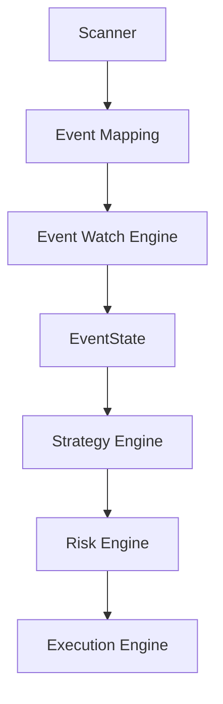

# Strategy Engine – Lógica de Decisión de Entradas en Mercados

**Versión 1.0 - Especificación Técnica para Implementación**

**PolyLiquidity Desk – MVP preparado para escala (100k–200k EUR)**

---

## 1. Propósito del Módulo

El **Strategy Engine** es el módulo responsable de:

1. **Analizar mercados** ya mapeados y con eventos monitorizados por el Watch Engine
2. **Identificar momentos de entrada óptimos** cuando el evento real está terminado pero Polymarket todavía no lo ha resuelto
3. **Determinar:**
   - Si se debe abrir una posición
   - Qué outcome comprar (`YES`/`NO`)
   - A qué **precio objetivo** (`target_price`)
   - Con qué **tamaño** (`size`)
4. **Generar Order Intents** (intenciones de orden) que serán validadas por el Risk Engine y luego ejecutadas

### Características de Diseño

La estrategia está diseñada para operar:

- ✅ **Rápido:** Baja latencia en decisiones
- ✅ **Seguro:** Conservador por diseño
- ✅ **Sin sobreexposición:** Respeta límites de riesgo
- ✅ **Trazable:** Lógica completamente documentada y loggeada
- ✅ **Determinista:** Mismas condiciones → misma decisión

---

## 2. Posición en la Arquitectura

### 2.1. Flujo Completo



### 2.2. Condiciones de Activación

El Strategy Engine **solo opera** cuando el evento externo tiene estado:

- **`FINISHED_CONFIRMED`** (seguro) - Modo normal
- **`FINISHED_UNCONFIRMED`** (opcional) - Modo agresivo (si está habilitado)

**El Strategy Engine NO opera cuando:**
- `event_status == LIVE` (evento aún no terminado)
- `event_status == UNKNOWN` (no se puede determinar)
- Latencia del sistema en estado `RED`

---

## 3. Entradas del Sistema

### 3.1. MarketState (del Scanner)

Para cada mercado activo, el Strategy Engine recibe:

```python
class MarketState:
    """Estado del mercado desde el Scanner."""
    market_id: UUID
    best_bid: float                    # Mejor precio de compra
    best_ask: float                    # Mejor precio de venta
    last_price: float                  # Último precio transado
    spread: float                      # Diferencia entre ask y bid
    outcomes: List[str]                # ["YES", "NO"]
    open_interest: float                # Interés abierto
    orderbook_snapshot: Dict | None    # Profundidad del orderbook (si disponible)
    close_time: datetime               # Fecha/hora de cierre del mercado
    volume_24h: float | None           # Volumen en últimas 24h
```

### 3.2. EventState (del Watch Engine)

```python
class EventState:
    """Estado del evento desde el Watch Engine."""
    event_status: str                  # "LIVE" | "FINISHED_CONFIRMED" | 
                                       # "FINISHED_UNCONFIRMED" | "UNKNOWN"
    confidence_score: float            # 0.0 - 1.0
    sources_state: Dict[str, str]     # {
                                       #   "espn": "FINISHED",
                                       #   "flashscore": "FINISHED"
                                       # }
    event_finished_at: datetime | None # Cuándo terminó el evento
    last_update: datetime              # Última actualización
```

### 3.3. Config (Parámetros Globales)

```python
class StrategyConfig:
    """Configuración de la estrategia."""
    min_entry_price: float = 0.97     # Precio mínimo para entrar
    max_entry_spread: float = 0.02    # Spread máximo permitido
    safety_tick: float = 0.001         # Tick de seguridad para precio
    target_edge: float = 0.01         # Margen objetivo hacia 1.0
    max_order_size: float = 5000.0    # Tamaño máximo por orden (USDC)
    max_exposure_per_market: float = 10000.0  # Exposición máxima por mercado
    max_global_exposure: float = 200000.0      # Exposición global máxima
    latency_mode: str = "GREEN"       # "GREEN" | "YELLOW" | "RED"
    aggressive_mode: bool = False      # Permitir FINISHED_UNCONFIRMED
```

---

## 4. Salidas del Sistema

### 4.1. OrderIntent

El módulo devuelve una lista de **Order Intents**:

```python
class OrderIntent(BaseModel):
    """Intención de orden antes de validación de riesgo."""
    market_id: UUID
    side: str = "BUY"                  # Solo compras en esta estrategia
    price: float                       # Precio objetivo
    size: float                        # Tamaño en shares
    reason: str                        # Razón de la entrada
    metadata: Dict = {}                # Metadata adicional
```

**Ejemplo de OrderIntent:**
```json
{
  "market_id": "pm123",
  "side": "BUY",
  "outcome": "YES",
  "price": 0.979,
  "size": 4500,
  "reason": "event_finished_confirmed",
  "metadata": {
    "best_ask": 0.98,
    "best_bid": 0.976,
    "safety_tick_applied": 0.001,
    "latency_mode": "GREEN",
    "event_confidence": 0.97
  }
}
```

### 4.2. Sin Intención de Orden

Si no debe crear ninguna orden, el Strategy Engine puede retornar:

```json
{
  "market_id": "pm321",
  "intent": null,
  "reason": "conditions_not_met",
  "details": {
    "event_status": "LIVE",
    "best_ask": 0.93,
    "min_price_required": 0.97
  }
}
```

---

## 5. Condiciones para Crear una Orden

Para minimizar riesgo y entradas erróneas, la estrategia aplica varias capas de filtros.

### 5.1. Condición 1: Evento Terminado

**Regla principal:**
```python
if event_status != "FINISHED_CONFIRMED":
    return None  # NO entrada
```

**Modo agresivo (opcional):**
```python
if aggressive_mode and event_status == "FINISHED_UNCONFIRMED":
    if confidence_score >= 0.85:
        # Entrada moderada (size reducido)
        size_multiplier = 0.5
    else:
        return None
```

### 5.2. Condición 2: Precio Atractivo

El sistema solo entra cuando el precio está lo suficientemente cerca de 1.0:

```python
if best_ask < min_entry_price:
    return None  # Precio demasiado bajo
```

**Ejemplos:**
- `min_entry_price = 0.97` → Buscamos mispricings extremos
- `min_entry_price = 0.99` → Solo entradas muy seguras

**Esto evita:**
- Ruido y falsos positivos
- Entradas en eventos no decididos
- Pérdidas por eventos que se revierten

### 5.3. Condición 3: Spread Razonable

Si el spread es muy grande, podría ser manipulación o latencia del AMM:

```python
if spread > max_entry_spread:
    return None  # Spread demasiado amplio
```

**Ejemplo:**
```python
max_entry_spread = 0.02  # 2%
if spread > 0.02:
    return None
```

### 5.4. Condición 4: Latencia Apta

Si la latencia del sistema está en nivel:

| Latencia | Acción |
|----------|--------|
| **GREEN** | Operar normal |
| **YELLOW** | Entrar pero ajustando precio/tamaño (más conservador) |
| **RED** | NO entrar |

**Implementación:**
```python
latency_status = latency_monitor.get_status()

if latency_status == LatencyStatus.RED:
    return None  # NO crear orden
elif latency_status == LatencyStatus.YELLOW:
    # Ajustes más abajo
    size_multiplier = 0.5
    safety_tick_multiplier = 2.0
```

---

## 6. Cálculo del Precio Objetivo (target_price)

El Strategy Engine calcula un precio conservador para evitar ser front-runneado o pagar demasiado.

### 6.1. Fórmula Base

```python
safe_price = best_ask - safety_tick
max_price = 1.0 - target_edge

target_price = min(safe_price, max_price)

# Asegurar que no esté por debajo del best_bid
target_price = max(target_price, best_bid)
```

### 6.2. Ejemplo de Cálculo

**Inputs:**
```python
best_ask = 0.98
best_bid = 0.976
safety_tick = 0.001
target_edge = 0.01
```

**Cálculo:**
```python
safe_price = 0.98 - 0.001 = 0.979
max_price = 1.0 - 0.01 = 0.99

target_price = min(0.979, 0.99) = 0.979
target_price = max(0.979, 0.976) = 0.979
```

**Resultado:** `target_price = 0.979`

### 6.3. Ajustes por Latencia

**YELLOW:**
```python
effective_safety_tick = safety_tick * 2.0  # Más conservador
```

**RED:**
```python
effective_safety_tick = safety_tick * 3.0  # Muy conservador
# (Aunque no deberíamos entrar en RED)
```

### 6.4. Validación Final

**Regla adicional:**
```python
if target_price < min_entry_price:
    return None  # NO entrar
```

---

## 7. Cálculo del Tamaño (size)

El tamaño base se calcula según múltiples restricciones.

### 7.1. Fórmula Base

```python
base_size = min(
    liquidity_available,              # Liquidez en orderbook
    max_order_size,                   # Tamaño máximo por orden
    remaining_market_exposure,        # Exposición restante por mercado
    remaining_global_exposure        # Exposición global restante
)
```

### 7.2. Cálculo Detallado

```python
def calculate_size(market_id, target_price, orderbook_liquidity):
    config = StrategyConfig()
    
    # 1. Exposición restante por mercado
    current_exposure = get_current_exposure(market_id)
    remaining_market = config.max_exposure_per_market - current_exposure
    size_from_capacity = remaining_market / target_price
    
    # 2. Liquidez en orderbook
    size_from_liquidity = orderbook_liquidity
    
    # 3. Tamaño máximo por orden
    max_single = config.max_order_size / target_price
    
    # 4. Exposición global restante
    global_exposure = get_global_exposure()
    remaining_global = config.max_global_exposure - global_exposure
    size_from_global = remaining_global / target_price
    
    # Tomar el mínimo
    size = min(
        size_from_capacity,
        size_from_liquidity,
        max_single,
        size_from_global
    )
    
    return max(0.0, size)
```

### 7.3. Ajustes por Latencia

**YELLOW:**
```python
size = base_size * 0.5  # Reducir tamaño a la mitad
```

**RED:**
```python
size = 0.0  # NO crear orden
```

### 7.4. Ajustes por Confianza

**FINISHED_UNCONFIRMED (modo agresivo):**
```python
if event_status == "FINISHED_UNCONFIRMED":
    if confidence_score >= 0.85:
        size = base_size * 0.5  # Reducir tamaño
    else:
        size = 0.0  # NO entrar
```

---

## 8. Heurísticas Adicionales para Deportes

Solo aplican cuando `event_type = "sports"`.

### 8.1. Evento con Final Reciente

Si el evento terminó hace > X minutos:

```python
time_since_finished = now() - event_finished_at

if time_since_finished > timedelta(minutes=10):
    # Entradas menos agresivas
    size = size * 0.7  # Reducir tamaño
    safety_tick = safety_tick * 1.5  # Más conservador
```

**Razón:** Cuanto más tiempo pasa, más probable que Polymarket ya haya actualizado.

### 8.2. Múltiples Fuentes Coinciden

Si ESPN + FlashScore + NBA API coinciden:

```python
if len(sources_finished) >= 3:
    confidence_bonus = +0.05
    # Permitir entradas más agresivas
    size_multiplier = 1.1
```

### 8.3. Polymarket Actualiza Lentamente

Detectado comparando:
- Latencia en resolver mercados anteriores
- Retraso medio del feed

**Si Polymarket es lento:**
```python
if polymarket_latency_avg > threshold:
    # Estrategia más agresiva
    min_entry_price = 0.95  # Reducir umbral
    size_multiplier = 1.2    # Aumentar tamaño
```

---

## 9. Razones para NO Entrar

El Strategy Engine documenta claramente por qué NO opera:

### 9.1. Evento No Terminado

```json
{
  "market_id": "pm321",
  "intent": null,
  "reason": "event_not_finished",
  "details": {
    "event_status": "LIVE",
    "required_status": "FINISHED_CONFIRMED"
  }
}
```

### 9.2. Precio Demasiado Bajo

```json
{
  "market_id": "pm321",
  "intent": null,
  "reason": "ask_price_too_low",
  "details": {
    "best_ask": 0.93,
    "min_price_required": 0.97
  }
}
```

### 9.3. Spread Demasiado Amplio

```json
{
  "market_id": "pm321",
  "intent": null,
  "reason": "spread_too_wide",
  "details": {
    "spread": 0.03,
    "max_spread": 0.02
  }
}
```

### 9.4. Latencia Alta

```json
{
  "market_id": "pm321",
  "intent": null,
  "reason": "latency_too_high",
  "details": {
    "latency_status": "RED",
    "required_status": "GREEN"
  }
}
```

### 9.5. Sin Liquidez

```json
{
  "market_id": "pm321",
  "intent": null,
  "reason": "insufficient_liquidity",
  "details": {
    "available_liquidity": 100,
    "min_required": 1000
  }
}
```

**Esta trazabilidad es CRÍTICA** para debugging y auditoría.

---

## 10. Ejemplo Completo (Workflow Real)

### 10.1. Inputs

**Mercado:**
```
Lakers vs Warriors
best_ask = 0.98
best_bid = 0.976
spread = 0.004
last_price = 0.978
```

**Event Watch Engine:**
```
ESPN → FINISHED
FlashScore → FINISHED
Confidence = 0.97
Estado final: FINISHED_CONFIRMED
```

**Config:**
```python
min_entry_price = 0.97
safety_tick = 0.001
target_edge = 0.01
max_order_size = 5000
latency_mode = "GREEN"
```

### 10.2. Verificación de Condiciones

1. **Evento terminado:** ✅ `FINISHED_CONFIRMED`
2. **Precio atractivo:** ✅ `best_ask (0.98) >= 0.97`
3. **Spread razonable:** ✅ `spread (0.004) <= 0.02`
4. **Latencia:** ✅ `GREEN`

### 10.3. Cálculo de target_price

```python
safe_price = 0.98 - 0.001 = 0.979
max_price = 1.0 - 0.01 = 0.99
target_price = min(0.979, 0.99) = 0.979
target_price = max(0.979, 0.976) = 0.979
```

**Resultado:** `target_price = 0.979`

### 10.4. Cálculo de size

```python
liquidez disponible: 10000
max_order_size: 5000
remaining exposure: 7000

size_from_capacity = 7000 / 0.979 = 7150
size_from_liquidity = 10000
max_single = 5000 / 0.979 = 5107

size = min(7150, 10000, 5107) = 5107
```

**Resultado:** `size = 5107` (limitado por `max_order_size`)

### 10.5. OrderIntent Generado

```json
{
  "market_id": "pm555",
  "side": "BUY",
  "price": 0.979,
  "size": 5107,
  "reason": "event_finished_confirmed",
  "metadata": {
    "best_ask": 0.98,
    "best_bid": 0.976,
    "safety_tick_applied": 0.001,
    "latency_mode": "GREEN",
    "event_confidence": 0.97,
    "time_since_finished": "00:02:15"
  }
}
```

---

## 11. Trazabilidad Interna (Logging Estructurado)

Cada decisión genera un log en formato JSON:

### 11.1. Log de Entrada Creada

```json
{
  "timestamp": "2025-01-25T20:15:30.123Z",
  "level": "INFO",
  "component": "strategy_engine",
  "market_id": "pm555",
  "event_status": "FINISHED_CONFIRMED",
  "inputs": {
    "best_ask": 0.98,
    "best_bid": 0.976,
    "spread": 0.004,
    "latency_mode": "GREEN",
    "event_confidence": 0.97
  },
  "computed": {
    "target_price": 0.979,
    "base_size": 5107,
    "final_size": 5107,
    "safety_tick_applied": 0.001
  },
  "result": "intent_created",
  "order_intent": {
    "market_id": "pm555",
    "price": 0.979,
    "size": 5107
  },
  "trace_id": "b3c1e7fc-2a5f-4b7a-9c90-1b..."
}
```

### 11.2. Log de NO Entrada

```json
{
  "timestamp": "2025-01-25T20:15:30.123Z",
  "level": "INFO",
  "component": "strategy_engine",
  "market_id": "pm555",
  "result": "no_intent",
  "reason": "spread_too_wide",
  "details": {
    "spread": 0.03,
    "max_spread": 0.02
  },
  "trace_id": "b3c1e7fc-2a5f-4b7a-9c90-1b..."
}
```

### 11.3. Campos de Trazabilidad

**Cada log incluye:**
- `trace_id`: Para rastrear el flujo completo
- `inputs`: Todos los inputs usados en la decisión
- `computed`: Valores calculados intermedios
- `result`: Resultado final (`intent_created` o `no_intent`)
- `reason`: Razón específica si no se creó intent

---

## 12. Estructura de Archivos a Implementar

```
backend/app/core/
├── strategy.py                    # Strategy Engine principal
├── strategy_config.py            # Configuración de estrategia
└── strategies/
    ├── __init__.py
    ├── base_strategy.py           # BaseStrategy (abstracto)
    ├── sports_strategy.py        # Estrategia para deportes (MVP)
    ├── politics_strategy.py      # Estrategia para política (futuro)
    └── finance_strategy.py      # Estrategia para finanzas (futuro)
```

### 12.1. Módulos Principales

**`app/core/strategy.py`:**
- Clase `Strategy`
- Método `tick() -> List[OrderIntent]`
- Métodos privados:
  - `_calculate_target_price()`
  - `_calculate_size()`
  - `_get_orderbook_liquidity()`
  - `_check_conditions()`

**`app/core/strategy_config.py`:**
- Clase `StrategyConfig`
- Parámetros configurables
- Validación de configuración

---

## 13. Integración con Otros Módulos

### 13.1. Scanner

**Flujo:**
```
Scanner → MarketState → Strategy Engine
```

### 13.2. Event Watch Engine

**Flujo:**
```
Event Watch Engine → EventState → Strategy Engine
```

### 13.3. Risk Engine

**Flujo:**
```
Strategy Engine → OrderIntent → Risk Engine → ApprovedOrderIntent
```

### 13.4. Execution Engine

**Flujo:**
```
Risk Engine → ApprovedOrderIntent → Execution Engine → Order
```

---

## 14. Resumen

El **Strategy Engine**:

- ✅ **Es determinista:** Mismas condiciones → misma decisión
- ✅ **Es conservador por diseño:** Solo entra cuando hay edge casi garantizado
- ✅ **Es latency-aware:** Ajusta comportamiento según latencia del sistema
- ✅ **Es risk-aware:** Delega validación final al Risk Engine
- ✅ **Es modular:** Puede soportar múltiples tipos de eventos (sports, politics, finance, crypto, etc.)
- ✅ **Es trazable:** Cada decisión está completamente documentada

**Su función es clara:**
> Detectar entradas con edge casi garantizado, minimizar falsos positivos, operar rápido, y siempre bajo riesgo controlado.

---

## 15. Próximos Pasos

1. **Implementar Strategy Engine base** con todas las condiciones
2. **Implementar cálculo de target_price** con ajustes por latencia
3. **Implementar cálculo de size** con todas las restricciones
4. **Implementar heurísticas específicas** para deportes
5. **Integrar con Latency Monitor** para ajustes dinámicos
6. **Implementar logging estructurado** con trace_id
7. **Crear tests unitarios** para cada componente
8. **Crear tests de integración** para flujo completo
9. **Configurar métricas y alertas** para monitoreo
10. **Documentar casos edge** y cómo se manejan
