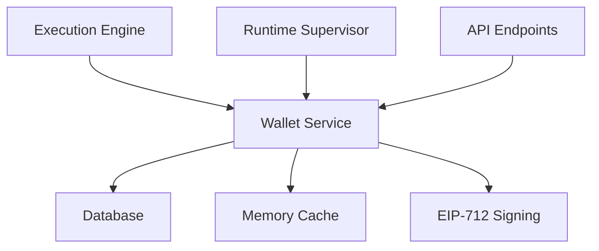
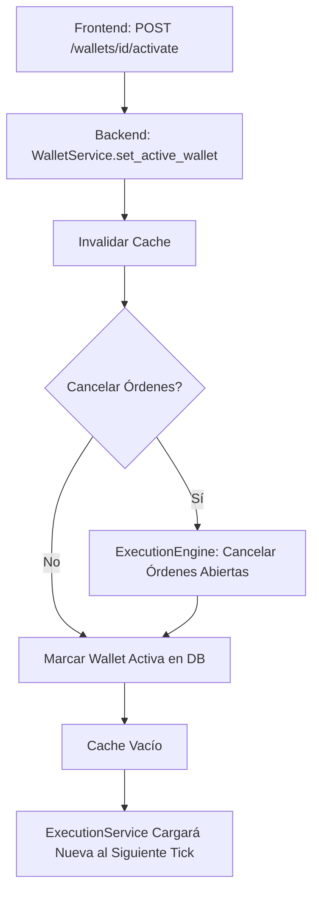

# Wallet Service – Gestión Operativa de Wallets

**Versión 1.0 - Especificación Técnica para Implementación**

**PolyLiquidity Desk – Gestión Operativa de Wallets**

---

## 1. Propósito del Módulo

El **WalletService** es el módulo responsable de gestionar los recursos operativos de firma utilizados por el ExecutionEngine para enviar órdenes a Polymarket.

### Características Principales

**WalletService:**
- ✅ NO es parte del sistema de usuarios
- ✅ NO se gestiona vía variables de entorno
- ✅ NO depende del operador humano en tiempo real
- ✅ Es un recurso operativo crítico, equivalente al signing key manager de un sistema de trading financiero

**Es equivalente a un hardware key manager**, pero implementado en software con las garantías necesarias para operar cientos de miles de euros de volumen.

---

## 2. Posición en la Arquitectura

### 2.1. Flujo de Integración



### 2.2. Responsabilidades

**El WalletService:**
- ✅ Gestiona wallets como recurso operativo
- ✅ Garantiza solo una wallet activa
- ✅ Permite rotación en runtime sin reinicio
- ✅ Almacena private keys de forma segura
- ✅ Proporciona cache eficiente para firmas rápidas

**El WalletService NO:**
- ❌ Gestiona usuarios
- ❌ Expone private keys al frontend
- ❌ Almacena private keys en texto plano

---

## 3. Motivación del Diseño

Durante la operación del bot, deben cumplirse estas necesidades:

### 3.1. Solo Una Wallet Activa

**Requiere:**
- Solo una wallet puede estar activa en un momento dado
- Evita inconsistencias, exposiciones no deseadas o órdenes paralelas firmadas por múltiples identidades

### 3.2. Rotación en Runtime Sin Reinicio

**Permite:**
- Migrar a nuevas claves
- Actualizar permisos
- Rotar claves comprometidas
- Cambiar de wallet después de un crash o rareza de la blockchain
- **Sin detener el motor de trading**

### 3.3. Private Keys Seguras

**No deben aparecer nunca:**
- ❌ En logs
- ❌ En excepciones
- ❌ En endpoints del frontend
- ❌ En variables de entorno
- ❌ En filesystems de devops

### 3.4. Cache Eficiente y Atomización

**Requiere:**
- Una vez activa, la private key debe estar disponible descifrada en RAM (nunca en disco)
- Lista para firmar miles de órdenes en pocos segundos

**Estas restricciones son equivalentes a sistemas de market-making profesionales.**

---

## 4. Modelo de Datos en Base de Datos

### 4.1. Esquema de Tabla

**Tabla `wallets` en PostgreSQL:**

```sql
CREATE TABLE wallets (
    id UUID PRIMARY KEY,
    label TEXT NOT NULL,
    address TEXT NOT NULL,
    encrypted_private_key BYTEA NOT NULL,
    active BOOLEAN NOT NULL DEFAULT FALSE,
    created_at TIMESTAMP NOT NULL,
    updated_at TIMESTAMP NOT NULL
);

CREATE INDEX idx_wallets_active ON wallets(active);
CREATE INDEX idx_wallets_address ON wallets(address);
```

### 4.2. Propiedades Importantes

**`encrypted_private_key`:**
- Se guarda encriptada usando **AES-256-GCM** (o equivalente)
- Usa IV aleatorio + authentication tag
- Nunca se guarda en texto plano

**`active`:**
- **Invariante dura:** solo puede haber una activa
- Se garantiza mediante transacciones SQL con exclusión mutua

**Regla crítica:**
> No se guarda nunca la private key en texto plano.

---

## 5. Diseño del Servicio

### 5.1. API Interna del Servicio

```python
class WalletService:
    """Servicio de gestión de wallets operativas."""
    
    @classmethod
    async def get_active_wallet(cls) -> WalletInMemory:
        """
        Obtiene la wallet activa (address + private key descifrada).
        Cache en memoria para acceso rápido.
        
        Returns:
            WalletInMemory: Wallet activa con private key descifrada
            None: Si no hay wallet activa
        """
        pass
    
    @classmethod
    async def set_active_wallet(
        cls,
        wallet_id: UUID,
        *,
        cancel_open_orders: bool = True
    ) -> None:
        """
        Cambia la wallet activa.
        
        Args:
            wallet_id: ID de la wallet a activar
            cancel_open_orders: Si True, cancela órdenes abiertas antes de cambiar
        
        Raises:
            ValueError: Si la wallet no existe
            RuntimeError: Si no se puede activar
        """
        pass
    
    @classmethod
    async def create_wallet(
        cls,
        label: str,
        address: str,
        private_key: str
    ) -> WalletModel:
        """
        Crea una nueva wallet cifrando la private key.
        
        Args:
            label: Etiqueta descriptiva
            address: Dirección pública de la wallet
            private_key: Private key en texto plano (se cifra antes de guardar)
        
        Returns:
            WalletModel: Wallet creada
        """
        pass
    
    @classmethod
    async def list_wallets(cls) -> List[WalletModel]:
        """
        Lista todas las wallets (sin revelar private keys).
        
        Returns:
            List[WalletModel]: Lista de wallets
        """
        pass
    
    @classmethod
    async def decrypt_private_key(cls, encrypted_key: bytes) -> str:
        """
        Descifra una private key.
        
        Args:
            encrypted_key: Private key cifrada
        
        Returns:
            str: Private key descifrada
        
        Raises:
            ValueError: Si el descifrado falla
        """
        pass
```

### 5.2. Estructura de la Wallet en Memoria

```python
class WalletInMemory(BaseModel):
    """Wallet descifrada en memoria."""
    id: UUID
    label: str
    address: str
    private_key: str  # descifrada, solo en RAM
    loaded_at: datetime
```

---

## 6. Funcionamiento Interno

### 6.1. Cache Interno

**WalletService mantiene:**

```python
class WalletService:
    _active_wallet_cache: Optional[WalletInMemory] = None
    _active_lock: asyncio.Lock()
    _cipher: Fernet  # Para cifrado/descifrado
```

**La clave descifrada solo existe:**
- ✅ En PostgreSQL cifrada
- ✅ En el heap del proceso solo mientras la wallet esté activa

**El cache se invalida en cualquier cambio:**
```python
_active_wallet_cache = None
```

### 6.2. Cargar la Wallet Activa

**Algoritmo:**
```python
async def get_active_wallet():
    # 1. Verificar cache
    if _active_wallet_cache exists:
        return it
    
    # 2. Lock para evitar race conditions
    async with _active_lock:
        # 3. Leer de DB la wallet activa
        wallet = db.query(Wallet).filter(Wallet.active == True).first()
        if not wallet:
            return None
        
        # 4. Descifrar private_key
        try:
            private_key = decrypt_private_key(wallet.encrypted_private_key)
        except DecryptionError:
            # Error crítico: sistema en modo FAILSAFE
            raise RuntimeError("Cannot decrypt wallet private key")
        
        # 5. Construir WalletInMemory
        _active_wallet_cache = WalletInMemory(
            id=wallet.id,
            label=wallet.label,
            address=wallet.address,
            private_key=private_key,
            loaded_at=datetime.utcnow()
        )
        
        # 6. Retornar
        return _active_wallet_cache
```

**Tiempo estimado de operación:** < 1 ms una vez cacheado.

---

## 7. Flujo de Activación de Wallet

### 7.1. Flujo Completo



**Request:**
```http
PUT /wallets/{id}/activate
Content-Type: application/json

{
  "confirm": true,
  "cancel_open_orders": true
}
```

### 7.2. Reglas Duras

**1. Confirmación Explícita:**
- ❌ No se puede activar una wallet sin confirmación explícita
- ✅ Requiere `confirm: true` en el request

**2. Cancelación de Órdenes:**
- Si `cancel_open_orders = true` → ExecutionEngine debe cancelar TODO antes de firmar nada nuevo
- Si `cancel_open_orders = false` → Se permite cambio sin cancelar (riesgo de inconsistencias)

**3. Una Wallet Activa:**
- ❌ No puede haber dos wallets activas simultáneamente
- ✅ Transaction SQL con UPDATE en exclusión mutua

**4. Al Menos Una Wallet Activa:**
- ❌ No puede haber cero wallets activas
- ✅ Si se desactiva la única activa, activar automáticamente la última activa conocida o fallar hard

**Implementación:**
```python
async def set_active_wallet(wallet_id: UUID, cancel_open_orders: bool):
    """Cambia la wallet activa con garantías de atomicidad."""
    async with db.transaction():
        # 1. Desactivar todas las wallets activas
        db.query(Wallet).filter(Wallet.active == True).update({"active": False})
        
        # 2. Activar nueva wallet
        wallet = db.query(Wallet).filter(Wallet.id == wallet_id).first()
        if not wallet:
            raise ValueError(f"Wallet {wallet_id} not found")
        
        wallet.active = True
        db.commit()
        
        # 3. Invalidar cache
        _active_wallet_cache = None
        
        # 4. Cancelar órdenes si se requiere
        if cancel_open_orders:
            await execution_engine.cancel_all_open_orders()
```

---

## 8. Seguridad

### 8.1. Protección de Private Keys

**La private key nunca aparece en:**
- ❌ Logs
- ❌ Excepciones
- ❌ Endpoints del frontend
- ❌ Variables de entorno
- ❌ Filesystems de devops

**Solo existe:**
- ✅ En PostgreSQL cifrada
- ✅ En RAM mientras la wallet esté activa
- ✅ Se borra del heap al desactivar wallet

### 8.2. Cifrado

**Requisitos:**
- ✅ La clave de cifrado del `encrypted_private_key` nunca se expone
- ✅ El cipher debe usar **IV aleatorio + authentication tag**
- ✅ Usar **AES-256-GCM** o equivalente

**Implementación:**
```python
from cryptography.fernet import Fernet
from cryptography.hazmat.primitives.ciphers.aead import AESGCM
import os

class WalletEncryption:
    """Cifrado seguro de private keys."""
    
    def __init__(self):
        # En producción, usar un key management system
        self.key = os.getenv("WALLET_ENCRYPTION_KEY")
        if not self.key:
            raise RuntimeError("WALLET_ENCRYPTION_KEY not set")
        
        # Usar Fernet (AES-128-CBC + HMAC) o AESGCM
        self.cipher = Fernet(self.key.encode())
    
    def encrypt(self, private_key: str) -> bytes:
        """Cifra una private key."""
        return self.cipher.encrypt(private_key.encode())
    
    def decrypt(self, encrypted_key: bytes) -> str:
        """Descifra una private key."""
        try:
            return self.cipher.decrypt(encrypted_key).decode()
        except Exception as e:
            raise ValueError(f"Decryption failed: {e}")
```

---

## 9. Integración con Execution Engine

### 9.1. Uso en Execution Engine

**En cada orden:**
```python
# En Execution Engine
async def execute_order(intent: OrderIntent):
    # 1. Obtener wallet activa
    wallet = await WalletService.get_active_wallet()
    if not wallet:
        # Abortar operación inmediatamente
        raise RuntimeError("No active wallet available")
    
    # 2. Firmar payload
    signed_payload = sign_eip712(
        payload=order_payload,
        private_key=wallet.private_key
    )
    
    # 3. Enviar a Polymarket
    await polymarket_api.send_order(signed_payload)
```

### 9.2. Manejo de Errores

**Si falla:**

| Error | Acción |
|-------|--------|
| **No hay wallet activa** | ExecutionEngine debe abortar la operación inmediatamente |
| **Error de descifrado** | Sistema se pone en modo FAILSAFE |
| **Wallet desactivada** | Invalidar cache y reintentar |

---

## 10. Integración con Runtime Supervisor

El RuntimeSupervisor debe emitir alertas si:

- ✅ No existe wallet activa
- ✅ No se puede cargar la wallet debido a error de cifrado
- ✅ El ExecutionEngine detecta firmas inválidas repetidas
- ✅ Se intenta activar una wallet sin cancelar órdenes en vuelo

### 10.1. Estados Supervisados

| Estado | Condición |
|--------|-----------|
| **GREEN** | Wallet activa cargada y válida |
| **YELLOW** | Cache inválido o recarga fallida |
| **RED** | Sin wallet activa o descifrado inválido |

**Implementación:**
```python
# En Runtime Supervisor
async def check_wallet_health():
    """Verifica salud de wallet."""
    wallet = await WalletService.get_active_wallet()
    
    if not wallet:
        self.set_mode(RuntimeMode.RED)
        await self.send_alert(
            level="CRITICAL",
            message="No active wallet available"
        )
        return
    
    # Verificar que la wallet es válida
    if not self._validate_wallet(wallet):
        self.set_mode(RuntimeMode.RED)
        await self.send_alert(
            level="CRITICAL",
            message="Active wallet is invalid"
        )
        return
    
    self.set_mode(RuntimeMode.GREEN)
```

---

## 11. Endpoints REST

### 11.1. GET /wallets

**Lista wallets sin revelar claves.**

**Response:**
```json
[
  {
    "id": "uuid",
    "label": "main",
    "address": "0x1234...",
    "active": true,
    "created_at": "2025-01-25T20:00:00Z",
    "updated_at": "2025-01-25T20:00:00Z"
  }
]
```

### 11.2. GET /wallets/active

**Devuelve la wallet activa (solo metadata).**

**Response:**
```json
{
  "id": "uuid",
  "label": "main",
  "address": "0x1234...",
  "active": true
}
```

### 11.3. POST /wallets

**Crea una wallet cifrando private_key.**

**Request:**
```json
{
  "label": "main",
  "address": "0x1234...",
  "private_key": "0xabcd..."
}
```

**Response:**
```json
{
  "id": "uuid",
  "label": "main",
  "address": "0x1234...",
  "active": false
}
```

### 11.4. PUT /wallets/{id}/activate

**Activa una wallet.**

**Request:**
```json
{
  "confirm": true,
  "cancel_open_orders": true
}
```

**Response:**
```json
{
  "status": "activated",
  "wallet_id": "uuid"
}
```

### 11.5. DELETE /wallets/{id}

**Elimina una wallet (solo si está inactiva).**

**Response:**
```json
{
  "status": "deleted",
  "wallet_id": "uuid"
}
```

---

## 12. Casos Especiales

### 12.1. Si la Private Key Cambia en Runtime

**Flujo:**
1. El operador sube una nueva wallet
2. Activa la nueva
3. ExecutionEngine cambia contexto sin reiniciar

**Implementación:**
```python
# El cache se invalida automáticamente
# ExecutionEngine obtendrá la nueva wallet en el siguiente tick
```

### 12.2. En Modo de Emergencia

**El supervisor detecta:**
- Firmas inválidas
- Errores repetidos de Polymarket
- Inconsistencias en address vs signer

**Acción automática:**
1. Desactivar trading
2. Emitir alerta
3. Requerir reactivación manual de wallet

**Implementación:**
```python
# En Runtime Supervisor
if invalid_signatures_detected:
    await execution_engine.pause_trading()
    await wallet_service.invalidate_cache()
    await send_alert("CRITICAL: Invalid signatures detected")
    # Requerir reactivación manual
```

### 12.3. Doble Activación por Concurrencia

**Resuelto con:**
```sql
BEGIN TRANSACTION;

-- Desactivar todas
UPDATE wallets SET active = false WHERE active = true;

-- Activar nueva
UPDATE wallets SET active = true WHERE id = $wallet_id;

COMMIT;
```

**Dentro de una transacción serializable.**

---

## 13. Checklist de Conformidad

| Requisito | Cumplido |
|-----------|----------|
| Solo una wallet activa | ✅ |
| Private key cifrada en DB | ✅ |
| Private key solo en RAM | ✅ |
| Activación runtime sin reinicio | ✅ |
| Cancelación de órdenes al cambiar | ✅ |
| Cache seguro y atómico | ✅ |
| Seguridad cryptográfica | ✅ |
| Integración con ExecutionEngine | ✅ |
| Integración con Supervisor | ✅ |

---

## 14. Estructura de Archivos a Implementar

```
backend/app/
├── core/
│   └── wallet.py              # WalletService
│
├── models/
│   └── wallet.py              # Wallet model
│
└── api/
    └── wallets.py             # Wallet API endpoints
```

### 14.1. Módulos Principales

**`app/core/wallet.py`:**
- Clase `WalletService`
- Métodos:
  - `get_active_wallet()`
  - `set_active_wallet()`
  - `create_wallet()`
  - `list_wallets()`
  - `decrypt_private_key()`

**`app/models/wallet.py`:**
- Clase `Wallet` (SQLAlchemy model)
- Campos: id, label, address, encrypted_private_key, active

**`app/api/wallets.py`:**
- Endpoints REST
- Autenticación admin
- Validación de requests

---

## 15. Integración con Otros Módulos

### 15.1. Execution Engine

**Flujo:**
```
Execution Engine → WalletService.get_active_wallet() → Firmar Orden
```

### 15.2. Runtime Supervisor

**Flujo:**
```
Runtime Supervisor → WalletService.get_active_wallet() → Verificar Salud
```

### 15.3. API Endpoints

**Flujo:**
```
Frontend → API Endpoints → WalletService → Database
```

---

## 16. Resumen

El **WalletService** es un componente crítico:

- ✅ **Garantiza seguridad:** Private keys nunca expuestas
- ✅ **Garantiza consistencia:** Solo una wallet activa
- ✅ **Garantiza capacidad de respuesta:** Cache eficiente
- ✅ **Garantiza resiliencia:** Rotación sin reinicio

**Es equivalente a un hardware key manager**, pero implementado en software con las garantías necesarias para operar cientos de miles de euros de volumen.

---

## 17. Próximos Pasos

1. **Implementar WalletService** con cache y cifrado
2. **Crear modelo Wallet** en base de datos
3. **Implementar API endpoints** para gestión de wallets
4. **Integrar con Execution Engine** para firmar órdenes
5. **Integrar con Runtime Supervisor** para monitoreo
6. **Implementar cifrado seguro** (AES-256-GCM)
7. **Crear tests unitarios** para cada método
8. **Crear tests de integración** para flujo completo
9. **Documentar procedimientos** de rotación de wallets
10. **Configurar key management** para producción
