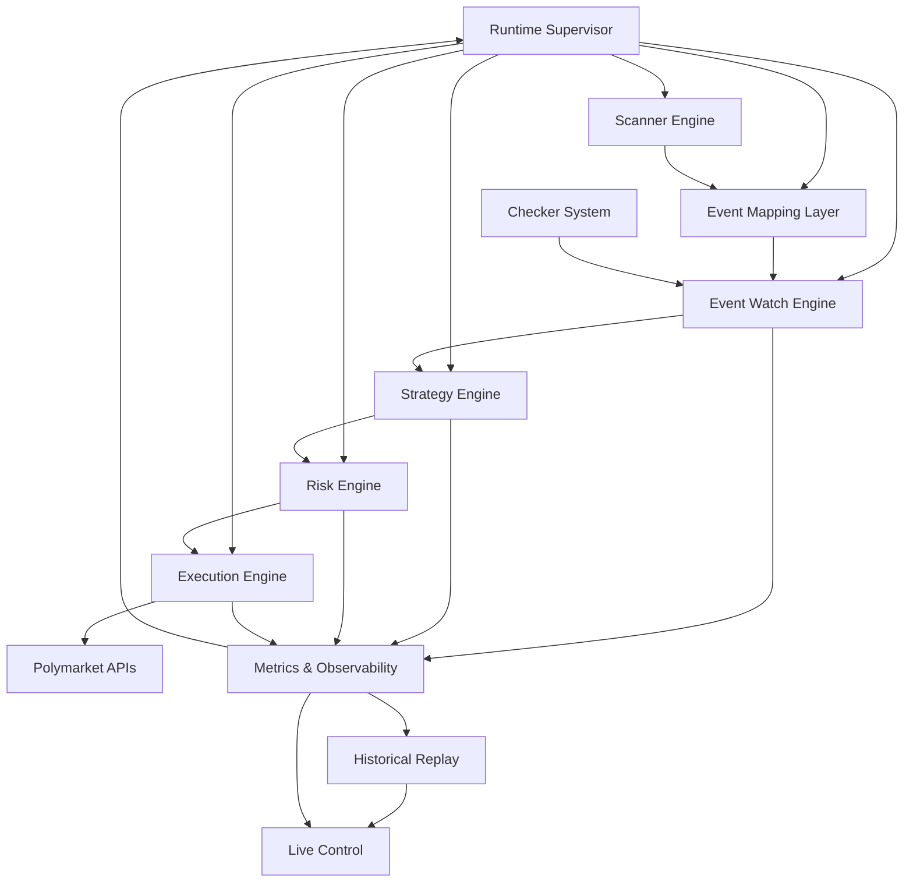
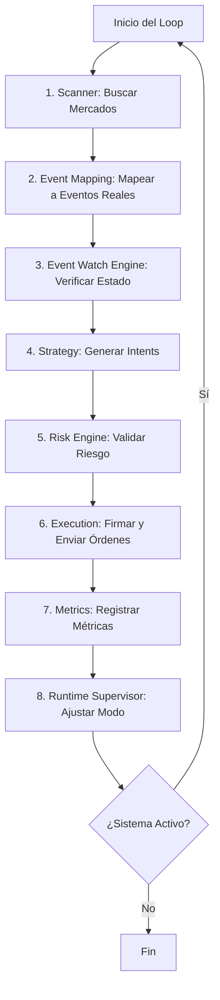

# PolyLiquidity Desk

**Autonomous Liquidity Provisioning System for Prediction Markets (Polymarket)**

**Versión 1.0 - Documentación General del Sistema**

---

## 1. Visión General

PolyLiquidity Desk es un **sistema de trading algorítmico automatizado de alto rendimiento** diseñado para detectar, validar y actuar sobre oportunidades de liquidez en Polymarket, particularmente en mercados impulsados por eventos del mundo real (deportes, noticias, elecciones, etc.).

### Características Principales

El sistema combina:

- ✅ **Verificación multi-fuente de eventos** - Validación robusta con múltiples checkers independientes
- ✅ **Escaneo de alta frecuencia** - Detección rápida de oportunidades
- ✅ **Modelos de precios estratégicos** - Cálculo preciso de precios objetivo
- ✅ **Gestión de riesgo en tiempo real** - Control de exposición y límites
- ✅ **Ejecución determinística** - Pipeline robusto con trazabilidad completa
- ✅ **Observabilidad completa** - Métricas, logs y dashboards en tiempo real
- ✅ **Replay y diagnóstico auditable** - Análisis histórico y debugging

**Esto no es un bot simple.**  
Es una **plataforma de nivel trading desk** construida para niveles de capital en el rango de 100k–200k+ EUR.

---

## 2. Arquitectura del Sistema

PolyLiquidity Desk está compuesto por **12 módulos completamente desacoplados, observables y testeables**:

### 2.1. Diagrama de Arquitectura

### 2.2. Módulos del Sistema

#### **Backend Core Logic**

1. **Scanner Engine** - Búsqueda y filtrado de mercados en Polymarket
2. **Event Mapping Layer** - Mapeo de mercados → eventos del mundo real
3. **Checker System** - Verificación multi-fuente de eventos (ESPN, Flashscore, etc.)
4. **Event Watch Engine** - Watchers paralelos que monitorean eventos en tiempo real
5. **Strategy Engine** - Cálculo de precios objetivo y tamaño de órdenes
6. **Risk Engine** - Validación de exposición y límites de riesgo
7. **Execution Engine** - Creación, firma (EIP-712) y envío de órdenes

#### **Supervisión y Estabilidad**

8. **Runtime Supervisor** - Monitoreo de latencia, circuit breakers y fail-safes
9. **Metrics & Observability Layer** - Recolección de métricas y alertas
10. **Historical Replay** - Auditoría completa y replay de eventos

#### **Experiencia de Usuario**

11. **Live Control** - Dashboard en tiempo real para monitoreo y control
12. **Signatures & Traceability** - Trazabilidad completa de órdenes y firmas

**Cada módulo está completamente documentado en su propio archivo `.md` en `docs/services/`.**

---

## 3. Índice de Documentación

Todas las subsistemas principales están documentadas en detalle:

### **Backend Core Logic**

- [`scanner.md`](./services/scanner.md)  
  Búsqueda de mercados, filtrado y detección de candidatos.

- [`event_mapping_layer.md`](./services/event_mapping_layer.md)  
  Mapeo de mercados → eventos del mundo real, sistema extensible multi-dominio.

- [`checker_system.md`](./services/checker_system.md)  
  Verificación multi-fuente de eventos (APIs deportivas, APIs de noticias, etc.).

- [`event_watch_engine.md`](./services/event_watch_engine.md)  
  Watchers paralelos que monitorean eventos en tiempo real.

- [`strategy.md`](./services/strategy.md)  
  Cálculo de precio objetivo, asignación de tamaño y creación de intents.

- [`risk_engine.md`](./services/risk_engine.md)  
  Límites de exposición, integración con modo runtime y validación de riesgo.

- [`execution.md`](./services/execution.md)  
  Creación de órdenes, firma (EIP-712), envío y gestión del ciclo de vida.

- [`signatures_trazability.md`](./services/signatures_trazability.md)  
  Firma EIP-712, trazabilidad completa y auditoría de órdenes.

### **Supervisión y Estabilidad**

- [`runtime_supervisor.md`](./services/runtime_supervisor.md)  
  Monitoreo de latencia, circuit breakers, fail-safes y modo de seguridad global.

- [`metrics_observabilitiy.md`](./services/metrics_observabilitiy.md)  
  Recolección de métricas, integración con Prometheus/Grafana, alertas.

- [`historical_replay.md`](./services/historical_replay.md)  
  Auditoría completa, motor de replay, debugging de viaje en el tiempo.

### **Experiencia de Usuario y Control**

- [`livecontrol.md`](./services/livecontrol.md)  
  Dashboard en tiempo real: eventos monitoreados, intents, ejecución, latencia y alertas.

### **Documentación de Alto Nivel**

- [`algoritmo_backend.md`](./algoritmo_backend.md)  
  Visión general del algoritmo del backend a nivel de negocio.

---

## 4. Flujo de Lógica de Alto Nivel

### 4.1. Loop Principal de Trading

El sistema ejecuta un loop principal que coordina todas las etapas:

**Pasos del Loop:**

1. **Scanner:** Buscar mercados en Polymarket
2. **Event Mapping:** Vincular mercados a eventos del mundo real
3. **Event Watch Engine:** Verificar estado de eventos (LIVE/FINISHED) con quorum
4. **Strategy:** Generar intents (precio y tamaño)
5. **Risk Engine:** Validar exposición y modo runtime
6. **Execution:** Firmar y enviar órdenes, rastrear fills
7. **Metrics:** Registrar salud del sistema y comportamiento
8. **Runtime Supervisor:** Ajustar modo global (GREEN/YELLOW/RED)

**Este loop se ejecuta cada 1–3 segundos dependiendo de la configuración.**

---

## 5. Características Clave

### 5.1. Verificación Multi-Fuente de Eventos

Los eventos se validan mediante múltiples checkers independientes:

- **ESPN API** (directo, sin API key)
- **Flashscore** (indirecto o vía MCP)
- **APIs alternativas** de deportes/noticias
- **Watchers manuales** (opcional)

**Sistema de quorum para robustez:**

| Fuentes Confirmadas | Estado |
|---------------------|--------|
| **2+ fuentes** | `FINISHED_CONFIRMED` |
| **1 fuente** | `FINISHED_UNCONFIRMED` |
| **0 fuentes** | `LIVE` |

### 5.2. Capa de Riesgo de Nivel Institucional

- ✅ Exposición por mercado
- ✅ Exposición global
- ✅ Límites de mercados concurrentes
- ✅ Ajustes dinámicos de safe-tick
- ✅ Restricciones de modo runtime
- ✅ Circuit breakers para anomalías

### 5.3. Motor de Estrategia Determinístico

Calcula:

- ✅ Mejor precio de ejecución
- ✅ Márgenes de seguridad
- ✅ Tamaño ajustado por latencia
- ✅ Reglas de eficiencia de capital
- ✅ Ventanas de ejecución conscientes del tiempo

### 5.4. Pipeline de Ejecución Robusto

Incluye:

- ✅ Firma EIP-712 completa
- ✅ Batching de órdenes
- ✅ Rastreo de fills parciales
- ✅ Recuperación de errores
- ✅ Reconciliación de resolución de mercado

**El motor produce un trace completo para cada orden.**

### 5.5. Observabilidad y Debuggability

El sistema tiene:

- ✅ Streaming WebSocket en tiempo real
- ✅ Endpoints de snapshot
- ✅ Exportadores de métricas (Prometheus)
- ✅ Logging de eventos estructurado
- ✅ Trazabilidad estructurada
- ✅ Motor de replay para análisis forense

---

## 6. Modelo de Seguridad en Runtime

El **Runtime Supervisor** hace cumplir la seguridad operacional:

### 6.1. Modos de Operación

| Modo   | Comportamiento |
|--------|----------------|
| **GREEN**  | Operación normal |
| **YELLOW** | Tamaño conservador, agresividad reducida |
| **RED**    | Trading pausado, órdenes opcionalmente canceladas |

### 6.2. Circuit Breakers

- **Trading Circuit** - Protege contra cascadas de errores
- **Checker Circuit** - Por proveedor (ESPN, Flashscore, etc.)
- **Polymarket API Circuit** - Para endpoints de mercado y trading

---

## 7. Garantías de Datos y Logging

Todo es **trazable** y **auditable**:

### 7.1. Logs Garantizados

- ✅ Decisiones de watchers
- ✅ Respuestas de checkers
- ✅ Creación de intents
- ✅ Decisiones de riesgo
- ✅ Ciclo de vida de ejecución
- ✅ Fills y rechazos
- ✅ Actualizaciones de modo runtime
- ✅ Muestras de latencia
- ✅ Snapshots de mercado

### 7.2. Capacidades de Historical Replay

Puedes:

- ✅ Reconstruir el estado del sistema en cualquier timestamp
- ✅ Reproducir cada decisión
- ✅ Probar nuevas estrategias con datos antiguos
- ✅ Detectar inconsistencias o bugs de casos límite

**Esto es esencial para sistemas con dinero real.**

---

## 8. Dashboard de Live Control

**En tiempo real muestra:**

- ✅ Eventos siendo monitoreados
- ✅ Resultados de checkers y confianza
- ✅ Mercados activos
- ✅ Intents y aprobaciones
- ✅ Flujo de órdenes
- ✅ Fills
- ✅ Gráficos de latencia
- ✅ Gráficos de exposición
- ✅ Transiciones de modo runtime
- ✅ Eventos de circuit breakers
- ✅ Alertas

**Equivalente a una UI de trading desk institucional de baja latencia.**

---

## 9. Despliegue

### 9.1. Configuraciones Soportadas

- ✅ Desarrollo local
- ✅ Despliegue con Docker
- ✅ Despliegue en servidor o VPS
- ✅ Supervisión de procesos (PM2 / Systemd)
- ✅ Stack opcional de Prometheus + Grafana
- ✅ Almacenamiento opcional (S3/SQLite/PostgreSQL) para historial

### 9.2. Requisitos Mínimos

- **Python 3.10+**
- **Node.js** (opcional, para UI)
- **SQLite/Postgres** (para historial)

---

## 10. Filosofía de Desarrollo

El sistema sigue principios usados en trading automatizado financiero:

- ✅ **Comportamiento determinístico** - Mismo input = mismo output
- ✅ **Arquitectura orientada a eventos** - Módulos desacoplados
- ✅ **Efectos secundarios mínimos** - Operaciones puras cuando es posible
- ✅ **Aislamiento fuerte entre módulos** - Interfaces claras
- ✅ **Logging uniforme** - Formato estructurado consistente
- ✅ **Operaciones idempotentes** - Reintentos seguros
- ✅ **Timing de ejecución predecible** - Sin bloqueos inesperados
- ✅ **Replayabilidad** - Todo es reproducible

---

## 11. Roadmap

### Fase 1 – MVP (Actual)

- ✅ Watchers de eventos deportivos
- ✅ Estrategia de precios básica
- ✅ Capa de riesgo completa
- ✅ Ejecución + firma
- ✅ Dashboard en vivo
- ✅ Métricas + Replay

### Fase 2 – Checkers Extendidos

- 🔄 Mercados basados en noticias
- 🔄 Indicadores económicos
- 🔄 Seguimiento de elecciones
- 🔄 Señales de sentimiento social

### Fase 3 – Ejecución Avanzada

- 🔄 Smart order routing
- 🔄 Gestión multi-wallet
- 🔄 Modelado predictivo de latencia

---

## 12. Licencia y Descargo de Responsabilidad

Este sistema automatiza decisiones de trading.  
**Úsalo responsablemente y con plena comprensión de los riesgos.**

Eres el único responsable de:

- ✅ Cumplir con regulaciones locales
- ✅ Límites de rate limiting de APIs
- ✅ Monitoreo operacional
- ✅ Gestión de riesgo financiero

**No se implica garantía de rentabilidad.**

---

## 13. Contribuir

Este es un sistema modular; cada componente puede mejorarse independientemente.

- ✅ Agregar nuevos checkers
- ✅ Mejorar modelos de precios
- ✅ Mejorar predicción de latencia
- ✅ Agregar nuevos dashboards
- ✅ Extender motor de replay

**Las pull requests son bienvenidas.**

---

## 14. Contacto / Soporte

Para soporte de arquitectura o troubleshooting:

- **Arquitectura del Sistema:** `docs/services/`
- **Troubleshooting:** `docs/services/runtime_supervisor.md`
- **Análisis de Replay:** `docs/services/historical_replay.md`
- **Debugging en Vivo:** Usar Live Control UI

---

## 15. Resumen

**PolyLiquidity Desk** es una plataforma completa de provisión de liquidez para mercados de predicción impulsados por eventos del mundo real.

**Características principales:**
- ✅ **Inteligente** - Detección automática de oportunidades
- ✅ **Seguro** - Múltiples capas de protección y validación
- ✅ **Auditable** - Trazabilidad completa y replay histórico
- ✅ **Escalable** - Arquitectura modular y extensible

**Construido para niveles de capital institucionales con seguridad y observabilidad de nivel profesional.**

---

**PolyLiquidity Desk – A complete liquidity provision platform for real-world-driven prediction markets.**  
**Intelligent. Safe. Auditable. Scalable.**
