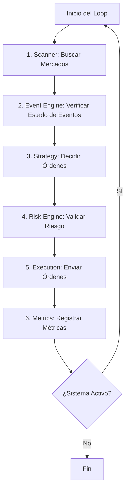
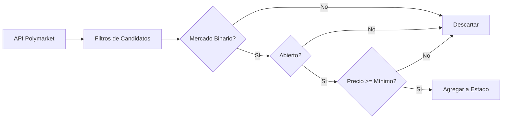
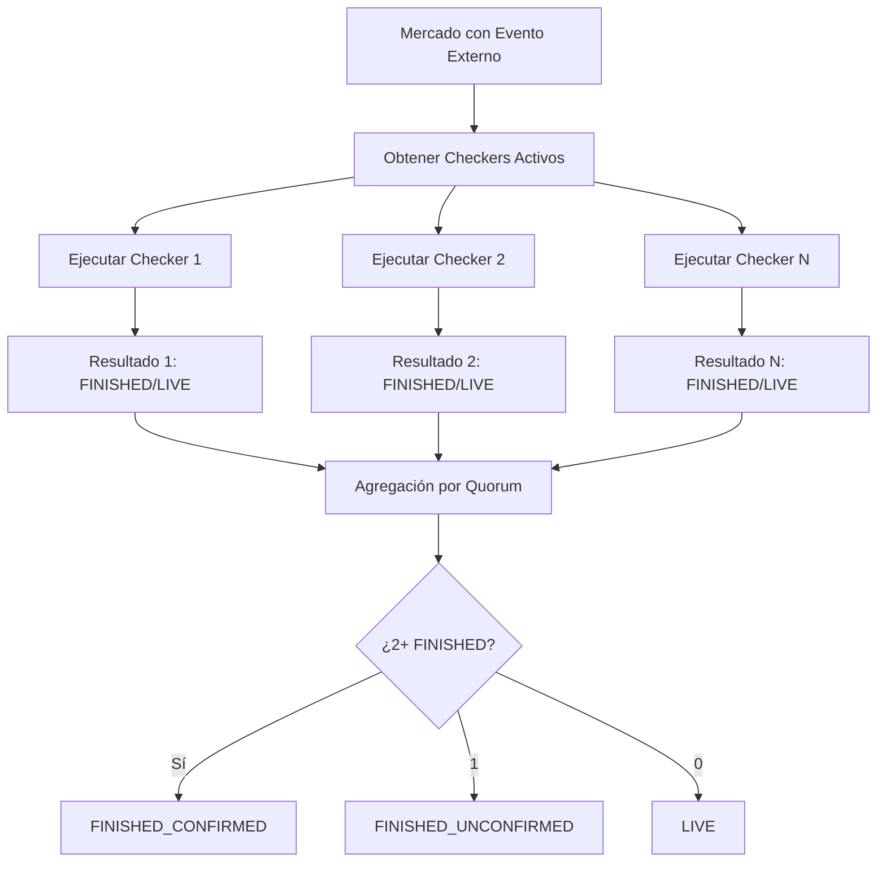
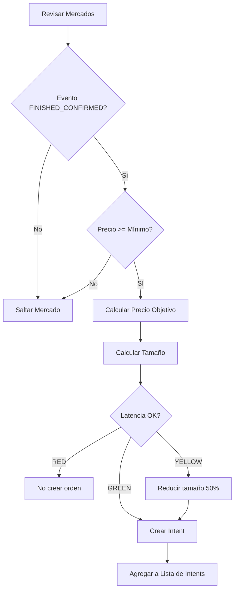
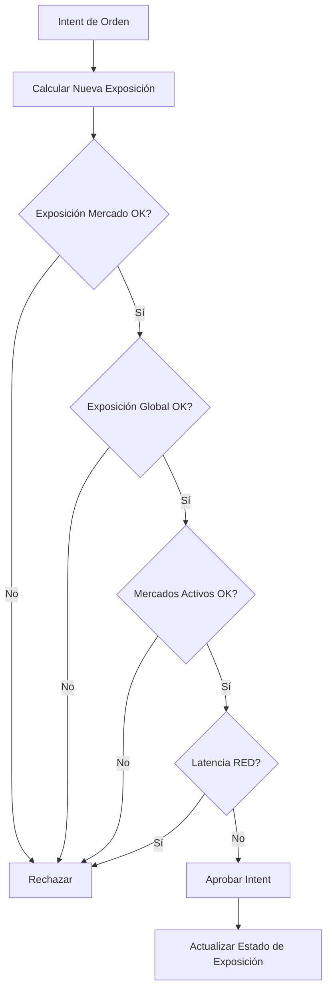
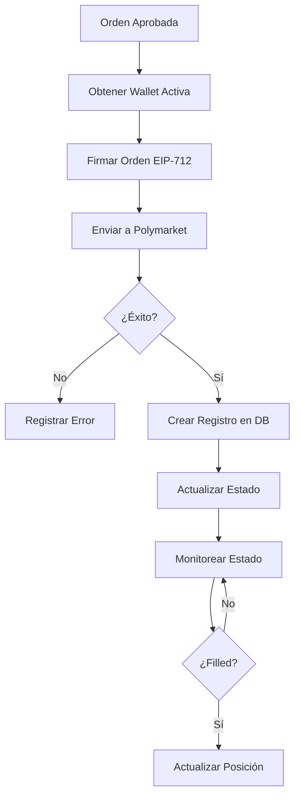
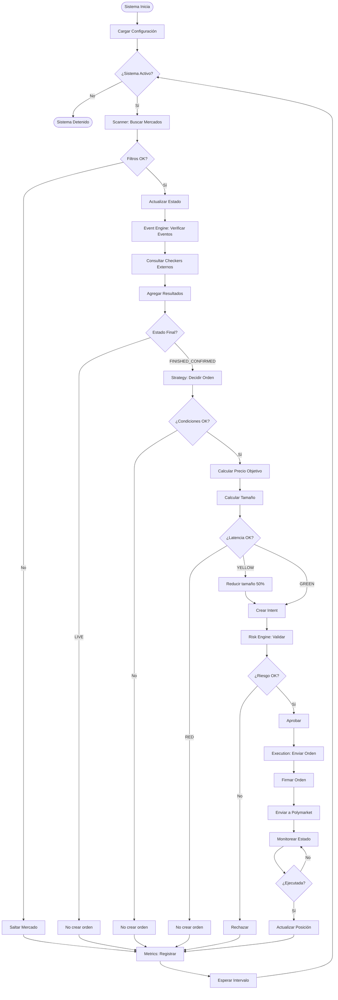

# Algoritmo del Backend - PolyLiquidity Desk

## Visión General

El sistema PolyLiquidity Desk es un **bot de trading automatizado** que opera en Polymarket, una plataforma de mercados de predicción. El objetivo del sistema es **detectar oportunidades de liquidez** cuando eventos deportivos (u otros eventos) están a punto de finalizar, y ejecutar órdenes de compra de forma automatizada para aprovechar estas oportunidades.

---

## Flujo Principal del Algoritmo

El sistema funciona en un **loop continuo** que se ejecuta cada pocos segundos (configurable). En cada iteración, el algoritmo realiza 6 pasos principales:



---

## Componentes del Sistema

### 1. Scanner (Buscador de Mercados)

**Objetivo:** Encontrar mercados candidatos en Polymarket que cumplan ciertos criterios.

**Qué hace:**
- Consulta la API de Polymarket para obtener listado de mercados
- Filtra mercados según criterios:
  - Solo mercados binarios (YES/NO)
  - Solo mercados ABIERTOS
  - Solo con precio >= precio mínimo configurado (ej: 0.97)
  - Eventos que NO estén resueltos aún
- Actualiza el estado interno del sistema con información de precios, spreads, volumen, etc.

**Frecuencia:** Se ejecuta cada X segundos (configurable, típicamente cada 30-60 segundos)

**Limitaciones:** 
- Respeta límites de rate limiting de Polymarket (200 requests cada 10 segundos)
- Usa caché para evitar consultas redundantes



---

### 2. Event Engine (Motor de Eventos)

**Objetivo:** Determinar cuándo un evento deportivo (o de otro tipo) ha finalizado realmente.

**Problema que resuelve:** 
Polymarket puede mostrar que un mercado está "abierto", pero el evento real (ej: partido de fútbol) puede haber terminado. El sistema necesita saber esto ANTES que Polymarket lo resuelva oficialmente.

**Qué hace:**
- Para cada mercado con un evento externo asociado:
  - Consulta múltiples "checkers" (verificadores) externos
  - Cada checker consulta su propia API (ej: API de deportes, API de resultados)
  - Cada checker responde: "FINISHED" o "LIVE" con un nivel de confianza
- **Agregación por Quorum:**
  - Si 2+ checkers confirman que está FINISHED → Estado: `FINISHED_CONFIRMED`
  - Si 1 checker dice FINISHED → Estado: `FINISHED_UNCONFIRMED`
  - Si ninguno dice FINISHED → Estado: `LIVE`

**Ejemplo:**
- Mercado: "¿Ganará Lakers el partido?"
- Checker 1 (API Deportes A): FINISHED, confianza 0.95
- Checker 2 (API Deportes B): FINISHED, confianza 0.90
- **Resultado:** `FINISHED_CONFIRMED` (2 checkers coinciden)



---

### 3. Strategy (Estrategia de Trading)

**Objetivo:** Decidir QUÉ órdenes crear, a QUÉ precio, y con QUÉ tamaño.

**Condiciones para crear una orden:**
1. El evento debe estar en estado `FINISHED_CONFIRMED`
2. El precio del mercado debe ser >= precio mínimo de entrada (ej: 0.97)
3. El sistema debe tener capacidad (no exceder límites de exposición)

**Cálculo del Precio Objetivo:**
```
Precio Objetivo = min(
    Mejor Oferta - Tick de Seguridad,
    1.0 - Margen Objetivo
)
```

**Ejemplo:**
- Mejor oferta (best ask): 0.98
- Tick de seguridad: 0.001
- Margen objetivo: 0.01
- **Precio objetivo:** min(0.98 - 0.001, 1.0 - 0.01) = min(0.979, 0.99) = **0.979**

**Cálculo del Tamaño:**
- Considera:
  - Exposición máxima por mercado
  - Exposición global máxima
  - Liquidez disponible en el orderbook
  - Tamaño máximo por orden
- Toma el **mínimo** de todas estas restricciones

**Ajustes por Latencia:**
- Si la latencia del sistema es ALTA (YELLOW):
  - Reduce el tamaño de la orden al 50%
  - Aumenta el tick de seguridad (más conservador)
- Si la latencia es CRÍTICA (RED):
  - No crea nuevas órdenes (fail-safe)



---

### 4. Risk Engine (Motor de Riesgo)

**Objetivo:** Validar que las órdenes propuestas no violen límites de riesgo.

**Reglas de Riesgo:**
1. **Exposición por Mercado:**
   - La exposición total en un mercado no puede exceder el máximo configurado
   - Ejemplo: Máximo $10,000 por mercado

2. **Exposición Global:**
   - La exposición total en todos los mercados no puede exceder el máximo global
   - Ejemplo: Máximo $100,000 en total

3. **Número de Mercados Activos:**
   - No puede haber más de X mercados activos simultáneamente
   - Ejemplo: Máximo 20 mercados activos

4. **Fail-Safe por Latencia:**
   - Si la latencia es CRÍTICA (RED): Rechaza TODAS las nuevas órdenes
   - Si la latencia es ELEVADA (YELLOW): Ya fue ajustada en Strategy

**Proceso:**
- Para cada intent de orden:
  - Calcula la nueva exposición si se ejecuta
  - Verifica todas las reglas
  - Si pasa todas → Aprueba
  - Si falla alguna → Rechaza con razón



---

### 5. Execution (Ejecución)

**Objetivo:** Enviar las órdenes aprobadas a Polymarket y gestionar su ciclo de vida.

**Proceso:**
1. **Para cada orden aprobada:**
   - Obtiene la wallet activa (necesaria para firmar)
   - Construye el payload de la orden
   - Firma la orden usando EIP-712 (firma criptográfica)
   - Envía la orden a la API de Trading de Polymarket
   - Crea registro en base de datos
   - Actualiza estado interno

2. **Monitoreo de Órdenes:**
   - Consulta periódicamente el estado de órdenes pendientes
   - Detecta cuando una orden es "filled" (ejecutada)
   - Actualiza posiciones cuando hay fills

3. **Cancelaciones:**
   - Si el sistema se pausa → Cancela todas las órdenes abiertas
   - Si un mercado se resuelve → Cancela órdenes de ese mercado

**Limitaciones:**
- Respeta límites de rate limiting (2400 requests cada 10 segundos para Trading API)
- Mide latencia end-to-end (desde creación hasta confirmación)



---

### 6. Metrics (Métricas)

**Objetivo:** Registrar métricas del sistema para monitoreo y análisis.

**Qué registra:**
- Número de órdenes enviadas
- Número de órdenes ejecutadas
- Exposiciones actuales
- Latencias del sistema
- Errores y excepciones

---

## Flujo Completo: Ejemplo Práctico

Imaginemos un escenario real:

### Escenario: Partido Lakers vs Warriors

1. **Scanner (00:00):**
   - Encuentra mercado: "¿Ganarán Lakers?" con precio 0.98
   - Mercado está ABIERTO y es binario
   - **Acción:** Agrega al estado interno

2. **Event Engine (00:05):**
   - Consulta Checker 1 (API Deportes A): "LIVE" (partido en curso)
   - Consulta Checker 2 (API Deportes B): "LIVE" (partido en curso)
   - **Resultado:** Estado = `LIVE`
   - **Acción:** No hacer nada (evento aún no terminó)

3. **Strategy (00:10):**
   - Revisa el mercado
   - Estado del evento: `LIVE` (no `FINISHED_CONFIRMED`)
   - **Acción:** No crea ninguna orden

4. **Event Engine (02:30):**
   - Consulta Checker 1: "FINISHED" (partido terminó, Lakers ganó)
   - Consulta Checker 2: "FINISHED" (partido terminó, Lakers ganó)
   - **Resultado:** Estado = `FINISHED_CONFIRMED` (2 checkers coinciden)
   - **Acción:** Actualiza estado del evento

5. **Strategy (02:35):**
   - Revisa el mercado
   - Estado del evento: `FINISHED_CONFIRMED` ✓
   - Precio: 0.98 >= 0.97 (mínimo) ✓
   - Calcula precio objetivo: 0.979
   - Calcula tamaño: $5,000 (basado en límites)
   - **Acción:** Crea Intent de orden (BUY 0.979 @ $5,000)

6. **Risk Engine (02:35):**
   - Verifica exposición por mercado: OK
   - Verifica exposición global: OK
   - Verifica mercados activos: OK
   - Latencia: GREEN ✓
   - **Acción:** Aprueba el Intent

7. **Execution (02:35):**
   - Obtiene wallet activa
   - Firma la orden
   - Envía a Polymarket
   - **Acción:** Orden enviada, esperando ejecución

8. **Execution (02:36):**
   - Polymarket ejecuta la orden (fill)
   - **Acción:** Actualiza posición, crea registro de trade

9. **Resultado Final:**
   - Sistema compró a 0.979
   - Cuando Polymarket resuelva el mercado (probablemente a 1.0), el sistema tendrá ganancia

---

## Protecciones y Fail-Safes

### 1. Rate Limiting
- **Problema:** Polymarket limita requests por segundo
- **Solución:** Sistema respeta límites y usa caché para reducir requests

### 2. Latency Monitoring
- **Problema:** Si el sistema es lento, puede perder oportunidades o ejecutar mal
- **Solución:** 
  - Monitorea latencia constantemente
  - Si latencia es ALTA → Reduce agresividad
  - Si latencia es CRÍTICA → Detiene nuevas entradas

### 3. Risk Limits
- **Problema:** Exposición excesiva puede causar pérdidas grandes
- **Solución:** Múltiples capas de límites (por mercado, global, número de mercados)

### 4. Quorum de Checkers
- **Problema:** Un checker puede dar información incorrecta
- **Solución:** Requiere 2+ checkers coincidiendo para confirmar que evento terminó

---

## Configuración Clave

El sistema es configurable mediante parámetros de riesgo:

- **Precio mínimo de entrada:** Precio mínimo del mercado para considerar entrada
- **Exposición máxima por mercado:** Límite de capital por mercado individual
- **Exposición global máxima:** Límite total de capital desplegado
- **Máximo de mercados activos:** Número máximo de mercados simultáneos
- **Tick de seguridad:** Margen de seguridad en el precio
- **Margen objetivo:** Margen de ganancia objetivo
- **Intervalo de escaneo:** Frecuencia de búsqueda de mercados
- **Intervalo de tick:** Frecuencia del loop principal

---

## Resumen del Algoritmo

El algoritmo funciona como un **ciclo continuo de detección y ejecución**:

1. **Busca** mercados candidatos en Polymarket
2. **Verifica** si los eventos externos han terminado (usando múltiples fuentes)
3. **Decide** qué órdenes crear (precio y tamaño)
4. **Valida** que no se excedan límites de riesgo
5. **Ejecuta** las órdenes aprobadas
6. **Registra** métricas y repite

El objetivo es **detectar eventos terminados ANTES que Polymarket los resuelva**, permitiendo comprar a precios favorables y obtener ganancias cuando el mercado se resuelve.

---

## Diagrama de Flujo Completo



---

## Conclusión

El algoritmo del backend de PolyLiquidity Desk es un **sistema automatizado de detección y ejecución de oportunidades de trading** que:

- **Detecta** mercados con eventos a punto de finalizar
- **Verifica** el estado real de eventos usando múltiples fuentes externas
- **Decide** cuándo y cómo entrar al mercado
- **Protege** contra riesgos mediante múltiples capas de validación
- **Ejecuta** órdenes de forma automatizada y eficiente

El sistema está diseñado para ser **robusto, seguro y eficiente**, con múltiples protecciones contra errores y condiciones adversas.

