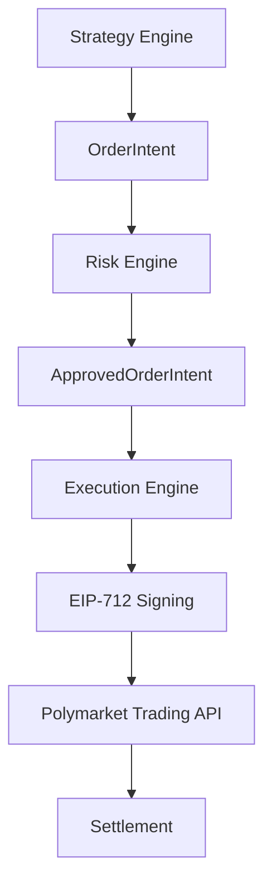

# Execution Engine

**Purpose**: Technical specification for the execution engine, including graph-based strategy architecture, order signing, and execution lifecycle.

**Audience**: Engineers implementing or maintaining the execution engine, strategy developers.

**Where this is used**: Execution engine implementation, strategy configuration, order lifecycle management.

**Last updated**: 2025-01-XX

---

# Execution Engine Architecture

## Overview

The Execution Engine is responsible for:

1. **Signing orders EIP-712** with the bot's wallet
2. **Sending orders** to Polymarket trading endpoints
3. **Managing order lifecycle**: Creation, acceptance, placement, execution (fills), expiration, cancellation
4. **Monitoring latency and errors** in real-time
5. **Maintaining complete traceability** for audits and deep debugging

**Critical Importance**: This is where real money moves. Everything must be secure, deterministic, and monitorable.

---

## Graph-Based Strategy Architecture

The backend uses a **declarative graph-based architecture** where:

- **Strategies are NOT hardcoded code**, they are **JSON graphs** executed at runtime
- **Each strategy is a live process** (long-lived) that executes a Control Loop
- **Decision Graph (hot path)**: Executes fast (< 50μs), only reads State Cache, never calls APIs. **Decides** if there's an opportunity and **builds a Plan**.
- **Execution Plans**: Immutable entities representing an execution plan (1 leg for near-end, N legs for surebet)
- **Execution Graphs (cold path)**: Execute plans asynchronously, handle retries, compensation, partial atomicity
- **Support Graphs (cold path)**: Execute asynchronously, can use APIs, AI, take as long as needed. Update State Cache.
- **State Cache**: Centralized service storing state (market_state, event_state, external_data, risk_state)
- **Strategy Triggers**: Explicit conditions determining when to activate Decision Graph (not "evaluate always")

### Core Principles

1. ✅ **Strategy is the root entity** - Not markets or events
2. ✅ **Event is the atomic execution unit** - Not the market
3. ✅ **Strategies do NOT call APIs directly** - Only read State Cache
4. ✅ **External data sources are configurable** - From DB/frontend
5. ✅ **No hardcoded names** - Everything is configurable
6. ✅ **Only execution venue is fixed** - Polymarket
7. ✅ **Declarative strategies** - JSON, not Python code
8. ✅ **Explicit immutable plan** - ExecutionPlan separates decision from execution
9. ✅ **Execution Graph for operations** - Handles multi-leg, retries, compensation
10. ✅ **Explicit triggers** - Not "evaluate always", only when conditions are met

---

## Architecture Layers

```
┌─────────────────────────────────────────────────────────────┐
│                    CONTROL LOOP                             │
│  (Fixed infrastructure - NOT user-editable)                 │
│  - Iterates over active strategies                          │
│  - Evaluates Strategy Triggers (explicit watchers)          │
│  - Fires Decision Graph only if trigger matches             │
│  - Executes Execution Graphs for ready plans                │
│  - Executes Support Graphs according to triggers            │
└─────────────────────────────────────────────────────────────┘
                          │
                          ▼
┌─────────────────────────────────────────────────────────────┐
│                  STRATEGY ENGINE                            │
│  - Orchestrates graph execution                            │
│  - Coordinates Graph Runtime + State Cache                 │
│  - Manages Execution Plans (immutable)                     │
│  - Coordinates Execution Graphs (multi-leg, retries)      │
└─────────────────────────────────────────────────────────────┘
                          │
        ┌─────────────────┴─────────────────┐
        ▼                                   ▼
┌──────────────────┐              ┌──────────────────┐
│  GRAPH RUNTIME   │              │  STATE CACHE     │
│  - Executes nodes│              │  - market_state  │
│  - Hot/Cold path │              │  - event_state   │
│  - Sequential    │              │  - external_data │
└──────────────────┘              │  - risk_state    │
                                  └──────────────────┘
                          │
                          ▼
┌─────────────────────────────────────────────────────────────┐
│              EXECUTION PLAN STORE                          │
│  - Stores immutable plans                                 │
│  - States: PLAN_BUILT | EXECUTING | COMPLETED | FAILED   │
└─────────────────────────────────────────────────────────────┘
```

---

## Execution Plans

### Concept

**ExecutionPlan** is an **immutable** entity representing a complete execution plan. It separates **decision** (Decision Graph) from **execution** (Execution Graph).

### Why Execution Plans?

1. **For multi-leg surebets**: Need to execute multiple orders coordinately
2. **For iterative near-end**: Need to retry and adjust
3. **For compensation**: If one part fails, need to undo
4. **For partial atomicity**: Some legs can complete, others not

### Data Model

```python
class ExecutionPlan(BaseModel):
    """Immutable execution plan."""
    
    strategy_id: UUID
    event_id: UUID
    legs: List[PlanLeg]  # 1 for near-end, N for surebet
    ttl_ms: int  # Plan time-to-live
    created_at: datetime
    status: str  # "PLAN_BUILT" | "ABORTED" | "EXECUTING" | "COMPLETED" | "FAILED"
    trace_id: UUID


class PlanLeg(BaseModel):
    """A leg of the plan (one order to execute)."""
    
    leg_id: str
    side: str  # "BUY" | "SELL"
    outcome: str  # "YES" | "NO" | "UP" | "DOWN"
    target_price: Decimal
    size: Decimal  # In shares
    size_usdc: Decimal  # In USDC
    status: str  # "PENDING" | "EXECUTING" | "FILLED" | "PARTIAL" | "FAILED" | "CANCELLED"
    filled_size: Decimal = 0
    filled_size_usdc: Decimal = 0
    reason: str
    metadata: Dict[str, Any] = {}
```

### Plan States

| State | Description |
|-------|-------------|
| `PLAN_BUILT` | Plan created, ready to execute |
| `ABORTED` | Plan cancelled before execution |
| `EXECUTING` | Plan in execution (at least one leg active) |
| `COMPLETED` | All legs completed successfully |
| `FAILED` | Plan failed (could not complete) |

---

## Execution Flow

### Complete Sequence



### Step-by-Step Process

1. **Generate Order Payload**
   - Map intent fields to Polymarket order format
   - Get nonce from NonceManager
   - Calculate expiration

2. **EIP-712 Signing**
   - Build EIP-712 structure (domain, types, message)
   - Sign with private key
   - Create SignedOrder record

3. **Send to Polymarket**
   - Build HTTP payload
   - Send POST to trading endpoint
   - Handle rate limiting
   - Create ExecutionRecord

4. **Monitor Order**
   - Poll order status
   - Detect fills (partial or complete)
   - Update order state
   - Update positions

5. **Handle Completion**
   - Update exposure
   - Create trade records
   - Log completion

---

## EIP-712 Signing

### Structure

```json
{
  "domain": {
    "name": "Polymarket Exchange",
    "version": "1",
    "chainId": 137,
    "verifyingContract": "0x..."
  },
  "message": {
    "marketId": "pm_market_id",
    "outcome": "YES",
    "price": "979000000000000000",
    "size": "5000000000000000000000",
    "side": "BUY",
    "nonce": "123456789",
    "expiration": "1735689600",
    "clientOrderId": "intent_id-uuid"
  },
  "primaryType": "Order",
  "types": {
    "EIP712Domain": [...],
    "Order": [...]
  }
}
```

### Signing Process

1. Build EIP-712 structure
2. Calculate domain separator
3. Calculate message hash
4. Sign with private key using `eth_account` or similar
5. Return signature (hex string with `0x` prefix)

**Security**: Private key never logged, never exposed, only used for signing.

---

## Order Lifecycle

### State Machine

```
PENDING → SUBMITTED → OPEN → PARTIALLY_FILLED → FILLED
                              ↓
                         CANCELLED
                              ↓
                         FAILED
```

### States

- **PENDING**: Order created, not yet submitted
- **SUBMITTED**: Order sent to Polymarket, awaiting confirmation
- **OPEN**: Order active in orderbook
- **PARTIALLY_FILLED**: Order partially executed
- **FILLED**: Order completely executed
- **CANCELLED**: Order cancelled before execution
- **FAILED**: Order submission failed

### State Transitions

```python
def update_order_state(order_id: UUID, new_status: str, reason: str = None):
    """Update order state with transition validation."""
    current_status = get_order_status(order_id)
    
    # Validate transition
    if not is_valid_transition(current_status, new_status):
        raise InvalidStateTransitionError()
    
    # Update state
    order.status = new_status
    order.updated_at = datetime.utcnow()
    
    # Log transition
    log_state_transition(order_id, current_status, new_status, reason)
```

---

## Fill Detection

### Methods

1. **Polling**: Periodic status checks
2. **WebSocket**: Real-time updates (preferred)
3. **Callbacks**: If supported by Polymarket

### Processing Fills

```python
def handle_fill(order_id: UUID, fill_data: Dict):
    """Process an order fill."""
    # 1. Update order
    order.filled_size += fill_data["size"]
    if order.filled_size >= order.size:
        order.status = "FILLED"
    else:
        order.status = "PARTIALLY_FILLED"
    
    # 2. Update position
    update_position(order.market_id, fill_data["size"], fill_data["price"])
    
    # 3. Update exposure
    update_exposure(order.market_id, fill_data["size"] * fill_data["price"])
    
    # 4. Create trade record
    create_trade_record(order_id, fill_data)
    
    # 5. Log fill
    log_fill(order_id, fill_data)
```

---

## Order Cancellation

### Reasons

- System pause
- Red latency
- Safe shutdown
- Market resolution
- Strategy invalidation

### Process

```python
async def cancel_order(order_id: UUID, reason: str):
    """Cancel an order in Polymarket."""
    order = get_order(order_id)
    
    if order.status in ("FILLED", "CANCELLED"):
        return  # Already finished
    
    # Acquire rate limit permission
    if not await rate_limiter.wait_for_capacity(EndpointType.TRADING_ORDER, timeout=1.0):
        return
    
    # Send cancellation
    try:
        response = await client.delete(f"{endpoint}/orders/{order.polymarket_order_id}")
        response.raise_for_status()
        
        # Update state
        await update_order_state(order_id, "CANCELLED", reason)
    except Exception as e:
        log_error("cancel_failed", order_id=order_id, error=str(e))
```

---

## Traceability

### ID Chain

```
trace_id (generated in Strategy)
  └─> intent_id (OrderIntent)
      └─> signed_order_id (SignedOrder)
          └─> execution_id (ExecutionRecord)
              └─> polymarket_order_id (from Polymarket)
                  └─> order_state_history_id (OrderStateHistory)
```

### Logging

All execution logs are structured JSON with:

- `timestamp`: ISO 8601 with timezone
- `level`: INFO, WARN, ERROR, DEBUG
- `trace_id`: UUID for correlation
- `component`: execution, signer, order_monitor
- `event_type`: order_signed, order_sent, order_filled, etc.
- `order_id`, `polymarket_order_id`: For tracking
- `latency_ms`: Execution latency
- `error_type`, `error_code`: If error occurred

### Example Log

```json
{
  "timestamp": "2025-01-25T20:15:30.123Z",
  "level": "INFO",
  "component": "execution",
  "event_type": "order_sent",
  "trace_id": "b3c1e7fc-2a5f-4b7a-9c90-1b...",
  "order_id": "order_xyz",
  "polymarket_order_id": "pm_order_123",
  "latency_ms": 183,
  "message": "Order sent to Polymarket trading API"
}
```

---

## Error Handling

### Signing Errors

**Examples:**
- Private key unavailable
- Signing library failure
- EIP-712 message inconsistency

**Action:**
- SignedOrder NOT created
- OrderIntent.status → REJECTED_BY_EXECUTION
- Log ERROR (without exposing private key)
- No retry (critical error, requires intervention)

### HTTP Errors

**Examples:**
- Network timeout
- 429 (rate limit)
- 500 (server error)

**Action:**
- ExecutionRecord with status = ERROR or TIMEOUT
- Retry logic: max 3 retries, exponential backoff
- If fails after 3 attempts: mark as REJECTED_BY_EXECUTION

### Exchange Rejection

**Examples:**
- Price out of range
- Market closed
- Invalid signature
- Wrong nonce

**Action:**
- ExecutionRecord with status = REJECTED
- OrderIntent.status → REJECTED_BY_EXECUTION
- Log ERROR with exchange error code
- No retry (validation error, requires correction)

---

## Security

### Private Key Handling

- ❌ Never logged
- ❌ Never stored in database
- ❌ Never sent over network in plain text
- ❌ Never exposed in error messages
- ✅ Loaded once at startup (or on-demand with secure cache)
- ✅ Kept in memory only as long as needed for signing

### Nonce Management

```python
class NonceManager:
    """Nonce manager for orders."""
    
    def get_next_nonce(self) -> int:
        """Get next nonce."""
        current_nonce = self._get_current_nonce()
        return current_nonce + 1
    
    def sync_nonce(self):
        """Sync nonce from blockchain if order fails."""
        # Query current nonce from blockchain
        # Update internal counter
        pass
```

**Rules:**
- Each order increments nonce
- If order fails → nonce synced via blockchain
- Nonces never reused

### Circuit Breaker

```python
class TradingCircuitBreaker:
    """Circuit breaker for trading."""
    
    def __init__(self, failure_threshold: int = 5, window_seconds: int = 60):
        self.failure_threshold = failure_threshold
        self.window_seconds = window_seconds
        self.failure_count = 0
        self.state = "CLOSED"  # CLOSED, OPEN, HALF_OPEN
    
    def record_failure(self):
        """Record a failure."""
        self.failure_count += 1
        if self.failure_count >= self.failure_threshold:
            self.state = "OPEN"
            # Pause trading
            # Cancel open orders
            # Send alerts
```

**Actions when OPEN:**
- No new orders until cooldown
- Cancel open orders
- System alerts

---

## Rate Limiting

### Limits

- **Polymarket Scanner**: 200 req / 10s
- **Trading API**: 2400 req / 10s
- **Data API**: 200 req / 10s

### Implementation

```python
# Acquire rate limit permission
if not await rate_limiter.wait_for_capacity(EndpointType.TRADING_ORDER, timeout=2.0):
    return None  # Timeout

# Send order
response = await client.post(f"{endpoint}/trades", json=payload)

# Check rate limit
if response.status_code == 429:
    await rate_limiter.record_violation(EndpointType.TRADING_ORDER)
    raise RateLimitError()
```

---

## Integration with Other Modules

### Risk Engine

```
Risk Engine → ApprovedOrderIntent → Execution Engine
```

### Wallet Service

```
Execution Engine → WalletService → Wallet → EIP-712 Signing
```

### Rate Limiter

```
Execution Engine → RateLimiter → Polymarket API
```

### Latency Monitor

```
Execution Engine → LatencyMonitor → Record Execution Latency
```

---

## Operational Configuration & Invariants

### Execution Invariants (CRITICAL)

1. **An ExecutionPlan is immutable after creation.**
   - Once created with status `PLAN_BUILT`, the plan CANNOT be modified
   - Cannot change: legs, sizes, prices, TTL
   - Can only change plan state (allowed transitions)

2. **No node may modify a plan after PLAN_BUILT.**
   - ❌ Prohibited: change `leg.size`
   - ❌ Prohibited: change `leg.target_price`
   - ❌ Prohibited: add/remove legs
   - ✅ Allowed: update `leg.status` (PENDING → EXECUTING → FILLED)

3. **Plan state transitions are strictly enforced.**
   ```
   PLAN_BUILT → EXECUTING → COMPLETED | FAILED | ABORTED
                    ↓
                 ABORTED (from any state)
   ```

4. **Execution TTL is enforced strictly.**
   - If `plan.ttl_ms` expires, plan MUST be aborted automatically
   - Cannot execute legs of expired plan
   - Legs in execution are cancelled if plan expires

5. **Execution Graph nodes may not read external data for decision-making.**
   - Execution Graph nodes can read State Cache
   - ❌ Prohibited: call external APIs to decide if execute
   - ✅ Allowed: call APIs to execute (polymarket trading API)
   - ✅ Allowed: read State Cache updated by Support Graphs

6. **Compensation may only reduce exposure, never increase it.**
   - Compensation can only:
     - ✅ Reverse executed orders (reduce exposure)
     - ✅ Cancel pending orders
   - ❌ Prohibited: create new orders during compensation
   - ❌ Prohibited: increase size of existing orders

7. **Hot path nodes may not modify State Cache.**
   - Decision Graph (hot path) can only READ State Cache
   - ❌ Prohibited: `update_state_cache` in Decision Graph
   - ✅ Allowed: `update_state_cache` in Support Graphs and Execution Graphs

---

## Related Documentation

- [`../strategies/README.md`](../strategies/README.md) - Strategy philosophy
- [`../risk/kill-switch.md`](../risk/kill-switch.md) - Circuit breakers
- [`../exchange/order-lifecycle.md`](../exchange/order-lifecycle.md) - Order lifecycle details
- [`../exchange/failure-modes.md`](../exchange/failure-modes.md) - Failure handling

---

## Open Questions

- What is the exact EIP-712 structure for Polymarket?
- How are nonces managed across multiple concurrent orders?
- What is the procedure for handling orphaned orders?
- How do we verify signatures for audit purposes?


