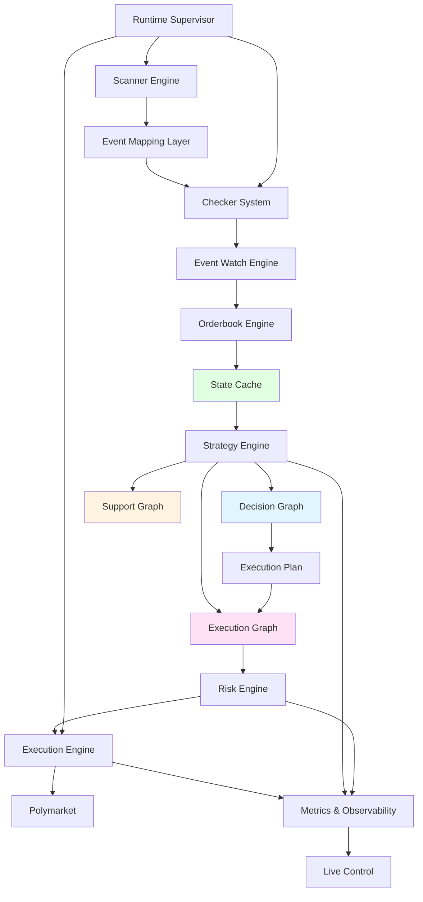
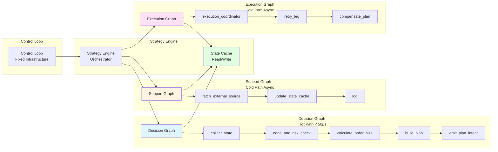
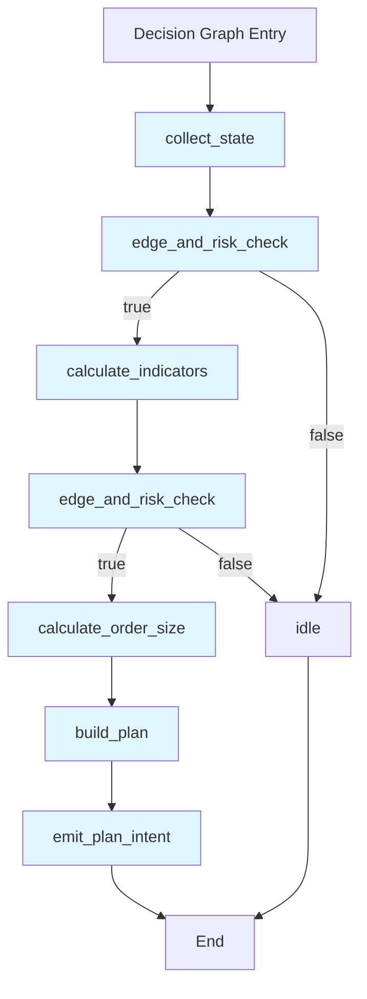
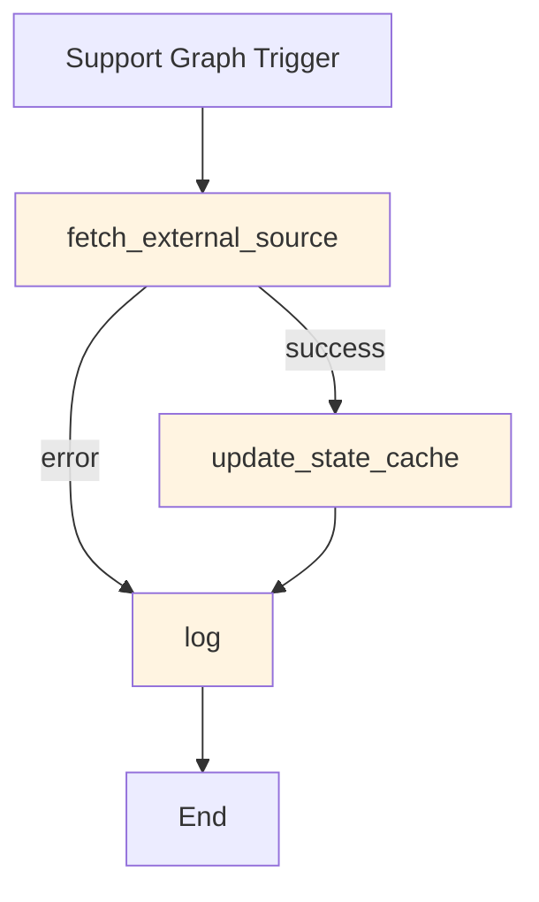
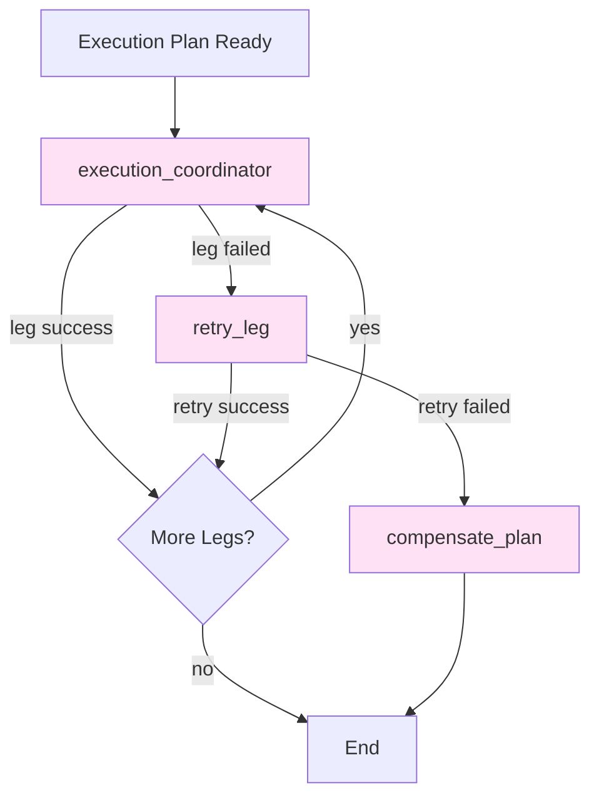
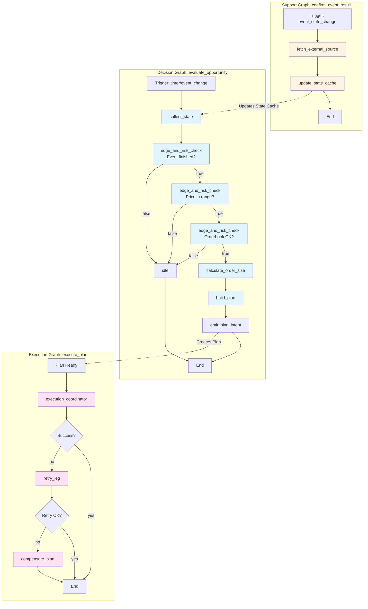
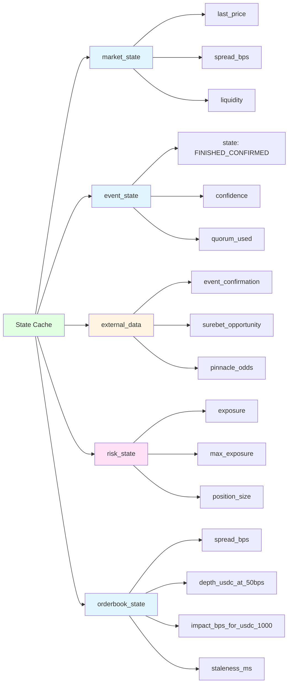

# Graph Nodes Reference

**Purpose**: Complete reference of all available graph nodes in the Strategy Engine, organized by graph type (Decision, Support, Execution).

**Audience**: Strategy developers, traders configuring strategies, engineers implementing new nodes.

**Where this is used**: Strategy design, node selection, graph configuration.

**Last updated**: 2025-01-XX

---

## System Architecture Overview

### Complete Module Flow



### Graph Types Architecture



---

## Node Types by Graph

### Decision Graph Nodes (Hot Path)

**Purpose**: Fast decision-making (< 50μs), only reads State Cache, builds Execution Plans.

**Restrictions**: 
- ❌ Cannot call APIs
- ❌ Cannot modify State Cache
- ✅ Only reads State Cache
- ✅ Can build Execution Plans



### Support Graph Nodes (Cold Path)

**Purpose**: Update State Cache with external data, can call APIs, async execution.

**Restrictions**:
- ✅ Can call APIs
- ✅ Can modify State Cache
- ✅ Can take as long as needed



### Execution Graph Nodes (Cold Path)

**Purpose**: Execute Execution Plans, handle retries, compensation, order lifecycle.

**Restrictions**:
- ✅ Can read State Cache
- ✅ Can call trading APIs
- ❌ Cannot modify Execution Plan after PLAN_BUILT
- ✅ Can update leg status



---

## Complete Node Catalog

### Decision Graph Nodes

| Node Type | Description | Config Parameters | Path |
|-----------|-------------|-------------------|------|
| `collect_state` | Recopila estado del State Cache (solo lectura) | `sources: List[str]` - ["market_state", "event_state", "external_data", "risk_state", "orderbook_state"] | `backend/app/core/strategy_engine/nodes/collect_state.py` |
| `edge_and_risk_check` | Evalúa condiciones con lógica AND/OR | `conditions: List[Dict]` - [{field, operator, value}], `logic: str` - "AND"\|"OR" | `backend/app/core/strategy_engine/nodes/edge_and_risk_check.py` |
| `calculate_order_size` | Calcula tamaño de orden con restricciones | `method: str` - "fixed_range"\|"capacity_aware", `min: Decimal`, `max: Decimal` | `backend/app/core/strategy_engine/nodes/calculate_order_size.py` |
| `calculate_indicators` | Calcula indicadores técnicos avanzados | `indicators: List[str]` - ["confidence_score", "book_imbalance", etc.] | `backend/app/core/strategy_engine/nodes/calculate_indicators.py` |
| `build_plan` | Construye ExecutionPlan inmutable | `legs: List[Dict]`, `ttl_ms: int`, `risk_config: Dict` | `backend/app/core/strategy_engine/nodes/build_plan.py` |
| `emit_plan_intent` | Emite intent de plan para Execution Graph | `plan_id: str` | `backend/app/core/strategy_engine/nodes/emit_plan_intent.py` |
| `emit_execution_intent` | Emite intent de ejecución directa (legacy) | `side: str`, `outcome: str`, `price: Decimal`, `size: Decimal` | `backend/app/core/strategy_engine/nodes/emit_execution_intent.py` |
| `derive_plan` | Deriva plan desde otro plan (multi-leg) | `source_plan_id: str`, `derivation_rules: Dict` | `backend/app/core/strategy_engine/nodes/derive_plan.py` |
| `noop` | No operation (placeholder/end node) | None | `backend/app/core/strategy_engine/nodes/noop.py` |

### Support Graph Nodes

| Node Type | Description | Config Parameters | Path |
|-----------|-------------|-------------------|------|
| `fetch_external_source` | Obtiene datos de fuente externa configurable | `source_id: str`, `endpoint: str`, `params: Dict`, `output_key: str` | `backend/app/core/strategy_engine/nodes/fetch_external_source.py` |
| `update_state_cache` | Actualiza State Cache con nuevos datos | `key: str`, `value_source: str`, `value_path: str`, `ttl_seconds: int` | `backend/app/core/strategy_engine/nodes/update_state_cache.py` |
| `log` | Registra eventos para debugging/auditoría | `level: str`, `message: str`, `data: Dict` | `backend/app/core/strategy_engine/nodes/log.py` |
| `noop` | No operation (placeholder/end node) | None | `backend/app/core/strategy_engine/nodes/noop.py` |

### Execution Graph Nodes

| Node Type | Description | Config Parameters | Path |
|-----------|-------------|-------------------|------|
| `execution_coordinator` | Coordina ejecución de ExecutionPlan | `plan_id: str`, `execution_mode: str` - "sequential"\|"parallel"\|"atomic", `retry_config: Dict` | `backend/app/core/strategy_engine/nodes/execution_coordinator.py` |
| `retry_leg` | Reintenta ejecución de un leg fallido | `leg_id: str`, `max_retries: int`, `backoff_ms: int` | `backend/app/core/strategy_engine/nodes/retry_leg.py` |
| `compensate_plan` | Compensa plan fallido (reduce exposición) | `plan_id: str`, `compensation_mode: str` - "reverse"\|"cancel" | `backend/app/core/strategy_engine/nodes/compensate_plan.py` |
| `noop` | No operation (placeholder/end node) | None | `backend/app/core/strategy_engine/nodes/noop.py` |

---

## Node Execution Flow Example

### Near-Resolution Liquidity Provider Strategy



---

## State Cache Structure

### Available State Sources



---

## Node Configuration Examples

### Decision Graph: collect_state

```json
{
  "type": "collect_state",
  "config": {
    "sources": ["market_state", "event_state", "external_data", "risk_state", "orderbook_state"]
  },
  "next": "check_event_finished"
}
```

### Decision Graph: edge_and_risk_check

```json
{
  "type": "edge_and_risk_check",
  "config": {
    "conditions": [
      {
        "field": "event_state.state",
        "operator": "==",
        "value": "FINISHED_CONFIRMED"
      },
      {
        "field": "market_state.last_price",
        "operator": ">=",
        "value": 0.95
      },
      {
        "field": "orderbook_state.spread_bps",
        "operator": "<=",
        "value": 150
      }
    ],
    "logic": "AND"
  },
  "on_true": "check_price_range",
  "on_false": "idle"
}
```

### Support Graph: fetch_external_source

```json
{
  "type": "fetch_external_source",
  "config": {
    "source_id": "uuid-of-external-source",
    "endpoint": "/api/event/result",
    "params": {
      "event_id": "{{event.id}}"
    },
    "output_key": "event_confirmation"
  },
  "next": "update_cache"
}
```

### Execution Graph: execution_coordinator

```json
{
  "type": "execution_coordinator",
  "config": {
    "plan_id": "{{plan.id}}",
    "execution_mode": "sequential",
    "retry_config": {
      "max_retries": 3,
      "backoff_ms": 1000
    },
    "compensation_enabled": true
  },
  "next": "end"
}
```

---

## Related Documentation

- [`execution-engine.md`](./execution-engine.md) - Execution engine architecture
- [`../strategies/README.md`](../strategies/README.md) - Strategy philosophy
- [`../strategies/templates.md`](../strategies/templates.md) - Strategy templates guide
- [`../strategies/near-resolution-complete-analysis.md`](../strategies/near-resolution-complete-analysis.md) - Complete strategy example

---

## Node Development Guidelines

### Creating New Nodes

1. **Inherit from `GraphNode`** - Base class in `backend/app/core/strategy_engine/nodes/base.py`
2. **Implement `execute()` method** - Returns appropriate `NodeResult` type
3. **Register in `__init__.py`** - Add to exports
4. **Add tests** - Unit tests in `backend/tests/unit/strategy_engine/nodes/`
5. **Document** - Update this file with node description and config

### Node Result Types

- `SuccessResult` - Node completed successfully
- `ConditionalResult` - Boolean result (true/false paths)
- `PlanResult` - Created/modified ExecutionPlan
- `ExecutionResult` - Execution completed
- `FailureResult` - Node failed (with reason)
- `CalculationResult` - Calculated value
- `ExecutionIntentResult` - Legacy execution intent (deprecated)

---

## Quick Reference: Node Selection Guide

**Need to read State Cache?** → `collect_state`

**Need to check conditions?** → `edge_and_risk_check`

**Need to calculate order size?** → `calculate_order_size`

**Need to build execution plan?** → `build_plan`

**Need to fetch external data?** → `fetch_external_source` (Support Graph only)

**Need to update State Cache?** → `update_state_cache` (Support/Execution Graph only)

**Need to execute plan?** → `execution_coordinator` (Execution Graph only)

**Need to retry failed leg?** → `retry_leg` (Execution Graph only)

**Need to compensate failed plan?** → `compensate_plan` (Execution Graph only)

