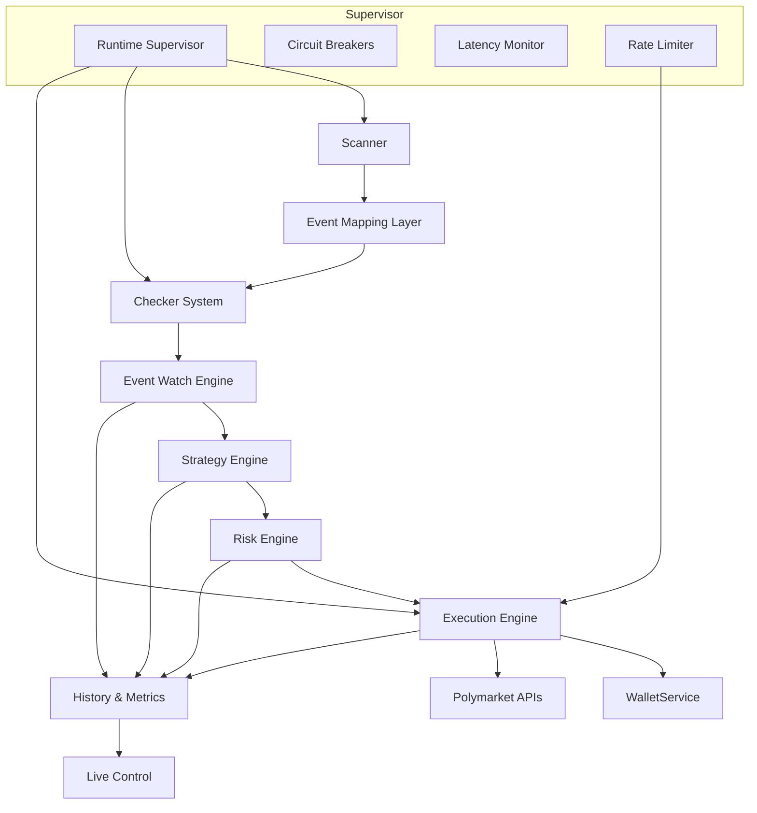
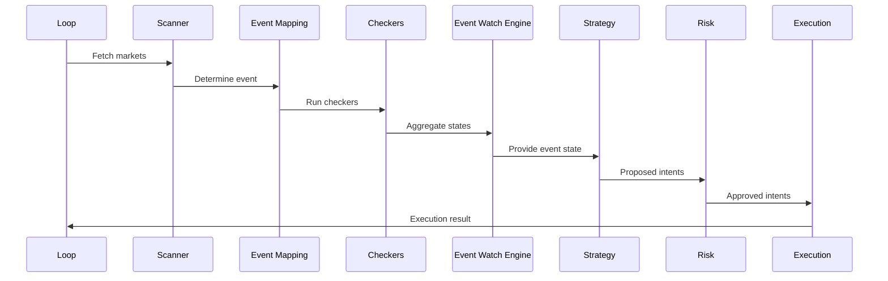

# System Overview

**Purpose**: High-level overview of the PolyLiquidity Desk system architecture, components, and operational flow.

**Audience**: Engineers, researchers, and stakeholders understanding the system at a high level.

**Where this is used**: Onboarding, architecture discussions, system design decisions.

**Last updated**: 2025-01-XX

---

# PolyLiquidity Desk – System Overview

PolyLiquidity Desk is an **automated liquidity provisioning system** designed to operate on prediction markets like Polymarket. Its objective is to detect external events (e.g., sports) that have concluded before the market is officially resolved and exploit pricing opportunities by executing automated orders.

## Key Characteristics

The system is composed of **independent modules**, supervised by a **Runtime Supervisor** that guarantees:

- ✅ **Operational security** - Circuit breakers and fail-safes
- ✅ **Operational robustness** - Fault tolerance and automatic recovery
- ✅ **Risk limit compliance** - Continuous exposure validation

**The architecture is designed to scale and support capital levels of 100k–200k+ EUR.**

---

## Technology Stack

### Backend

- **Python 3.12+** - Main language
- **FastAPI** - Web framework
- **AsyncIO** - Asynchronous programming
- **PostgreSQL** - Data persistence
- **SQLAlchemy + Alembic** - ORM and migrations
- **Pydantic** - Data validation
- **Ethereum Libraries** - EIP-712 signing

### Frontend

- **Next.js 14** (App Router)
- **TypeScript**
- **Tailwind CSS**
- **Stack OAuth** - Authentication

### Operation

The system operates in a **high-frequency runtime loop (1–5 seconds)**, fault-tolerant, monitored, and audited.

---

## High-Level Architecture

### Architecture Diagram



### Main Flow

**Scanner → Event Mapping → Checker System → Event Watch Engine → Strategy → Risk → Execution → Polymarket**

---

## System Components

### Core Logic Modules

1. **Scanner Engine** - Discovers and filters markets in Polymarket
2. **Event Mapping Layer** - Maps markets → real-world events
3. **Checker System** - Multi-source event verification (ESPN, Flashscore, etc.)
4. **Event Watch Engine** - Parallel watchers monitoring events in real-time
5. **Strategy Engine** - Order decision logic (price, size, timing)
6. **Risk Engine** - Exposure and risk limit validation
7. **Execution Engine** - EIP-712 signing and order submission

### Supervision & Stability

8. **Runtime Supervisor** - Latency monitoring, circuit breakers, fail-safes
9. **Metrics & Observability Layer** - Metric collection and alerts
10. **Historical Replay** - Complete audit and event replay

### User Experience

11. **Live Control** - Real-time dashboard for monitoring and control
12. **Signatures & Traceability** - Complete order and signature traceability

---

## Runtime Loop Overview

### Sequence Diagram



**Loop configurable:** 1–5 seconds

### Loop Steps

1. **Scanner:** Search markets in Polymarket
2. **Event Mapping:** Determine real event
3. **Checkers:** Execute checkers in parallel
4. **Event Watch Engine:** Aggregate states
5. **Strategy:** Generate intents
6. **Risk:** Validate and approve/reject
7. **Execution:** Sign and send orders
8. **Metrics:** Record metrics

---

## System Guarantees

The system guarantees:

- ✅ **Never enters without external quorum** - Multi-source validation
- ✅ **Never violates risk limits** - Continuous validation
- ✅ **Never executes if latency is red** - Automatic fail-safe
- ✅ **All actions are logged** - Complete traceability
- ✅ **Every state transition is traceable** - Complete audit
- ✅ **Automatic recovery from transient failures** - Fault tolerance
- ✅ **Extensible to new event domains without massive refactor** - Modular architecture

---

## Data Model Summary

### Markets

```python
class Market:
    id: UUID
    title: str
    event_external_id: str
    state: str  # OPEN, CLOSED, RESOLVED
    price_*: float  # best_ask, best_bid, etc.
    timestamps: datetime
```

### Events

```python
class Event:
    id: UUID
    type: str  # sports, politics, etc.
    provider: str
    external_ids: Dict[str, str]
    state: str  # LIVE, FINISHED_CONFIRMED, etc.
    confidence: float
    timestamps: datetime
```

### Orders

```python
class Order:
    id: UUID
    market_id: UUID
    side: str  # BUY, SELL
    size: float
    price: float
    status: str  # open, filled, cancelled
    raw_response: Dict
    signature: str
    timestamps: datetime
```

---

## Deployment Architecture

### Components

- **Docker** - Containerization
- **Gunicorn/Uvicorn** - ASGI server for API
- **SupervisorD / SystemD** - Main loop supervision
- **PostgreSQL** - Main database
- **Redis** (optional) - Caching
- **Centralized logging** - Elastic, Loki, or equivalent

### Requirements

**Minimum:**
- Python 3.12+
- PostgreSQL 12+
- 4GB RAM minimum
- 2 CPU cores minimum

**Recommended:**
- 8GB+ RAM
- 4+ CPU cores
- SSD for database
- Low-latency network

---

## Caching & Rate Limiting

### Caching Strategies

- **Scanner:** 30–60s
- **Checkers:** TTL per sport
- **Event Engine:** Weak caching to avoid spikes

### Rate Limiting

**Limits:**
- **Polymarket Scanner:** 200 req / 10s
- **Trading API:** 2400 req / 10s
- **Checkers:** Configurable per module

**Circuit breakers** prevent external failures from blocking the loop.

---

## Related Documentation

- [`data-flow.md`](./data-flow.md) - Detailed data flow through the system
- [`execution-engine.md`](./execution-engine.md) - Execution engine architecture
- [`../strategies/README.md`](../strategies/README.md) - Strategy philosophy
- [`../risk/kill-switch.md`](../risk/kill-switch.md) - Circuit breakers and fail-safes
- [`../infrastructure/monitoring.md`](../infrastructure/monitoring.md) - Monitoring and observability

---

## Open Questions

- What is the maximum number of concurrent watchers?
- How are system resources allocated during peak load?
- What is the disaster recovery procedure?
- How is the system scaled horizontally?


